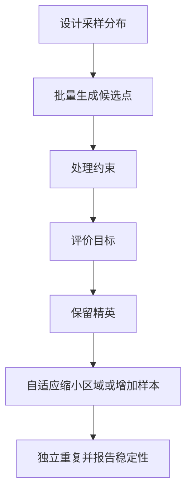

# 蒙特卡罗搜索流程

## 适用场景

- 多极值、黑盒或复杂可行域的近似全局搜索

## 核心公式/步骤

1. 设计采样分布
2. 批量生成候选点
3. 处理约束
4. 评价目标
5. 保留精英
6. 自适应缩小区域或增加样本
7. 独立重复并报告稳定性

## 流程图

## 典型例题

> [!example]- 示例
> 稀疏可行域应改用可行生成或修复，而不是盲目拒绝采样。

## 知识链接

- [[知识体系/知识点/优化建模与求解/蒙特卡罗随机搜索原理]]

## 习题链接

- [[源MD/讲稿--03-直接搜索法与蒙特卡罗法#1.7. 练习题]]
- [[源MD/遗传算法（Genetic Algorithm）教学讲稿#练习题5：综合应用]]
