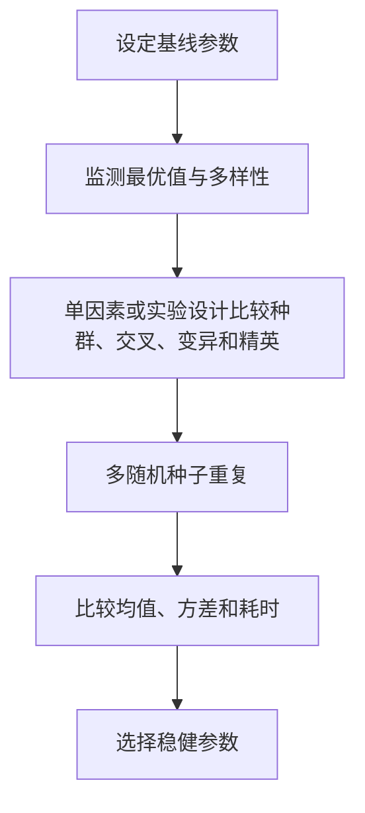

# 遗传算法参数调优流程

## 适用场景

- GA 收敛慢、不稳定或质量不足

## 核心公式/步骤

1. 设定基线参数
2. 监测最优值与多样性
3. 单因素或实验设计比较种群、交叉、变异和精英
4. 多随机种子重复
5. 比较均值、方差和耗时
6. 选择稳健参数

## 流程图

## 典型例题

> [!example]- 示例
> 不能只用一次运行最优值决定参数，应比较多次运行统计量。

## 知识链接

- [[知识体系/知识点/优化建模与求解/选择算子与精英保留]]
- [[知识体系/知识点/优化建模与求解/变异多样性与早熟收敛]]

## 习题链接

- [[源MD/讲稿--03-直接搜索法与蒙特卡罗法#1.7. 练习题]]
- [[源MD/遗传算法（Genetic Algorithm）教学讲稿#练习题5：综合应用]]
