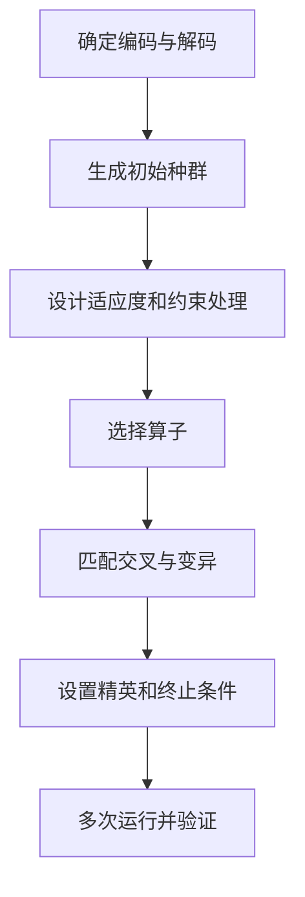

# 遗传算法设计流程

## 适用场景

- 复杂非凸、离散、黑盒或组合优化

## 核心公式/步骤

1. 确定编码与解码
2. 生成初始种群
3. 设计适应度和约束处理
4. 选择算子
5. 匹配交叉与变异
6. 设置精英和终止条件
7. 多次运行并验证

## 流程图

## 典型例题

> [!example]- 示例
> TSP 使用排列编码、PMX/OX 交叉与交换变异，避免非法路径。

## 知识链接

- [[知识体系/知识点/优化建模与求解/遗传算法基本循环]]
- [[知识体系/知识点/优化建模与求解/适应度缩放与约束处理]]

## 习题链接

- [[源MD/讲稿--03-直接搜索法与蒙特卡罗法#1.7. 练习题]]
- [[源MD/遗传算法（Genetic Algorithm）教学讲稿#练习题5：综合应用]]
