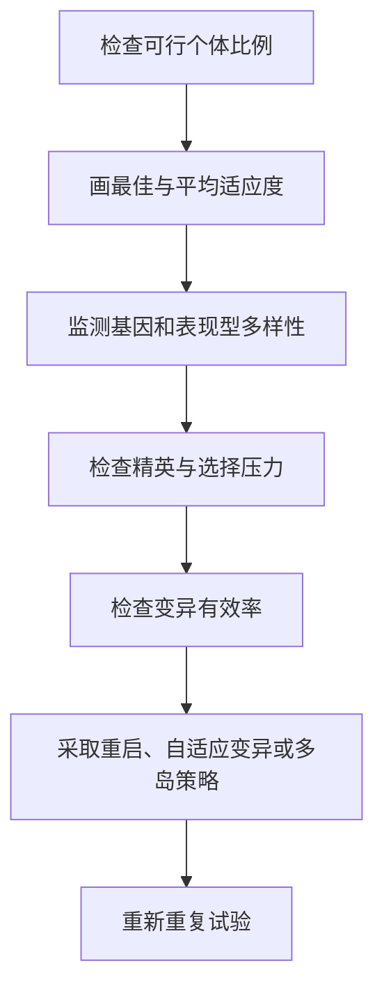

# 遗传算法诊断流程

## 适用场景

- 判断早熟、停滞或约束失败

## 核心公式/步骤

1. 检查可行个体比例
2. 画最佳与平均适应度
3. 监测基因和表现型多样性
4. 检查精英与选择压力
5. 检查变异有效率
6. 采取重启、自适应变异或多岛策略
7. 重新重复试验

## 流程图

## 典型例题

> [!example]- 示例
> 最佳值很早停滞且多样性迅速接近零，通常是早熟而非真正收敛。

## 知识链接

- [[知识体系/知识点/优化建模与求解/变异多样性与早熟收敛]]

## 习题链接

- [[源MD/讲稿--03-直接搜索法与蒙特卡罗法#1.7. 练习题]]
- [[源MD/遗传算法（Genetic Algorithm）教学讲稿#练习题5：综合应用]]
