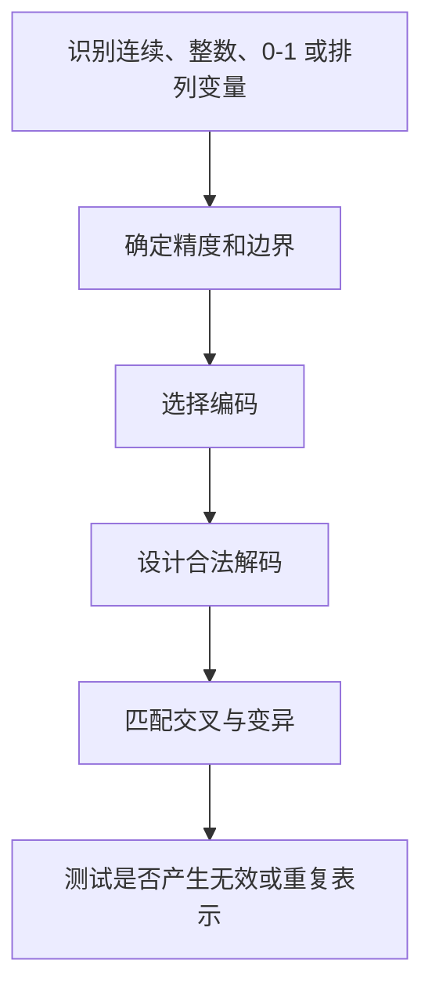

# 遗传编码选择流程

## 适用场景

- 需要把问题变量映射到遗传表示

## 核心公式/步骤

1. 识别连续、整数、0-1 或排列变量
2. 确定精度和边界
3. 选择编码
4. 设计合法解码
5. 匹配交叉与变异
6. 测试是否产生无效或重复表示

## 流程图

## 典型例题

> [!example]- 示例
> 连续参数优先实数编码，路径问题优先排列编码。

## 知识链接

- [[知识体系/知识点/优化建模与求解/编码方式与搜索空间]]
- [[知识体系/知识点/优化建模与求解/交叉算子与编码兼容性]]

## 习题链接

- [[源MD/讲稿--03-直接搜索法与蒙特卡罗法#1.7. 练习题]]
- [[源MD/遗传算法（Genetic Algorithm）教学讲稿#练习题5：综合应用]]
