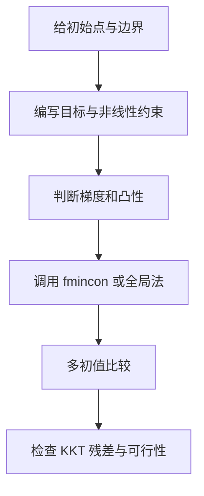

# 非线性规划求解流程

## 适用场景

- 目标或约束非线性且可计算

## 核心公式/步骤

1. 给初始点与边界
2. 编写目标与非线性约束
3. 判断梯度和凸性
4. 调用 fmincon 或全局法
5. 多初值比较
6. 检查 KKT 残差与可行性

## 流程图

## 典型例题

> [!example]- 示例
> 非凸模型应多初值运行，并与网格或随机搜索结果交叉验证。

## 知识链接

- [[知识体系/知识点/优化建模与求解/优化模型结构与算法匹配]]

## 习题链接

- [[源MD/讲稿--03-直接搜索法与蒙特卡罗法#1.7. 练习题]]
- [[源MD/遗传算法（Genetic Algorithm）教学讲稿#练习题5：综合应用]]
