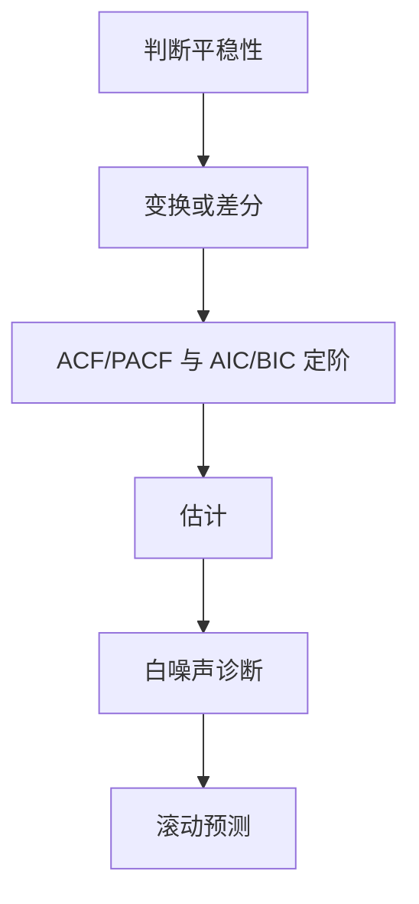

# Box-Jenkins建模流程

## 适用场景

- 单变量时间序列预测

## 核心公式/步骤

1. 判断平稳性
2. 变换或差分
3. ACF/PACF 与 AIC/BIC 定阶
4. 估计
5. 白噪声诊断
6. 滚动预测

## 流程图

## 典型例题

> [!example]- 示例
> 残差仍显著自相关时必须重新定阶。

## 知识链接

- [[ARMA与ARIMA模型]]

## 习题链接

- 后续链接到对应课程习题库。
