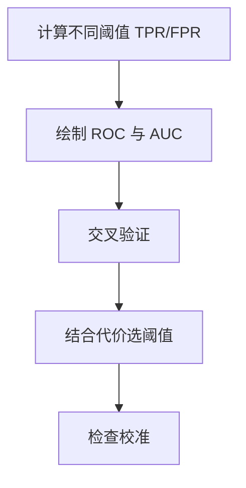

# ROC评估流程

## 适用场景

- 二分类模型比较与阈值选择

## 核心公式/步骤

1. 计算不同阈值 TPR/FPR
2. 绘制 ROC 与 AUC
3. 交叉验证
4. 结合代价选阈值
5. 检查校准

## 流程图

## 典型例题

> [!example]- 示例
> 筛查常优先灵敏度，再控制假阳性。

## 知识链接

- [[常用参数与非参数检验]]

## 习题链接

- 后续链接到对应课程习题库。
