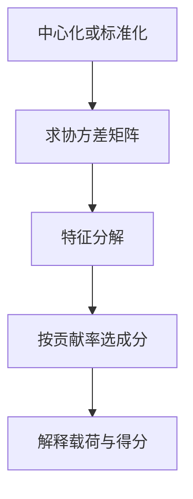

# 主成分分析流程

## 适用场景

- 变量多且强相关

## 核心公式/步骤

1. 中心化或标准化
2. 求协方差矩阵
3. 特征分解
4. 按贡献率选成分
5. 解释载荷与得分

## 流程图

## 典型例题

> [!example]- 示例
> 量纲不同的评价指标通常先标准化。

## 知识链接

- [[主成分与因子分析]]

## 习题链接

- 后续链接到对应课程习题库。
