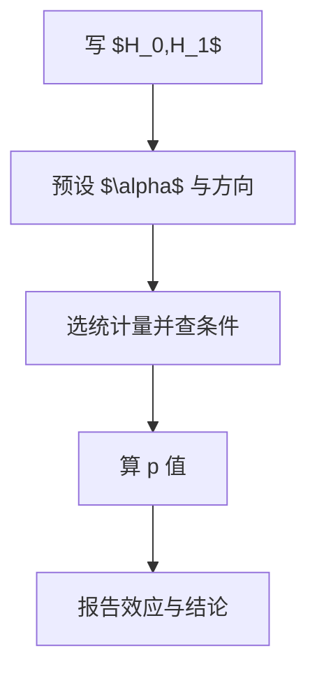

# 假设检验通用流程

## 适用场景

- 判断样本证据是否反对总体命题

## 核心公式/步骤

1. 写 $H_0,H_1$
2. 预设 $\alpha$ 与方向
3. 选统计量并查条件
4. 算 p 值
5. 报告效应与结论

## 流程图

## 典型例题

> [!example]- 示例
> 新工艺是否提高均值应在看数据前确定单侧备择。

## 知识链接

- [[常用参数与非参数检验]]

## 习题链接

- 后续链接到对应课程习题库。
