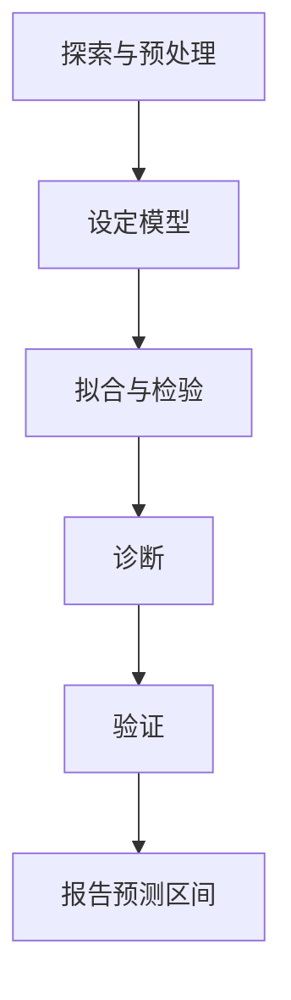

# 回归建模流程

## 适用场景

- 解释或预测连续响应

## 核心公式/步骤

1. 探索与预处理
2. 设定模型
3. 拟合与检验
4. 诊断
5. 验证
6. 报告预测区间

## 流程图

## 典型例题

> [!example]- 示例
> 用验证误差而非训练 $R^2$ 选择预测模型。

## 知识链接

- [[最小二乘与回归显著性]]

## 习题链接

- 后续链接到对应课程习题库。
