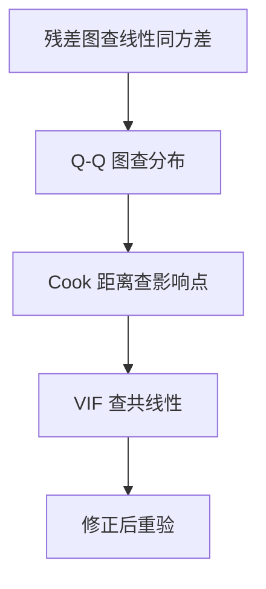

# 回归诊断流程

## 适用场景

- 模型拟合后检查可靠性

## 核心公式/步骤

1. 残差图查线性同方差
2. Q-Q 图查分布
3. Cook 距离查影响点
4. VIF 查共线性
5. 修正后重验

## 流程图

## 典型例题

> [!example]- 示例
> 漏斗形残差可考虑变换、加权最小二乘或稳健标准误。

## 知识链接

- [[最小二乘与回归显著性]]

## 习题链接

- 后续链接到对应课程习题库。
