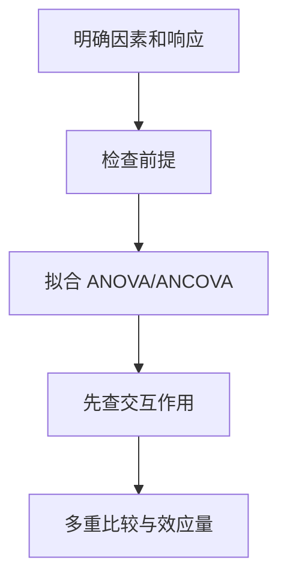

# 方差分析实施流程

## 适用场景

- 比较多组或多因素均值

## 核心公式/步骤

1. 明确因素和响应
2. 检查前提
3. 拟合 ANOVA/ANCOVA
4. 先查交互作用
5. 多重比较与效应量

## 流程图

## 典型例题

> [!example]- 示例
> 交互作用显著时不能脱离另一因素解释主效应。

## 知识链接

- [[方差分析与协方差分析]]

## 习题链接

- 后续链接到对应课程习题库。
