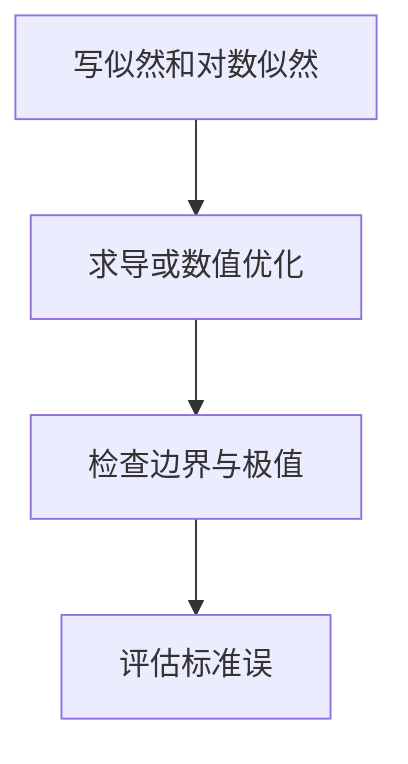

# 极大似然估计法

## 适用场景

- 概率模型已知，需要估计参数

## 核心公式/步骤

1. 写似然和对数似然
2. 求导或数值优化
3. 检查边界与极值
4. 评估标准误

## 流程图

## 典型例题

> [!example]- 示例
> 伯努利成功概率的 MLE 为样本成功比例。

## 知识链接

- [[估计量评价标准]]

## 习题链接

- 后续链接到对应课程习题库。
