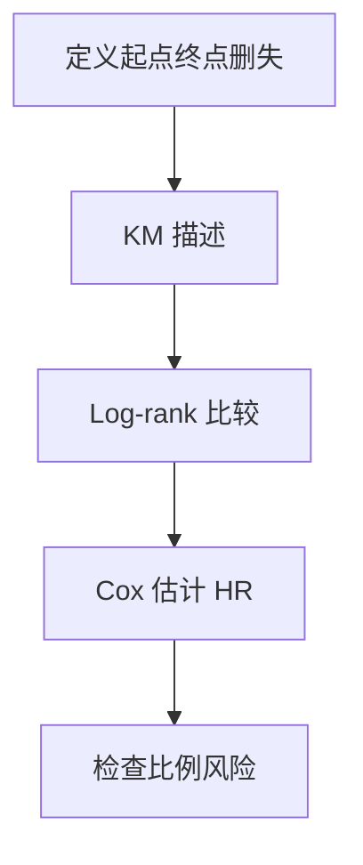

# 生存分析流程

## 适用场景

- 事件时间含删失

## 核心公式/步骤

1. 定义起点终点删失
2. KM 描述
3. Log-rank 比较
4. Cox 估计 HR
5. 检查比例风险

## 流程图

## 典型例题

> [!example]- 示例
> 报告 HR 时同时给区间、p 值和假设诊断。

## 知识链接

- [[生存分析核心模型]]

## 习题链接

- 后续链接到对应课程习题库。
