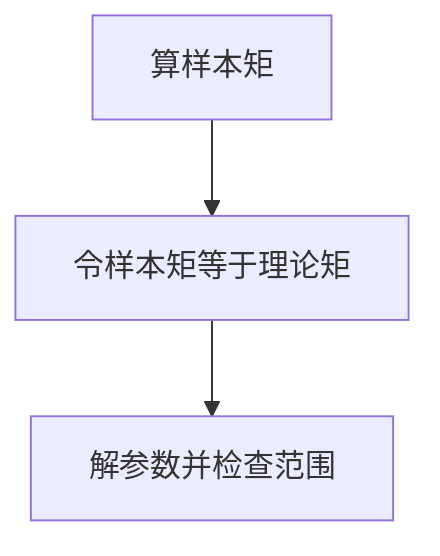

# 矩估计法

## 适用场景

- 理论矩与参数关系清楚

## 核心公式/步骤

1. 算样本矩
2. 令样本矩等于理论矩
3. 解参数并检查范围

## 流程图

## 典型例题

> [!example]- 示例
> 指数分布用 $E(X)=1/\lambda$ 得 $\hat\lambda=1/\bar X$。

## 知识链接

- [[估计量评价标准]]

## 习题链接

- 后续链接到对应课程习题库。
