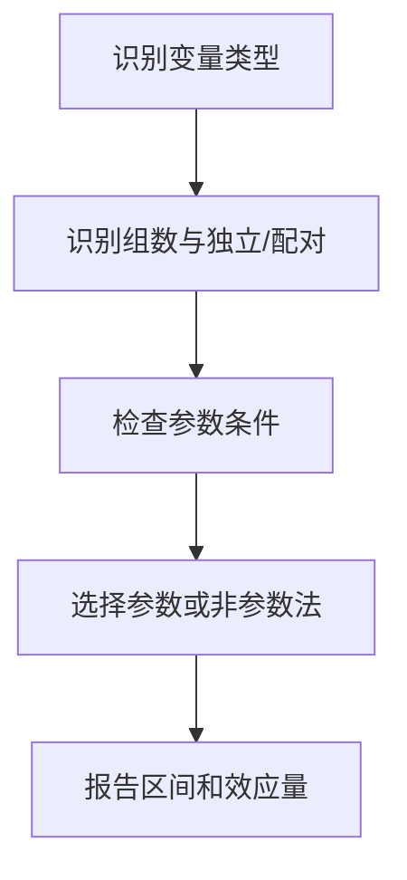

# 统计检验选择流程

## 适用场景

- 均值、比例、方差、分布或关联问题

## 核心公式/步骤

1. 识别变量类型
2. 识别组数与独立/配对
3. 检查参数条件
4. 选择参数或非参数法
5. 报告区间和效应量

## 流程图

## 典型例题

> [!example]- 示例
> 三组独立连续数据满足条件用 ANOVA，否则考虑 Kruskal–Wallis。

## 知识链接

- [[常用参数与非参数检验]]

## 习题链接

- 后续链接到对应课程习题库。
