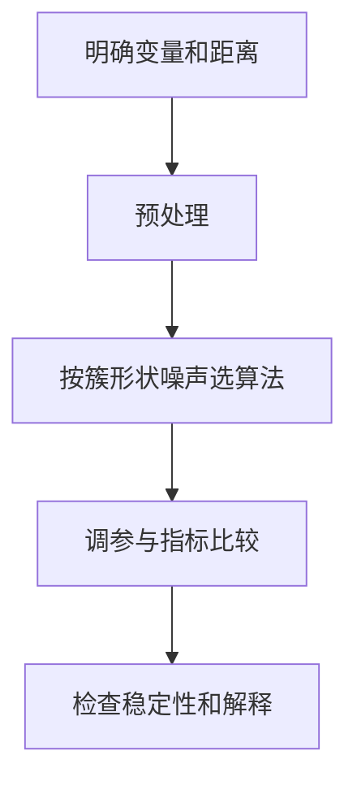

# 聚类方法选择流程

## 适用场景

- 无标签分群与结构探索

## 核心公式/步骤

1. 明确变量和距离
2. 预处理
3. 按簇形状噪声选算法
4. 调参与指标比较
5. 检查稳定性和解释

## 流程图

## 典型例题

> [!example]- 示例
> 非球状且含噪声的数据优先尝试 DBSCAN。

## 知识链接

- [[聚类方法比较]]

## 习题链接

- 后续链接到对应课程习题库。
