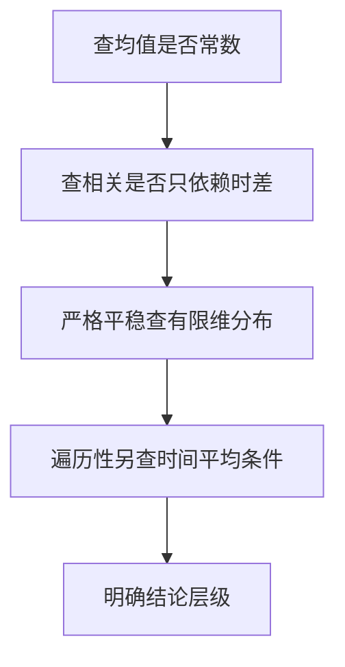

# 平稳性与遍历性判定流程

## 适用场景

- 判断过程能否用时差描述

## 核心公式/步骤

1. 查均值是否常数
2. 查相关是否只依赖时差
3. 严格平稳查有限维分布
4. 遍历性另查时间平均条件
5. 明确结论层级

## 流程图

## 典型例题

> [!example]- 示例
> 维纳协方差为 $\min(s,t)$，故不是宽平稳。

## 知识链接

- [[平稳过程相关函数性质]]

## 习题链接

- 后续链接到对应课程习题库。
