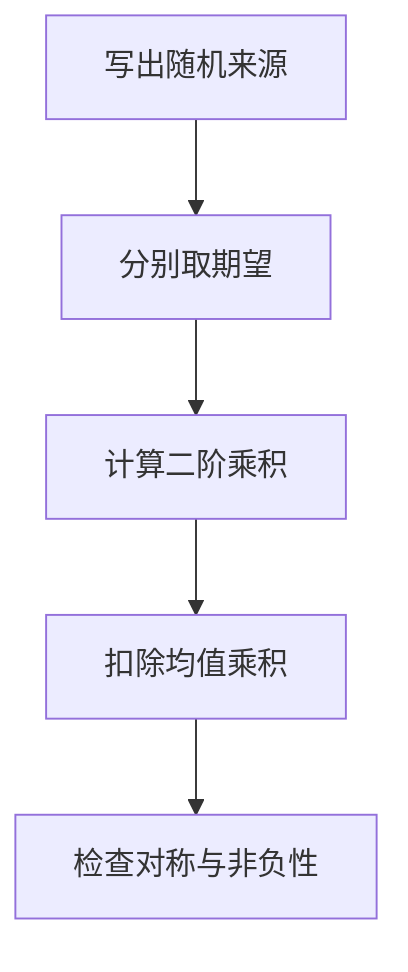

# 数字特征计算流程

## 适用场景

- 求均值、相关或协方差函数

## 核心公式/步骤

1. 写出随机来源
2. 分别取期望
3. 计算二阶乘积
4. 扣除均值乘积
5. 检查对称与非负性

## 流程图

## 典型例题

> [!example]- 示例
> $X(t)=A+tB$ 可由 $A,B$ 的矩展开计算。

## 知识链接

- [[维纳过程的数字特征]]

## 习题链接

- 后续链接到对应课程习题库。
