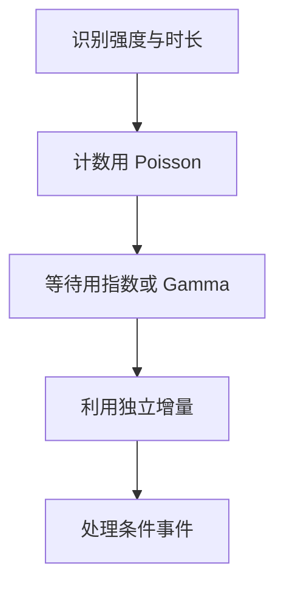

# 泊松过程计算流程

## 适用场景

- 计数、等待和到达问题

## 核心公式/步骤

1. 识别强度与时长
2. 计数用 Poisson
3. 等待用指数或 Gamma
4. 利用独立增量
5. 处理条件事件

## 流程图

## 典型例题

> [!example]- 示例
> $P(N(t)\ge1)=1-e^{-\lambda t}$。

## 知识链接

- [[泊松过程的计数与等待时间]]

## 习题链接

- 后续链接到对应课程习题库。
