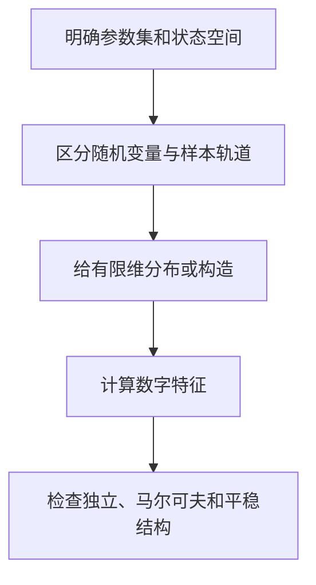

# 随机过程描述流程

## 适用场景

- 建立随机过程模型

## 核心公式/步骤

1. 明确参数集和状态空间
2. 区分随机变量与样本轨道
3. 给有限维分布或构造
4. 计算数字特征
5. 检查独立、马尔可夫和平稳结构

## 流程图

## 典型例题

> [!example]- 示例
> 对随机相位余弦先明确随机来源，再求二阶特征。

## 知识链接

- [[随机过程的分布体系]]

## 习题链接

- 后续链接到对应课程习题库。
