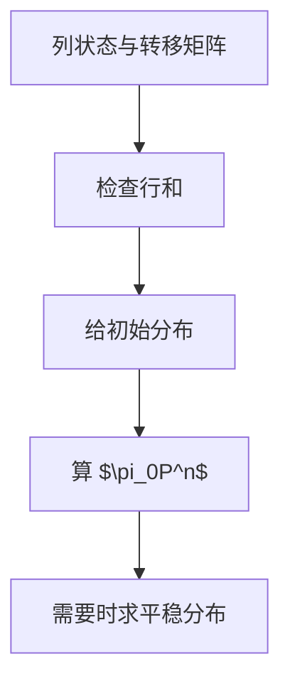

# 马尔可夫链状态预测流程

## 适用场景

- 离散状态系统多步预测

## 核心公式/步骤

1. 列状态与转移矩阵
2. 检查行和
3. 给初始分布
4. 算 $\pi_0P^n$
5. 需要时求平稳分布

## 流程图

## 典型例题

> [!example]- 示例
> 天气状态分布可逐步右乘转移矩阵。

## 知识链接

- [[Chapman-Kolmogorov方程]]

## 习题链接

- 后续链接到对应课程习题库。
