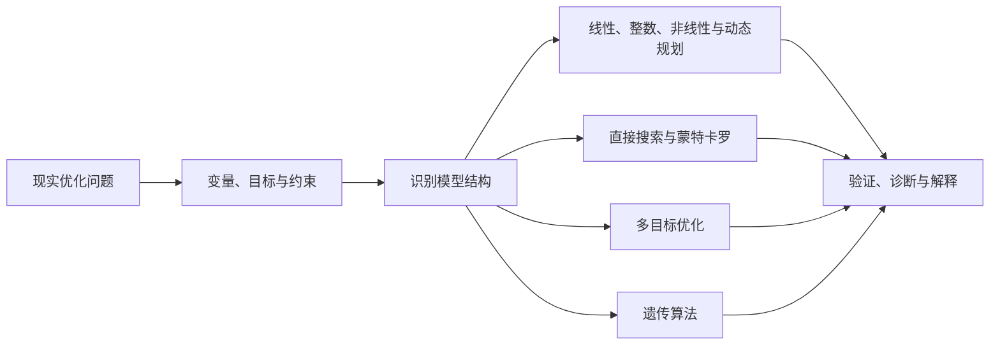
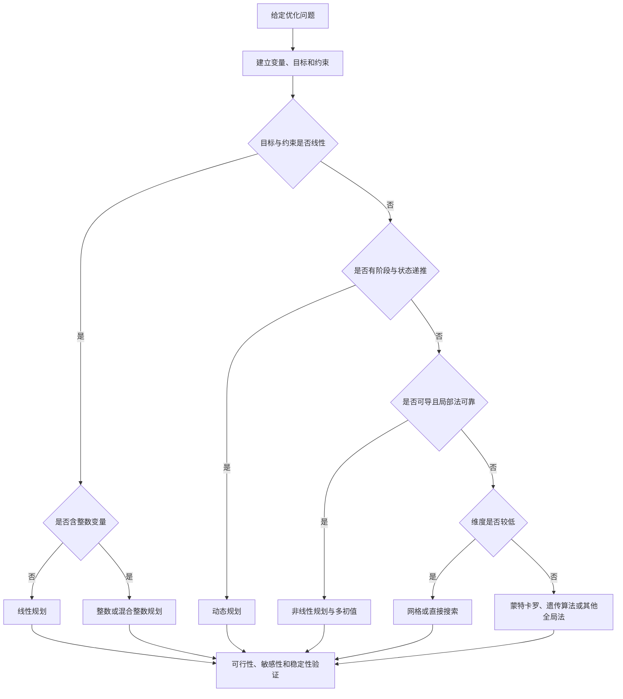

# 优化建模与求解 — 知识点梳理

## 一、本课程核心脉络

> 一句话来说：先尽可能利用模型结构选择专用算法，只有结构不足或问题复杂时再使用通用随机搜索。

## 二、建模基础（核心）

- [[知识体系/概念/优化建模与求解/最优化模型]]
- [[知识体系/概念/优化建模与求解/决策变量]]
- [[知识体系/概念/优化建模与求解/目标函数]]
- [[知识体系/概念/优化建模与求解/约束条件与可行域]]
- [[知识体系/知识点/优化建模与求解/最优化模型标准形式]]
- [[知识体系/方法/优化建模与求解/优化建模标准流程]]

> 一句话来说：优化模型必须完整回答“能决定什么、想优化什么、必须满足什么”。

## 三、结构化优化方法（优先使用）

- [[知识体系/概念/优化建模与求解/线性规划]]
- [[知识体系/概念/优化建模与求解/整数规划与混合整数规划]]
- [[知识体系/概念/优化建模与求解/非线性规划]]
- [[知识体系/概念/优化建模与求解/动态规划与状态]]
- [[知识体系/方法/优化建模与求解/优化求解器选择流程]]
- [[知识体系/方法/优化建模与求解/动态规划求解流程]]

> 一句话来说：模型结构越清晰，越应优先采用有理论保证和效率优势的专用求解器。

## 四、直接搜索与蒙特卡罗（黑盒近似）

- [[知识体系/概念/优化建模与求解/黑盒函数]]
- [[知识体系/知识点/优化建模与求解/网格搜索精度与复杂度]]
- [[知识体系/知识点/优化建模与求解/蒙特卡罗随机搜索原理]]
- [[知识体系/方法/优化建模与求解/网格搜索流程]]
- [[知识体系/方法/优化建模与求解/蒙特卡罗搜索流程]]

> 一句话来说：网格搜索系统但怕维数，蒙特卡罗搜索灵活但需要足够样本和重复验证。

## 五、多目标优化（权衡）

- [[知识体系/概念/优化建模与求解/多目标优化与Pareto最优]]
- [[知识体系/知识点/优化建模与求解/Pareto支配与多目标权衡]]
- [[知识体系/方法/优化建模与求解/多目标优化求解流程]]

> 一句话来说：多目标优化通常寻找一组不可同时改进的折中方案，而不是唯一的“最好”。

## 六、遗传算法（重点与难点）

- [[知识体系/概念/优化建模与求解/个体染色体与基因]]
- [[知识体系/概念/优化建模与求解/适应度与选择压力]]
- [[知识体系/概念/优化建模与求解/交叉与变异]]
- [[知识体系/概念/优化建模与求解/种群多样性]]
- [[知识体系/知识点/优化建模与求解/遗传算法基本循环]]
- [[知识体系/方法/优化建模与求解/遗传算法设计流程]]
- [[知识体系/方法/优化建模与求解/遗传算法诊断流程]]

> 一句话来说：遗传算法的质量取决于编码、约束处理、选择压力和多样性，而不只是调用一个 GA 函数。

## 七、判定/决策流程

## 八、核心公式速查表

| 主题 | 核心公式 | 含义 |
|:--|:--|:--|
| 优化标准形式 | $\min f(x)$，$g_i(x)\le0$，$h_j(x)=0$ | 变量、目标和约束 |
| Bellman 递推 | $V_t(s)=\min_a\{c_t+V_{t+1}\}$ | 多阶段最优子结构 |
| 网格规模 | $N=\prod_j n_j$ | 维数灾难 |
| Pareto 支配 | 所有目标不差且至少一个更好 | 非支配解定义 |
| GA 迭代 | 评价→选择→交叉→变异 | 种群演化 |

## 九、易错点与注意事项

> [!warning] 高频误区
> - 未定义变量单位和取值类型就直接写目标函数。
> - 可用 LP、MILP 或凸优化时仍直接使用遗传算法。
> - 只报告随机算法单次最好结果，不报告均值、方差和计算预算。
> - 排列编码使用普通交叉造成重复或缺失元素。
> - 罚系数不当导致大量不可行解或边界僵化。
> - 把算法停止当成已经证明全局最优。

## 十、相关知识点链接

- [[知识体系/知识点/知识点-方法-概念体系]]
- [[源MD/课件--优化建模与求解]]
- [[源MD/讲稿--03-直接搜索法与蒙特卡罗法]]
- [[源MD/遗传算法（Genetic Algorithm）教学讲稿]]

## 十一、作业与练习

- [[源MD/讲稿--03-直接搜索法与蒙特卡罗法#1.7. 练习题]]
- [[源MD/遗传算法（Genetic Algorithm）教学讲稿#练习题1：概念理解]]
- [[源MD/遗传算法（Genetic Algorithm）教学讲稿#练习题5：综合应用]]
