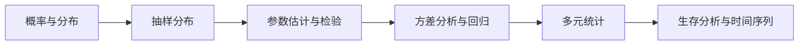
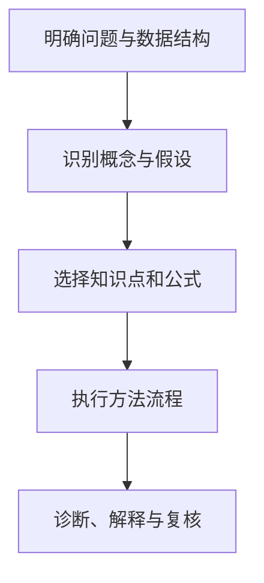

# 常用数据分析方法 — 知识点梳理

## 一、本课程核心脉络

> 一句话来说：课程主线是从定义与结构出发，选择正确的公式和方法解决问题。

## 2、概率与抽样基础

- [[概率空间与随机变量]]
- [[抽样分布]]
- [[大数定律与中心极限定理]]
- [[卡方t与F抽样分布]]

> 一句话来说：先理解概念和条件，再执行方法并解释结果。

## 3、参数估计与假设检验

- [[矩估计法]]
- [[极大似然估计法]]
- [[置信区间构造法]]
- [[统计检验选择流程]]

> 一句话来说：先理解概念和条件，再执行方法并解释结果。

## 4、方差分析与回归

- [[方差分析与协方差分析]]
- [[回归建模流程]]
- [[回归诊断流程]]

> 一句话来说：先理解概念和条件，再执行方法并解释结果。

## 5、多元与专题方法

- [[主成分分析流程]]
- [[聚类方法选择流程]]
- [[生存分析流程]]
- [[Box-Jenkins建模流程]]

> 一句话来说：先理解概念和条件，再执行方法并解释结果。

## 判定/决策流程

## 核心公式速查表

| 主题 | 核心公式 |
|:--|:--|

| t 枢轴量 | $T=(\bar X-\mu)/(S/\sqrt n)$ |
| OLS | $\hat\beta=(X^TX)^{-1}X^Ty$ |
| KM | $\hat S(t)=\prod(1-d_i/n_i)$ |
| ARIMA | $\phi(B)(1-B)^dX_t=\theta(B)\varepsilon_t$ |

## 易错点与注意事项

> [!warning] 高频误区
> - p值不是原假设为真的概率。
> - 显著不等于实际重要。
> - 回归关联不自动具有因果解释。
> - 模型必须诊断并验证。

## 相关知识点链接

- [[知识点-方法-概念体系]]
- [[常用数据分析方法-完整版]]
- [[00-随机过程-知识梳理]]

## 作业与练习

后续可在课程习题库中建立题目，并通过知识点与方法标签回链。
