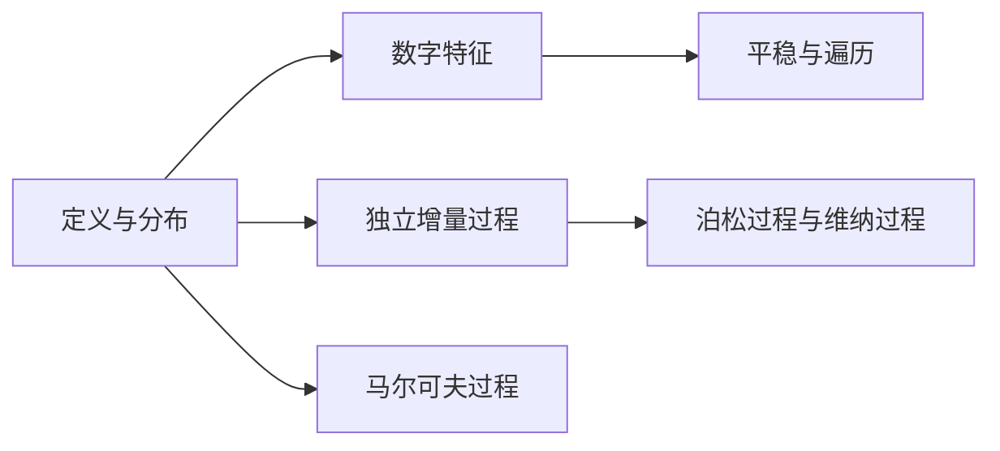
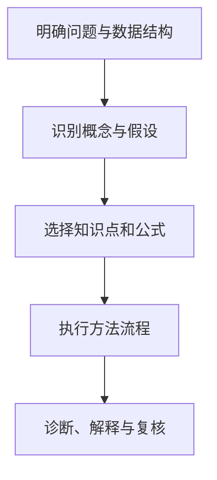

# 随机过程 — 知识点梳理

## 一、本课程核心脉络

> 一句话来说：课程主线是从定义与结构出发，选择正确的公式和方法解决问题。

## 2、定义与数字特征

- [[随机过程]]
- [[有限维分布]]
- [[均值相关与协方差函数]]
- [[数字特征计算流程]]

> 一句话来说：先理解概念和条件，再执行方法并解释结果。

## 3、重要随机过程

- [[维纳过程]]
- [[维纳过程的数字特征]]
- [[泊松过程]]
- [[泊松过程计算流程]]

> 一句话来说：先理解概念和条件，再执行方法并解释结果。

## 4、马尔可夫过程

- [[马尔可夫性质]]
- [[转移概率矩阵]]
- [[Chapman-Kolmogorov方程]]
- [[马尔可夫链状态预测流程]]

> 一句话来说：先理解概念和条件，再执行方法并解释结果。

## 5、平稳与遍历

- [[平稳过程]]
- [[遍历性]]
- [[平稳性与遍历性判定流程]]

> 一句话来说：先理解概念和条件，再执行方法并解释结果。

## 判定/决策流程

## 核心公式速查表

| 主题 | 核心公式 |
|:--|:--|

| 协方差 | $C(s,t)=R(s,t)-m(s)m(t)$ |
| 泊松计数 | $N(t)\sim Poisson(\lambda t)$ |
| 维纳协方差 | $Cov(W(s),W(t))=\min(s,t)$ |
| 状态分布 | $\pi_n=\pi_0P^n$ |

## 易错点与注意事项

> [!warning] 高频误区
> - 边缘分布相同不代表过程相同。
> - 独立过程与独立增量过程不同。
> - 维纳过程有平稳增量但不是宽平稳。
> - 平稳不自动推出遍历。

## 相关知识点链接

- [[知识点-方法-概念体系]]
- [[随机过程16：9]]
- [[00-常用数据分析方法-知识梳理]]

## 作业与练习

后续可在课程习题库中建立题目，并通过知识点与方法标签回链。
