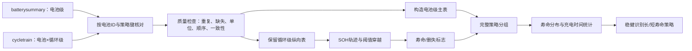

 
# A题问题一：数据整理与快充策略对寿命影响初步分析

题面：[[联赛题目/题目/2026年度“策联杯”数学建模精英联赛-A题.md]]

> [!success] 附件状态更新
> 已收到并审计 `battery_summary.csv` 与 `cycle_train.csv`。数值结果见[[联赛题目/A题/问题分析/数据审计报告.md]]和[[联赛题目/A题/问题分析/问题一结果分析.md]]。所有SOH均高于0.8，因此本问只能直接比较早期衰减，真实EOL寿命仍需问题三外推。

> [!abstract] 一句话定位
> 问题一是以“电池”为独立实验单位、以“循环”为重复测量的**纵向数据整理与探索性统计问题**。核心不是训练复杂预测器，而是建立可信的数据口径，把策略、SOH轨迹、充电时间与循环寿命整理到同一电池级分析框架中，为问题二至四提供无泄漏、可复用的基础数据。

## 1. 题目原文提炼

题目要求从49块电池的汇总表与逐循环表中提取充电策略、充电时间、SOH变化和循环寿命，并描述不同策略下的寿命分布。随后识别典型长寿命与短寿命策略，比较其差异并给出合理解释。

本问首先需要解决“如何一致地定义和计算寿命”，其次才是比较不同策略。题面没有要求本问证明单一参数的因果作用；由于策略参数并非独立变化，且一项策略可能对应有限数量的电池，本问只能形成探索性证据和后续假设，正式效应分离与显著性分析属于问题二。

## 2. 数学本质判定

| 层次 | 类型 | 判定理由 |
|---|---|---|
| 主类型 | **描述统计 / 探索性数据分析** | 题面要求整理SOH曲线、寿命和充电时间，并分析寿命分布 |
| 次类型 | **分组比较 / 统计推断的前置分析** | 需要比较不同完整充电策略，但本问尚不宜宣称参数因果效应 |
| 数据结构 | **纵向重复测量数据** | 每块电池在多个循环上反复记录SOH、容量、内阻和温度 |
| 特殊结构 | **可能含右删失的寿命数据** | 固定观测上限内未达到80% SOH的电池不能直接把末次循环当真实寿命 |

### 本问不属于什么

- 不是寿命预测题：第151—200次SOH和EOL外推属于问题三；
- 不是策略参数因果识别题：$C_1,Q_1,C_2$ 的独立效应属于问题二；
- 不是策略优化题：时间—寿命权衡和推荐策略属于问题四。

## 3. 分析对象、输入、输出与约束

### 3.1 分析对象

| 层级  | 观测单位                   | 主要用途                   | 独立性说明                 |
| --- | ---------------------- | ---------------------- | --------------------- |
| 电池级 | 单块电池 $i$               | 策略、寿命、平均充电时间、典型长/短寿命识别 | 统计比较的基本实验单位           |
| 循环级 | 电池 $i$ 的第 $t$ 次循环      | SOH轨迹、衰减阶段、波动与阈值穿越     | 同一电池内相关，不能当作独立样本      |
| 策略级 | 完整组合 $s=(C_1,Q_1,C_2)$ | 组间寿命分布与代表性策略比较         | 有效样本量是该策略对应电池数，不是循环行数 |
|     |                        |                        |                       |

### 3.2 输入—输出—约束表

| 维度 | 内容 |
|---|---|
| 已知输入 | `batterysummary.csv`：策略参数、初始容量、平均充电时间、平均内阻、平均温度、测试标志等；`cycletrain.csv`：电池—循环级容量、SOH、平滑SOH、充电时间、内阻、温度与策略等 |
| 待求输出 | 电池级主表；各电池SOH曲线；一致定义的循环寿命/删失标志；策略级寿命与充电时间统计；典型长/短寿命策略及其可核验差异 |
| 硬约束 | EOL阈值统一为80% SOH；保留电池ID与循环顺序；不得把问题三的测试截断当真实寿命；两个数据表的策略与ID必须一致 |
| 软约束 | 图表能区分策略与个体；统计摘要同时报告中心和离散程度；典型策略选择对口径变化不过度敏感 |
| 已核验信息 | 49块电池、9种策略、9块测试电池150循环、40块非测试电池200循环；SOH为0—1比例；无任何80% EOL事件 |
| 仍缺信息 | 充电时间的文字单位、`SOH_smooth`具体平滑算法、NEWSTRUCTURE精确定义、汇总均值覆盖的循环区间 |

## 4. 关键派生量及口径问题

### 4.1 SOH一致性

题给定义为：

$$
SOH_{i,t}=\frac{Q_{i,t}}{Q_{i,0}}.
$$

获得附件后应交叉核验表中SOH与容量比是否一致，并判断其表示为 $[0,1]$ 还是 $[0,100]$。阈值必须随单位选择写为0.8或80，不能混用。

### 4.2 循环寿命

最直接的电池寿命定义为：

$$
L_i=\min\{t:SOH_{i,t}\le 0.8\}.
$$

但逐循环SOH可能包含测量波动，单次短暂越过0.8未必代表不可逆寿命终止。因此附件到位后至少比较三种口径：

1. 原始SOH首次越阈；
2. 平滑SOH首次越阈；
3. 持续越阈：连续若干循环均不高于阈值。

题面若有官方寿命字段或明确判定方式，则以官方口径为主，其他口径用于稳健性检验。

### 4.3 右删失

若电池在最后一个可见循环仍有 $SOH>0.8$，只能确认 $L_i$ 大于最后循环数，不能令 $L_i$ 等于最后循环数。应保留删失指示：

$$
\delta_i=\begin{cases}
1,&\text{观测到SOH达到阈值},\\
0,&\text{观测截止时仍未达到阈值}.
\end{cases}
$$

尤其是问题三标记的9块测试电池，其数据只到第150次循环，不能参与“完整寿命已知”的直接排名。

## 5. 数据整理逻辑

### 5.1 必做质量检查

| 检查 | 具体问题 | 不处理的后果 |
|---|---|---|
| 主键 | `battery_id + cycle` 是否唯一 | 重复行会扭曲轨迹和样本量 |
| 顺序 | 循环数是否单调、是否有跳号 | 曲线和衰减率可能错位 |
| 表间一致性 | 同一电池的 $C_1,Q_1,C_2$ 是否一致 | 策略分组错误 |
| SOH一致性 | 表中SOH与容量/初始容量是否相符 | 阈值寿命计算错误 |
| 单位 | SOH、SOC、充电时间、温度、内阻单位 | 数量级和阈值混乱 |
| 缺失 | 缺失发生在哪些字段、哪些电池与循环 | 可能具有非随机缺失机制 |
| 异常 | SOH突升、容量跃变、负时间、异常温度/内阻 | 可能是测量噪声或数据错误 |
| 截断 | 哪些电池只有150次，哪些到200次或EOL | 数据泄漏及寿命误标 |

### 5.2 建议的双层数据结构

**循环级纵向表**保留所有原始观测，用于曲线、衰减率和问题三特征；**电池级主表**每块电池一行，至少包含：

| 字段组 | 代表字段 |
|---|---|
| 身份与分组 | 电池ID、完整策略ID、`predictiontest` |
| 策略 | $C_1,Q_1,C_2$ |
| 初始状态 | 初始容量、初始SOH、初始内阻、初始温度 |
| 过程摘要 | 平均/中位充电时间、前期SOH下降幅度、观测循环数 |
| 寿命结局 | $L_i$、删失标志、寿命定义版本 |
| 质量标志 | 缺失数、异常点数、是否存在循环跳号 |

## 6. 寿命分布与典型策略的分析边界

### 6.1 分布统计应报告什么

每个完整策略至少报告：电池数、观测到EOL的数量、寿命中位数/均值、四分位距/标准差、最小—最大值、平均充电时间及其离散程度。若有删失，不应只给普通均值，应明确哪些统计量可识别。

### 6.2 典型长/短寿命策略不能只看极值

仅选择“寿命最大的一块电池所属策略”和“最小的一块电池所属策略”容易被个体噪声支配。更稳健的典型策略应同时考虑：

- 策略组的中心寿命，而非单块极值；
- 策略组样本量和组内波动；
- 删失比例；
- 充电时间差异；
- 对寿命判定口径变化是否稳定。

本问可以比较**完整策略**差异，但不应把差异直接归因于 $C_1$、$Q_1$ 或 $C_2$ 中某一个参数，因为这些参数并非完全独立设计。

## 7. 与后续问题的数据流

| 本问产物 | 流向 | 后续用途 |
|---|---|---|
| 清洗后的循环级纵向表 | 问题2、3 | 参数效应分析、早期衰减特征和SOH预测 |
| 电池级主表及完整策略ID | 问题2 | 策略差异和参数关联分析 |
| 寿命/删失定义 | 问题2、3、4 | 统一循环寿命目标，避免各问口径漂移 |
| 长/短寿命典型策略 | 问题2、4 | 机制讨论及推荐策略对照基准 |
| 充电时间摘要 | 问题4 | 时间—寿命权衡目标 |
| 数据质量标志 | 所有后续问题 | 过滤、加权、敏感性和局限性说明 |

## 8. 常识与数量级校验

附件审计显示所有SOH均未达到0.8，不能给出观测EOL寿命数值结论；以下校验已经执行：

1. $SOH$ 初期应约在1附近（或100%附近），EOL约为0.8（或80%）；
2. $Q_{i,t}/Q_{i,0}$ 与表中SOH应在允许的数值误差内一致；
3. 对所有被标记为“已达到EOL”的电池，寿命循环必须落在实际观测范围内；
4. 测试电池第150次以后没有真实值时，不得声称其完整寿命来自训练表；
5. 策略样本量之和应等于纳入比较的独立电池数，而不是循环记录数；
6. 长寿命策略的结论若因使用原始SOH或平滑SOH就反转，必须报告为不稳健。

## 9. 当前主要风险与待确认项

| 优先级 | 风险/待确认项               | 为什么关键                       |
| --: | --------------------- | --------------------------- |
|  P0 | 当前数据没有任何80% EOL事件       | 问题一不能把150/200循环当真实寿命，只能使用早期衰减代理 |
|  P0 | `SOH_smooth` 的平滑方法未知   | 问题3若直接使用它可能产生前视泄漏，需重算因果特征      |
|  P0 | 电池1第12循环异常及平滑污染        | 必须保留原始记录但排除其对早期特征的扭曲           |
|  P1 | `NEWSTRUCTURE` 精确定义未知  | 相同数值策略在新旧结构间差异明显，可能是重要混杂因素     |
|  P1 | 每种完整策略仅3—8块电池          | 能描述分布，但后续显著性和参数效应不确定性较大        |
|  P2 | 温度、内阻和初始容量是否存在系统组间差异  | 影响长短寿命策略解释边界                |

## 10. 文献检索与初筛结果

- 中文：锂离子电池 快充策略 循环寿命；锂电池 SOH 纵向数据 寿命分析；电池退化 右删失 生存分析
- 英文：`lithium-ion battery fast charging cycle life`; `battery SOH longitudinal degradation`; `battery lifetime censored survival analysis`

已按上述关键词完成初筛，得到 **10 篇核心文献与 3 篇补充文献**，详见 [[联赛题目/A题/参考文献/问题一文献筛选.md]]。其中 Severson et al. (2019)、Jiang et al. (2021)、Harris et al. (2017)、Johnen et al. (2020) 与 Ibraheem et al. (2025) 分别对数据同源性、组间寿命分布、电芯个体差异及删失寿命处理最有直接价值。

## 11. 已采用的分析口径

附件没有任何SOH越过0.8，因此首次/持续越阈的选择暂不影响问题一数值结果。当前采用：

1. 用平滑SOH描述轨迹，但剔除电池1第10—14循环受异常值污染的平滑段；
2. 全部电池均标记为未观测EOL，不把最后循环数冒充寿命；
3. 以策略组中位早期衰减和组内稳定性识别典型策略，不按单块极值选取；
4. 150循环为49块电池共同主窗口，200循环仅作40块非测试电池的稳健性对照。
