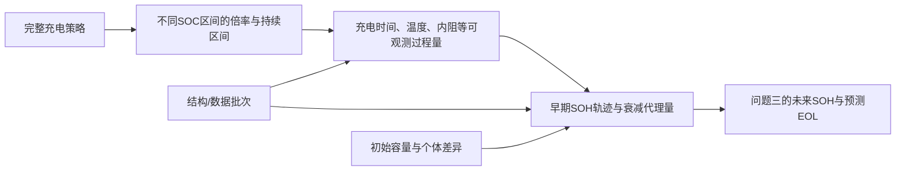

# A题问题二：充电策略及其参数对电池寿命衰减的影响分析

题面：[[联赛题目/题目/2026年度“策联杯”数学建模精英联赛-A题.md]]  
前序结果：[[联赛题目/A题/问题分析/问题一分析.md]]、[[联赛题目/A题/问题分析/问题一结果分析.md]]、[[联赛题目/A题/问题分析/数据审计报告.md]]

> [!abstract] 一句话定位
> 问题二是一个以**策略差异检验、参数—衰减关联分析和稀疏试验设计下的可识别性判断**为核心的统计推断问题。难点并非计算相关系数，而是：真实80% EOL尚未出现、只有少量参数组合、参数只在策略层变化，并且“NEWSTRUCTURE”与数据批次完全重合，因此必须区分“策略总体差异”“参数关联”和“参数因果效应”。

> [!warning] 阶段边界
> 本文只锁定问题本质、输入输出、统计单位、可识别范围和风险，**暂不指定具体统计模型或检验方法**。模型比较应在问题分析确认后单独开展。

## 1. 题目原文提炼

题目要求在问题一的策略级寿命差异基础上，进一步回答五个层次的问题：

1. 九种完整充电策略的寿命衰减是否存在总体差异，哪些策略差异足够稳定；
2. 第一阶段倍率 $C_1$、切换SOC $Q_1$ 和第二阶段倍率 $C_2$ 与寿命衰减分别呈何种关系；
3. 在有限且非正交的试验组合下，哪些参数效应仍可估计，效应大小和不确定性如何；
4. 高倍率出现在不同SOC区间时，衰减是否不同；
5. 将统计关联转化为合理的电化学解释，同时明确不能支持的因果与外推结论。

题面使用“循环寿命”作为结果，但当前附件的所有SOH均高于0.8，尚无一块电池出现真实EOL。因此，本问不能直接把150或200次循环当成寿命，只能先使用统一窗口内的**可观测早期衰减结局**；问题三给出的预测EOL可在之后作为补充结局，但其预测不确定性和潜在循环论证必须一并传递。

## 2. 数学本质判定

| 层次 | 类型 | 判定理由 |
|---|---|---|
| 主类型 | **分组差异与统计推断** | 题目明确要求判断不同策略寿命差异是否显著 |
| 主类型 | **多因素关联分析** | 需要刻画 $C_1,Q_1,C_2$ 与衰减结局的方向、强度和不确定性 |
| 关键难点 | **稀疏试验设计与可识别性分析** | 参数并非独立变化，完整数值参数组合只有7个 |
| 数据结构 | **电池级组间设计 + 循环级重复测量** | 参数在电池/策略级固定，SOH在循环内重复记录 |
| 解释层次 | **观察性机制解释而非严格因果识别** | 策略、结构和数据批次存在混杂，没有正交随机试验信息 |

### 2.1 必须区分的三个问题

| 问题 | 可回答内容 | 不可直接推出 |
|---|---|---|
| 完整策略是否不同 | 某一整套充电协议下的衰减分布是否有差别 | 差异一定由某一个倍率参数造成 |
| 参数是否相关 | 在已观察的7个完整参数点附近，参数与衰减是否共同变化 | 参数变化对寿命的全局因果效应 |
| 参数是否显著 | 给定分析口径下，关联相对于电池间变异是否稳定 | 在新电池、新结构或范围外仍然显著 |

## 3. 分析对象、输入、输出与约束

### 3.1 独立实验单位

统计推断的基本单位必须是**电池**。9,350条循环记录用于构造每块电池的轨迹特征，不能把每一行循环记录都当成独立样本；否则会将有效样本量从49虚增到9,350，严重夸大显著性。

参数 $C_1,Q_1,C_2$ 只在策略之间变化，因此参数效应的实际设计支持更接近“7个完整参数点”，而不是“46块参数完整电池”。同一策略内的多块电池主要用于估计个体波动，不能创造新的参数组合。

### 3.2 暂定结局变量

为保证49块电池处于同一观测窗口，定义第20至150循环的平滑SOH下降量：

$$
D_i^{20:150}=\widetilde{SOH}_{i,20}-\widetilde{SOH}_{i,150}.
$$

其中 $D_i^{20:150}>0$，数值越大表示早期衰减越快。采用第20循环而非第1循环，可减少初始活化、测量波动及已发现异常点对结果的影响。该量是**早期衰减代理结局**，不是80% EOL循环寿命。

| 候选结局 | 当前可用性 | 在问题二中的角色 | 主要风险 |
|---|---:|---|---|
| $D_i^{20:150}$ | 49/49块可计算 | 暂定主要结局，直接来自观测数据 | 只代表早期窗口，未必等价于长期寿命 |
| 第20—150循环衰减斜率 | 49/49块可计算 | 同口径稳健性结局 | 非线性轨迹可能被单一斜率压缩 |
| $D_i^{20:200}$ | 40/49块可计算 | 非测试电池敏感性结局 | 排除9块测试电池后组内样本更少 |
| 真实80% EOL寿命 $L_i$ | 0/49块观测到 | 当前不可直接分析 | 把150/200误作寿命会产生系统偏差 |
| 问题三预测寿命 $\widehat L_i$ | 尚未生成 | 后续补充结局 | 含预测误差；若预测器使用策略参数，再回归策略会循环论证 |

### 3.3 输入—输出—约束表

| 维度 | 内容 |
|---|---|
| 已知输入 | 49块电池的完整策略标签、$C_1,Q_1,C_2$、数据批次、NEWSTRUCTURE标识、充电时间、温度、内阻和前150/200循环SOH轨迹 |
| 待求输出 | 策略总体差异及成对差异；差异的效应量与不确定性；参数—衰减关联方向和大小；可识别/不可识别效应清单；不同SOC区间对比；机制与局限性说明 |
| 硬约束 | EOL阈值为0.8；不得把截断周期当寿命；不得把循环行当独立样本；不得无依据填补缺失 $C_1$；同参数的新旧结构标签不得静默合并；不得使用问题三测试电池的未知未来数据 |
| 软约束 | 优先使用全体电池共有的20—150窗口；同时报告效应量和不确定性；控制多次比较带来的偶然显著；结论限制在已观察参数邻域 |
| 关键待确认 | 主要结局采用早期衰减还是问题三预测EOL；缺失 $C_1$ 策略如何进入参数分析；NEWSTRUCTURE/批次如何处理 |

## 4. 参数设计审计：真正的难点是稀疏支持与混杂

### 4.1 设计支持规模

| 指标 | 核验值 | 含义 |
|---|---:|---|
| 电池数 | 49 | 电池级最大样本量 |
| 完整策略标签数 | 9 | 可做策略总体比较 |
| $C_1$ 完整的电池数 | 46 | `80PER_3_6C`的3块缺失 $C_1$ |
| $C_1$ 完整的策略标签数 | 8 | 参数分析可直接使用的标签数 |
| 不重复的完整 $(C_1,Q_1,C_2)$ 组合数 | 7 | 参数响应面的有效设计点非常少 |
| 每策略电池数 | 3—8 | 小样本且不均衡 |
| 问题三测试电池 | 每策略恰好1块 | 便于统一预测任务，但不能提供真实未来标签 |

参数的电池级Pearson相关为：

$$
\rho(C_1,Q_1)=-0.495,
\quad \rho(C_1,C_2)=-0.246,
\quad \rho(Q_1,C_2)=-0.274.
$$

对应方差膨胀指标约为1.37—1.70，说明传统意义上的线性共线性并不极端。**但这不等于参数效应可被可靠分离**：46块电池只是重复落在7个参数点上，缺乏单独改变一个参数而保持其余条件不变的正交对照，才是更主要的识别障碍。

### 4.2 结构与批次完全重合

数据中40块NEWSTRUCTURE电池全部来自 `dataset_id=3`，其余9块非NEWSTRUCTURE电池全部来自 `dataset_id=1/2`。因此，“结构变化”和“数据批次变化”无法从现有数据中拆开。

同一数值参数 $(4.8,80,4.8)$ 在新旧标签下形成了最直接的警示：

| 策略 | 数据批次 | 电池数 | $D^{20:150}$ 中位数 | 解释边界 |
|---|---:|---:|---:|---|
| `4_8C_80PER_4_8C` | 2 | 3 | 0.009882 | 旧结构/批次 |
| `4_8C_80PER_4_8C_NEWSTRUCTURE` | 3 | 6 | 0.001780 | 新结构/批次 |

在完全相同的数值参数下，旧标签的中位早期衰减约为新标签的 **5.55倍**。这不能证明“新结构导致寿命提升”，因为结构与批次未分离；但它足以证明：若只用 $C_1,Q_1,C_2$ 解释全部电池，参数效应会吸收结构/批次差异。

### 4.3 可利用与不可利用的近似对照

| 对照 | 被控制的部分 | 同时改变的部分 | 能支持什么 | 不能支持什么 |
|---|---|---|---|---|
| 两个5.6C NEWSTRUCTURE策略 | $C_1=5.6$、同批次/结构 | $Q_1:19\to36$，$C_2:4.6\to4.3$ | 比较两套SOC分配策略的联合差异 | 单独分离 $Q_1$ 或 $C_2$ 效应 |
| 两个 $C_2=4.0$ NEWSTRUCTURE策略 | $C_2=4.0$、同批次/结构 | $C_1:5.0\to5.3$，$Q_1:67\to54$ | 比较两套联合参数 | 单独分离 $C_1$ 或 $Q_1$ 效应 |
| 新旧4.8C—80%—4.8C | 三个数值参数相同 | 结构与批次同时改变 | 证明参数三元组不足以解释全部差异 | 区分结构效应与批次效应 |
| 两个 $Q_1=80,C_2=3.6$ 标签 | $Q_1,C_2$ 相同 | 一组 $C_1$ 缺失且批次不同 | 策略标签级比较 | 将差异解释成明确的 $C_1$ 效应 |

## 5. 五项任务的精确分析口径

### 5.1 任务一：不同策略寿命差异与显著性

需要回答的统计命题为：在统一结局口径下，九种完整策略对应的电池衰减分布是否相同。输出不能只有一个显著性判断，还应包括：

- 每策略的样本量、中心、离散程度和区间估计；
- 策略总体差异；
- 预先定义的关键策略对比与差异大小；
- 多次成对比较后的不确定性说明；
- 对异常电池、原始/平滑SOH和20—150/20—200窗口的敏感性。

显著性只说明“在当前样本和分析假设下，差异是否超出组内波动”，不等于工程影响很大；反之，小样本下不显著也不等于两策略完全相同。因此必须把**效应量**与**显著性**并列报告。

### 5.2 任务二：$C_1,Q_1,C_2$ 与衰减的关系

目标关系可抽象写为：

$$
D_i = g(C_{1i},Q_{1i},C_{2i},S_i,B_i,X_i)+\varepsilon_i,
$$

其中 $S_i$ 表示结构标签，$B_i$ 表示数据批次，$X_i$ 表示初始容量、温度等可能的基线差异。此式只说明需要区分的变量角色，不预设 $g(\cdot)$ 的具体形式。

本任务应输出：

- 参数与衰减关联的方向；
- 在现有参数点附近的变化幅度；
- 是否存在明显非线性或交互迹象；
- 结论对结构/批次处理方式是否敏感；
- 哪些参数效应因缺乏对照而不可单独解释。

论文措辞应使用“相关”“伴随变化”“条件关联”，除非后续获得随机化和无混杂证据，否则不使用“$C_2$ 每增加1C必然导致寿命下降多少”的因果表述。

### 5.3 任务三：参数显著性与影响程度

本任务要把两个概念分开：

1. **统计证据**：某参数的条件关联是否稳定区别于零；
2. **工程影响**：在数据实际变化范围内，该参数对应的衰减变化有多大。

由于只有7个完整参数点，任何多参数结果都必须同时给出参数支持范围、区间不确定性和删除某一策略后的稳定性。若显著性随是否纳入旧结构策略而反转，应报告“结构/批次敏感”，而不是挑选有利结果。

### 5.4 任务四：不同SOC区间的高倍率效应

两阶段协议对应：

$$
\mathcal I_1=[0,Q_1],\qquad
\mathcal I_2=(Q_1,80],\qquad
\mathcal I_3=(80,100].
$$

其中前两段的SOC宽度分别为 $Q_1$ 与 $80-Q_1$ 个百分点；第三段所有电池均采用相同的1C CC-CV方式，因此**现有数据无法识别80%—100%高SOC区间改变倍率的效应**。可分析的只是高倍率在0%—80%内部如何分配。

数据中最接近“区间作用”比较的是两个 $C_1=5.6$ 的NEWSTRUCTURE策略：

| 参数组合 | 第一段 | 第二段 | $D^{20:150}$ 中位数 |
|---|---|---|---:|
| $(5.6,19,4.6)$ | 5.6C覆盖0%—19% | 4.6C覆盖19%—80% | 0.003502 |
| $(5.6,36,4.3)$ | 5.6C覆盖0%—36% | 4.3C覆盖36%—80% | 0.002852 |

前者中位衰减高约0.000650，但 $Q_1$ 与 $C_2$ 同时变化，因此只能解释为“两套SOC区间—倍率联合配置不同”，不能单凭此对照断言是切换SOC或第二阶段倍率的单独作用。

### 5.5 任务五：机制与局限性

机制讨论应作为“与数据一致的候选解释”，而不是实验已经证明的机理。可核查的证据链为：

主要局限至少包括：

- 无真实80% EOL事件，当前只观察早期衰减；
- 只有7个完整参数组合，参数空间覆盖稀疏；
- 策略内样本量仅3—8，部分组对单块异常电池敏感；
- NEWSTRUCTURE与批次完全重合；
- $C_1$ 有3块结构性缺失；
- 温度、内阻既可能是混杂标志，也可能是充电策略作用后的中介量，不能不加区分地“控制”；
- 所有80%—100%阶段相同，无法回答该区间的高倍率外推问题；
- 结论只适用于A123 18650型磷酸铁锂电池及题给实验邻域。

## 6. 与问题一、三、四的数据流关系

| 来源/去向 | 传递内容 | 必须防止的问题 |
|---|---|---|
| 问题一 → 问题二 | 清洗后的双层数据、策略分组、早期衰减代理、异常标志 | 将问题一的探索性排名当作参数因果结论 |
| 问题二 → 问题三 | 策略差异、可识别参数信息、结构/批次风险 | 在测试电池未来信息进入特征前发生数据泄漏 |
| 问题三 → 问题二（补充） | 预测EOL及其不确定性 | 若预测器已直接使用策略参数，再用预测寿命证明参数效应会循环论证 |
| 问题二 → 问题四 | 可解释的策略—衰减关系、有效范围、不可外推区域 | 优化器利用稀疏数据漏洞推荐范围外极端参数 |

因此，问题二宜先形成一条不依赖问题三的“观测早期衰减证据链”，再把问题三预测寿命作为带不确定性的补充验证，而不能让预测值取代全部实测证据。

## 7. 常识与数量级校验

### 7.1 早期衰减量级

- 49块电池的 $D^{20:150}$ 均为正，范围为0.001199—0.027116，即约0.12—2.71个百分点；
- 九个策略的中位数范围为0.001780—0.025080，相差0.023300；
- 典型策略内标准差的中位数约0.000994，策略中位数跨度约为其23.4倍，说明组间确有值得检验的信号；
- 但样本量小、组间不均衡和结构/批次混杂仍可能影响显著性与解释。

### 7.2 充电时间量级

策略平均充电时间约为10.16—14.08（原表单位未说明）。数值随策略变化明显，但在单位确认前只能比较相对快慢，不能在论文中直接写“分钟”或“小时”。

### 7.3 边界情形

- 当 $Q_1=80$ 时，按题面两阶段定义，第二阶段 $(Q_1,80]$ 宽度为0；此时 $C_2$ 对0%—80%区间没有独立暴露宽度，参数解释需特别谨慎；
- `80PER_3_6C` 同时具有 $Q_1=80$、$C_2=3.6$ 和缺失 $C_1$，无法仅凭当前字段还原完整物理协议；
- 若把所有49块电池的最后循环当寿命，测试/非测试组会机械地产生150/200两点“寿命”，这是数据截断而非策略效应。

## 8. 问题二应交付的分析结果

后续建模与求解阶段至少应形成以下六类产物：

1. 策略级衰减分布表与总体差异结论；
2. 关键策略对比的效应量、区间与多重比较说明；
3. $C_1,Q_1,C_2$ 的条件关联、支持范围和稳定性；
4. “可识别—弱可识别—不可识别”参数效应矩阵；
5. 低SOC与中SOC倍率配置的联合对比；
6. 结构/批次、异常值、早期窗口与预测EOL口径的敏感性报告。

## 9. 文献检索与补充筛选

### 中文

- 锂离子电池 快充策略 循环寿命 统计显著性
- 分段恒流充电 SOC区间 容量衰减
- 非正交试验设计 参数效应 可识别性
- 锂电池早期循环 SOH衰减 寿命代理指标

### 英文

- lithium-ion battery fast charging protocol cycle life degradation
- stepped current charging SOC window capacity fade
- sparse non-orthogonal experimental design parameter identifiability
- early-cycle SOH degradation proxy lifetime prediction

已对 [[联赛题目/A题/参考文献/问题一文献筛选.md]] 中的文献去重，并新增筛选 **12 篇核心论文**，详见 [[联赛题目/A题/参考文献/问题二补充文献筛选.md]]。新增文献重点补齐了四项缺口：

1. 分段恒流在不同 SOC 区间的寿命影响；
2. 快充协议的主效应与交互分析；
3. 稀疏、非正交设计下的参数可识别边界；
4. 早期 SOH 衰减只能作为寿命代理、不能等同真实 EOL 的证据。

## 10. 阶段性判断

问题二的可靠主线不是直接给三个参数各配一个“显著/不显著”标签，而是先证明完整策略是否存在稳定差异，再在有限对照范围内分离参数关联，并把结构/批次混杂和真实EOL缺失显式纳入结论。当前数据足以研究**策略差异与局部关联**，不足以无条件声称三个参数的全局独立因果效应。

## 11. 检验理解的提问

> 每题都有多种合理选择；不同答案会改变后续分析口径，而不是考察题面记忆。

1. **歧义消解——结局优先级**  
   若某策略在第20—150循环的实测衰减更小，但问题三却预测它更早达到80% EOL，问题二正文应以哪一种为主：实测早期衰减、预测EOL，还是双结局并列且不强行给唯一排名？

2. **隐含假设——缺失参数**  
   对 `80PER_3_6C` 的3块电池，参数层分析应选择：仅保留在“完整策略比较”中而排除参数效应估计；把 $C_1$ 设为“未知类别”；还是依据策略名称补成某个倍率？请说明你愿意承担的解释风险。

3. **混杂边界——新旧结构**  
   面对相同 $(4.8,80,4.8)$ 参数但中位衰减相差约5.55倍的两组，你更希望正文主分析采用哪种口径：九个标签全部保留并显式区分结构/批次；只在40块NEWSTRUCTURE电池中讨论参数；或按数值三元组合并后把差异纳入组内波动？
