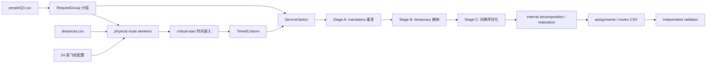

# Q3代码实现与复杂度分析

## 1. 程序整体结构

Q3 采用“有限物理路线池—离散时刻嵌入—人员流—具体飞机排班—人员回填”的分层实现。主问题不直接枚举“人员 × 分钟 × 路线 × 飞机”，而是先生成已经满足物理与时间规则的 `TimedColumn`，再由 CP-SAT 选择架次、飞机和聚合人员流。



| 文件 | 核心职责 | 主要输入 | 主要输出 |
|---|---|---|---|
| `q3/__main__.py` | 模块入口 | 命令行参数 | 调用 `run_q3.main` |
| `q3/config.py` | 7 天时域、整数分钟与日期时间转换 | `datetime`、分钟数 | 统一时间坐标 |
| `q3/fleet.py` | 题面表 3 的 24 架具体飞机配置 | 无外部结果依赖 | `Aircraft` 列表及兼容查询 |
| `q3/run_q3.py` | 数据审计、A/B/C 编排、父阶段校验、产物管理 | 数据、CLI、父阶段 CSV/JSON | 各阶段结果、summary、history、正式 CSV |
| `q3/algorithms/timed_pool.py` | 带时刻列传播、等待、服务选项判定 | 物理路线、请求组、起飞分钟 | `TimedColumn`、`ServiceOption` |
| `q3/algorithms/stage_a_pool.py` | Q2 种子、短路线、临界起飞时刻和有限列池 | mandatory 组、距离、可选 Q2 路线 | `StageAPool` 与覆盖统计 |
| `q3/algorithms/master.py` | Stage A/B 的人员流和具体飞机 CP-SAT 主问题 | 列、选项、请求组、可选预算 | `StageASolution` |
| `q3/algorithms/lex.py` | Stage C 顺序词典序求解及 Dinkelbach | Stage B 固定值、列池、共享截止时间 | `StageCSolution`、阶段历史 |
| `q3/algorithms/realize.py` | 聚合流拆分到具体人员、架次副本和飞机 | `x/y/z` 解、人员表 | `RealizedSolution` |
| `q3/io/csv_writer.py` | 按官方字段和排序规则写 CSV | 回填结果、原人员顺序 | assignments、routes |
| `q3/io/csv_validator.py` | 脱离求解器重读原始数据和 CSV 验证 | people、distance、fleet、两张 CSV | `ValidationResult` 与重算指标 |
| `q3/tests/` | 单元、toy、阶段衔接和 formal 工程测试 | 小型构造数据、现有产物 | 回归结果 |

## 2. 核心数据规模

当前数据审计得到：

| 对象 | 数量 |
|---|---:|
| 人员 `persons` | 4000 |
| Q3 请求组 `request groups` | 1877 |
| mandatory 人员 | 3840 |
| temporary 人员 | 160 |
| 具体飞机 | 24 |
| 计划天数 | 7 |

Q2 的 264 个组仅按其任务所需的 OD 聚合口径形成。Q3 的合法服务还取决于任务类别、最早上机时刻和最晚到达时刻；同一 OD 的人员可能具有不同时间窗，不能合并为同一无时窗流。因此 Q3 使用 `group_q3` 得到 1877 个请求组，并在回填时保留组内的具体 `person_id`。

24 架飞机是具体资源，不只是机型总数。`fleet.py` 同时保存 `aircraft_id`、基地和机型；只有基地与机型均匹配列的飞机才会产生决策变量。

## 3. 核心数据结构与变量

### 3.1 `RequestGroup`

`RequestGroup` 是人员流的需求单位，包含组号、OD、人数、任务类别、最早上机和最晚到达等属性。它用于生成服务选项和需求约束；求解结束后，组流量才按原始人员顺序展开。因此主问题变量规模依赖请求组和服务选项，而不是直接依赖 4000 个逐人二进制变量。

### 3.2 `TimedColumn`

`TimedColumn` 表示可由一架或多架兼容飞机执行的固定物理时刻模式。它同时包含日期、基地、机型、闭环路线、加油决策、各站到离时刻、起飞与返场分钟、飞机使用时间、距离、燃油和兼容飞机编号。物理路线与完整时刻表固定后，飞机冲突可以表示为固定可选区间，人员时间也能直接成为整数目标系数。

### 3.3 `ServiceOption`

`ServiceOption` 连接一个请求组和一个带时刻列，并记录具体的上机位置、首次到达下机位置、人员在途时间和服务距离。同一个组在同一重复访问路线中可能因不同上机 occurrence 产生多个选项；每个选项对应一个整数人员流变量。

### 3.4 `StageASolution` 与 `StageCSolution`

`StageASolution` 保存 Stage A/B 的状态、选中的 `(column, aircraft)`、各选项流量、`T_air`、服务人数和当前有限列池的 bound 等。Stage B 复用同一解结构，只是增加预算和 temporary 目标。

`StageCSolution` 保存最终 incumbent、五级目标值、每一级 `StageResult`、Dinkelbach 迭代数以及认证标记。它区分“得到可行 incumbent”与“该级已证明 OPTIMAL”，并保留父阶段是否未经认证的信息。

### 3.5 主问题变量

- $x_{r,a}\in\{0,1\}$：具体飞机 $a$ 是否执行带时刻列 $r$；只对基地和机型兼容的组合建立。
- $y_r=\sum_a x_{r,a}$：同一带时刻模式实际执行的副本数。它在代码中是线性表达式，不额外承担人员配置含义。
- $z_o\in\mathbb Z_+$：服务选项 $o$ 上承运的组内人数。人员配置没有提前固化成整架次 passenger pattern。

## 4. 路线 skeleton 生成

`stage_a_pool.py` 的物理路线来源有两类。

第一类是可选的 Q2 已用路线种子。程序只读 `q2-routes.csv`，按机型和架次重构实际执行过的闭环路线及加油位置，再用统一物理可行性核重新计算，而不依赖 Q2 输出才能运行。Q2 种子中已经出现的多站、接力或链式结构可因此进入 Q3 池。

第二类是 mandatory OD 的确定性短路线。程序先按 OD 取代表请求，对兼容基地和三种机型尝试直接的短停靠顺序，经物理可行性核检查距离、飞行时间、燃油、加油和着陆规则，再按飞机时间与燃油排序，每个 OD 保留少量较优候选。相同的 `(base, type, route, refuel)` 键只保留一次。

当前实现不是经典 ALNS，也没有实现无界的 insert/remove/swap 邻域搜索。所谓 paired/chain 结构主要来自 Q2 已用路线种子；Q3 自身的确定性补充以单 OD 短路线为主。程序更没有枚举 52 个设施组成的所有长度不超过 5 的序列：这种枚举的组合数随序列长度指数增长，而且绝大多数序列与实际请求或燃油约束无关。

## 5. Timed Column 与时间嵌入

对每条物理 skeleton，程序先取得无额外等待时的相对到达、离开偏移。若请求组在该路线上的上机位置为 $\mu$、下机位置为 $\nu$，固定起飞分钟 $s$ 必须满足

$$
s\ge e_g-D_\mu^{rel},\qquad
s\le l_g-A_\nu^{rel}.
$$

程序将该区间与每天的 06:00—18:00 起飞机场窗、20:00 前返场以及同日运行约束相交。`_critical_starts` 对非空交集只加入最早点、中点和最晚点，再跨 7 天去重，而不是扫描 06:00—18:00 的每一分钟。

固定起飞时刻后，`propagate_timed_column` 按每段

$$
\left\lceil 60d_{ij}/v_k\right\rceil
$$

传播整数分钟，加入普通停靠或加油停靠时间，重算返场、飞机使用时间和全部站点时刻。通用传播器还支持 `pickup_earliest`：只有站点离开早于指定最早上机边界时才增加等待，等待会进入离站、返场与 `aircraft_time`。不过当前 `stage_a_pool.py` 的全量构池调用没有批量构造这类等待映射；现有池主要依靠临界起飞时刻满足时间窗，等待能力由通用核和 toy 覆盖，不能表述成已经实施了大规模 waiting-pattern 扩列。

列生成后立即计算其 mandatory 服务选项；没有任何服务选项的列被删除。完全相同的日期、基地、机型、路线、加油和到离时刻表按物理键去重，不因服务选项不同而复制。

## 6. Service Option

`service_options` 先将 `LAND` 映射为当前列基地；若请求给出具体机场，该机场必须等于列基地。随后枚举路线中每一个合法的起点 occurrence，并把下机位置固定为该 occurrence 之后第一次出现的实际终点。这同时落实：

- 路线位置匹配与具体机场兼容；
- `pickup < delivery`；
- first-arrival delivery；
- `departure[pickup] >= earliest_pickup`；
- `arrival[delivery] <= latest_arrival`。

路线允许重复访问设施。起点重复时，不同上机 occurrence 可以形成不同选项；终点重复时，每个选项仍只能在上机后的首次到达处下机。选项的占座区间采用半开区间 $[\mu,\nu)$，即乘客占用从上机站之后的航段，到下机站之前的航段。这正好表示“同站先下后上”，释放的座位可在该站立即复用。

## 7. Stage A 数学实现

Stage A 只包含 mandatory 组，并最小化

$$
T_{air}=\sum_r t_r y_r.
$$

每个 mandatory 组满足精确需求：

$$
\sum_{o\in O_g}z_o=q_g.
$$

对列 $r$ 的每个航段 $h$，动态容量为

$$
\sum_{o\in O_r:\,\mu_o\le h<\nu_o}z_o
\le Q_r y_r.
$$

代码还约束被选择的列副本必须有对应人员流，避免空架次进入最小化模型。飞机变量只为 `compatible_aircraft_ids` 建立，因此基地和机型不兼容的组合在模型中根本不存在。

对每个 $(r,a)$，代码建立 presence 为 $x_{r,a}$ 的 optional fixed interval：

$$
[s_r,e_r+30).
$$

每架具体飞机的所有可选区间加入一条 `AddNoOverlap`。返场后恰好 30 分钟起飞时两个半开区间不重叠，因此合法；29 分钟则冲突。数学文档使用显式冲突图，代码使用 `AddNoOverlap`，二者在固定 timed-column 池上表达的是相同的单机区间互斥与周转规则；这是 CP-SAT 调度编码的差异，不是业务约束变化。

## 8. Stage B：临时人员接纳

Stage A 最好且已通过独立验证的飞机时间被记为 $B_0$。Stage B 动态读取并验证父阶段产物，不使用固定 quick 数字。其约束为：

$$
\sum_{o\in O_g}z_o=q_g\quad(g\in G^M),
$$

$$
0\le\sum_{o\in O_g}z_o\le q_g\quad(g\in G^T),
$$

$$
T_{air}\le B_0,
$$

目标只最大化 temporary 服务人数。mandatory 与 temporary 共同进入逐航段容量；temporary 的 LAND、机场、first-arrival、时间窗、燃油、时刻和飞机排班规则均未放松。

Stage B 的 temporary 选项在现有 timed pool 上生成并限量保留。quick 中的 149/160 是开发运行的 incumbent，不是代码常量，也不是 formal 最终接纳数。formal Stage C 使用 formal Stage B summary 和 CSV 中经过验证的实际值。

## 9. Stage C：顺序词典序优化

Stage C 显式接收父阶段 $B_0$ 与 temporary 实际服务数，固定 mandatory 全覆盖、temporary 总服务数和 $T_{air}\le B_0$，依次求解：

1. C1：最小化 $T_{air}$；
2. C2：固定 C1 incumbent，最小化 $T_{pax}$；
3. C3：固定前两项，最小化 fuel；
4. C4：固定前三项，最小化实际架次数 $\sum_r y_r$；
5. C5：固定前四项，最大化整体座位利用率。

这不是加权和。每一级完成后，代码把该级 incumbent 的目标值作为等式加入下一模型，再使用上一解作为 hint。燃油与距离通过 Q2 沿用的 `_scale` 寻找十进制整数尺度，避免直接截断小数后交给 CP-SAT。

认证只在 `status == OPTIMAL` 时成立。若某一级仅为 FEASIBLE，其 incumbent 可以继续被固定，但后续结果均标记 `conditioned_on_uncertified_parent`；若 Stage B 本身未证明最优，Stage C 的 `full_certified` 也必为 false。各子问题共享一个阶段截止时间，并非每级重新获得完整预算。

## 10. Dinkelbach 与整体利用率

代码定义

$$
PK=\sum_o d_o z_o,
\qquad
AK=\sum_r Q_r d_r y_r,
\qquad
U=\frac{PK}{AK}.
$$

CP-SAT 只接受整数线性目标，不能直接优化分式。C5 使用 `Fraction(p, q)` 保存当前精确比率，并求解整数线性子问题

$$
\max\;q\,PK-p\,AK.
$$

取得新 incumbent 后以其 `PK/AK` 更新 Fraction；比率不再变化且子问题状态满足要求时视为收敛，代码设置有限迭代上限。这里优化的是全体乘客公里与全体可用座位公里之比，不是各架次利用率的算术平均。

若共享截止时间耗尽，子问题可以返回 UNKNOWN。代码不会把 UNKNOWN 解释为算法错误，也不会丢弃 C1—C4 已验证结果：没有新的 C5 可行解时，最终解仍取 C4 incumbent，并在 summary/history 标记 `seat_utilization_status` 和 `final_solution_source`。C5 只有在父级均认证、各比率子问题 OPTIMAL 且真正收敛时才能认证。

## 11. 人员回填与具体飞机映射

主问题的 $z_o$ 是组级整数流。`realize.py` 先按选项顺序从每组取出具体 `person_id`，把每个人转换为同一列上的单位占座区间 $[\mu,\nu)$。随后复用 Q2 的 interval decomposition，将这些区间分到 $y_r$ 个 flight copies，使每个副本每一航段不超过机型容量。

分解使用半开区间，因此在位置 $h$ 下机的乘客已经释放座位，在同一位置上机者可以进入同一副本。生成的副本再一一映射到满足 $x_{r,a}=1$ 的具体飞机；每架飞机按起飞时刻排序并从 1 连续生成 `flight_no`。

回填不改变路线、飞机或时刻。若选中飞机数与 $y_r$ 不一致、人员游标未恰好消费、区间无法合法分解或副本数不符，程序直接抛出 `RuntimeError`，不会静默修补求解器解。

## 12. CSV 与独立验证器

`csv_writer.py` 保留 people 模板中的全部 4000 行及原顺序。mandatory 必须有完整 assignment；未服务 temporary 的飞机、航班号和上下机位置保持空值。route CSV 按具体飞机和航班写连续 stop order，并处理首站 arrival、末站 departure 的模板空值。

`csv_validator.py` 不接收 CP-SAT 变量或 solver 对象，而是重新读取 peopleQ3、distances、24 架飞机配置以及输出 CSV。它独立检查：

- CSV 字段、4000 人顺序、重复或缺失人员、mandatory/temporary 空值规则；
- aircraft id、基地、机型、每架飞机连续 flight number；
- 路线首末机场闭环、最多 5 次海上着陆、连续 stop order；
- 整数飞行时间传播、普通/加油停靠下限、06:00—18:00 起飞、20:00 前返场、same-day；
- 合法加油设施、逐站燃油传播与安全余油；
- LAND 与具体机场、上机先于下机、first-arrival、个人最早上机和最晚到达；
- $[pickup,delivery)$ 语义下的逐航段动态容量；
- 同一具体飞机相邻架次至少 30 分钟周转；
- mandatory/temporary 服务数、$T_{air}$、$T_{pax}$、fuel、flights、PK、AK 和 utilization 的重算。

运行编排还把 solver metrics、回填后的 delivery metrics 与 validator metrics 对齐。三者一致可以发现“模型正确但 CSV 映射错误”或“CSV 看似完整但指标口径不同”等仅靠 solver status 无法发现的问题。

## 13. 时间复杂度

### 13.1 符号

| 符号 | 含义 |
|---|---|
| $P$ | 人数，当前为 4000 |
| $G$ | Q3 请求组数，当前为 1877 |
| $G_T$ | temporary 请求组数 |
| $V$ | 地点数，3 个机场加 52 个设施 |
| $S$ | 去重后的 physical skeleton 数 |
| $R$ | 保留的 timed column 数 |
| $O$ | 保留的 service option 数 |
| $H$ | 具体飞机数，$H=24$ |
| $L$ | 单架次航段数，最多 5 次海上着陆，故 $L\le6$ |
| $D$ | 天数，$D=7$ |
| $C_r$ | 列 $r$ 的兼容具体飞机数 |
| $X$ | $\sum_r C_r$，即可能的 `(column, aircraft)` 数 |
| $O_r$ | 列 $r$ 上的服务选项数 |
| $F$ | 最终实际架次数 |

以下复杂度描述的是建模前处理和数据结构操作；CP-SAT 搜索单独讨论。由于 $H,D,L,V$ 在本题中有较小固定上界，一些表达式在实际数据上会被常数显著压缩，但这里仍保留符号以说明扩展性。

### 13.2 数据读取与分组

people 读取与字段转换为 $O(P)$，距离表转为地点对字典或矩阵为 $O(V^2)$。pandas 分组通常采用哈希或排序：平均可视为 $O(P)$，保守上界可写成 $O(P\log P)$；组内保存人员编号仍需 $O(P)$ 空间。Q2/Q3 逐人一致性检查也是线性或由排序带来的 $O(P\log P)$。

### 13.3 skeleton generation

设可选 Q2 seed 的路线行数为 $N_2$，重构、物理核检查和去重约为 $O(N_2L)$，若计入 group/sort 则为 $O(N_2\log N_2)$。mandatory 短路线按唯一 OD 数 $U\le G$，遍历最多 3 个基地和 3 个机型，每次物理检查为 $O(L)$，因此约为

$$
O(N_2\log N_2+U\cdot3\cdot3\cdot L+S).
$$

候选排序的每个 OD 规模有常数上限。实际代码没有 $G\times G$ 的全配对循环，也没有 $|V|^5$ 级设施序列枚举。

### 13.4 timed-column generation

物理路线对请求的 occurrence 检查最多扫描短路线的上、下机位置，保守记为 $O(L^2)$。若 skeleton $s$ 对 $G_s$ 个组有物理服务可能，临界时刻数量记为 $K_s$；端点策略使 $K_s$ 远小于逐分钟枚举，并在理论上受 $O(DG_s)$ 控制。构建与筛选的主要循环可写为

$$
O\!\left(\sum_{s=1}^{S}
\left[G L^2+K_s\left(L+G_sL^2\right)\right]\right).
$$

其中传播单列为 $O(L)$，对该列生成组服务选项为 $O(G_sL^2)$。以最终对象计，常写成较直观的上界 $O(SGL^2+RGL^2)$。物理 schedule 去重使用哈希，平均 $O(RL)$；选项按组排序并截断为每组最多 60 个，代价为

$$
O\!\left(\sum_g O_g\log O_g\right)\le O(O\log O).
$$

Stage B 在既有列上补 temporary 选项的主循环是 $O(G_TRL^2)$，再加候选排序。这里的 service-option 数量往往比人员行数更能决定前处理开销。

### 13.5 master model construction

建立 $x$、可选区间和兼容索引为 $O(X)$；建立 $z$ 为 $O(O)$；需求约束通过选项索引累计为 $O(O+G)$。动态容量代码按列、航段扫描该列选项，复杂度为

$$
O\!\left(\sum_r L_rO_r\right)\le O(LO),
$$

最多产生 $O(RL)$ 条航段容量约束，实际只对存在 active service options 的航段形成有效线性项。

`AddNoOverlap` 的模型构造不是显式两两生成冲突边：每个兼容 `(r,a)` 只创建一个 optional interval，再把每架飞机的 interval 列表交给一条全局约束。因此构造与收集引用约为 $O(X)$，共有 $H$ 组 `NoOverlap`；求解器内部的传播和搜索代价不等于简单的 $O(X)$。

### 13.6 CP-SAT 求解

该模型包含整数人员流、0—1 架次选择、区间排班和多级目标，最坏情况属于指数级组合搜索，不能写成 $O(n^3)$ 或其他固定多项式。实际搜索时间受 $X$、$O$、容量约束稠密度、时间冲突密度、hint、目标固定后的可行域、`num_search_workers` 和 time budget 共同影响。

Stage C 会重建并顺序求解 C1—C4，再进行至多有限轮 C5 比率子问题，故建模与搜索会重复。若实际完成的子问题数为 $J$，线性建模工作约放大为 $J\cdot O(X+O+LO)$；搜索时间仍不能由该式预测。formal 对每个 stage 使用共享 deadline，因此 wall-clock 搜索有明确上限，Stage C 的各级不会各自重新获得完整预算。

### 13.7 realization

对正流量选项排序约为 $O(O_+\log O_+)$。设列 $r$ 上被服务的具体人员数为 $P_r$，区间分解需要排序并使用容量通道/堆，代价可写为

$$
O\!\left(\sum_r P_r\log P_r\right),
$$

且 $\sum_rP_r\le P$。具体架次映射与按飞机编号排序约为 $O(F\log F)$。由于每个乘客只在一个 flight 内完成运输，不存在跨航班路径搜索。

### 13.8 CSV validation

设 routes CSV 行数为 $N_R=O(FL)$。读取数据为 $O(P+N_R+V^2)$；按飞机/航班 group、排序的保守复杂度为 $O(N_R\log N_R+F\log F)$；逐人 OD、时间窗和逐航段载荷核验为 $O(PL+FL)$。因此可概括为

$$
O(P\log P+N_R\log N_R+PL+V^2).
$$

这里 $L\le6$，验证通常是确定性线性/排序工作，不承担 CP-SAT 的组合搜索。

## 14. 空间复杂度

原始人员与距离数据约占 $O(P+V^2)$。路线和选项池的主要对象规模为：

- physical skeleton：$O(SL)$；
- `TimedColumn` 的路线、时刻和加油数组：$O(RL)$；
- `ServiceOption`：$O(O)$；
- $x$ 变量及 optional intervals：$O(X)$；
- $z$ 变量：$O(O)$；
- 需求和容量约束索引：$O(G+LO)$，约束条数最多 $O(G+RL)$；
- realization 与 CSV：$O(P+FL)$。

因此 Python 前处理和 CP-SAT 模型的主导量可概括为

$$
O(SL+RL+O+X+LO),
$$

另加求解器内部的约束表示、传播状态和并行搜索状态。当前主要空间压力通常来自 TimedColumn 池、ServiceOption 池和 CP-SAT 模型，而不是 4000 行 people CSV。没有实际内存 profiler 数据，因此不推测 MB 数值。

## 15. CP-SAT 变量与约束规模

| 项目 | 理论数量 |
|---|---:|
| $x_{r,a}$ 二进制变量 | $X=\sum_r C_r$ |
| $y_r$ 表达式 | $R$ |
| $z_o$ 整数变量 | $O$ |
| optional intervals | $X$ |
| 请求需求约束 | 约 $G$ |
| dynamic-capacity 约束 | 至多 $\sum_rL_r\le RL$ |
| `NoOverlap` | 每架具体飞机一组，共 $H=24$ 组 |
| Stage B/C 时间预算约束 | 1 条，外加各级目标固定等式 |

容量约束的线性项总量近似 $O(LO)$，不是每条约束都包含全部选项。实际 $S,R,O,X$ 应从对应 formal summary 或运行日志读取；本文不把 quick 池规模冒充 formal 规模，也不捏造正式变量数。

## 16. 并行与 GPU

核心优化使用 OR-Tools CP-SAT，并由 `num_search_workers` 控制 CPU 并行；给定命令中的典型值为 8。候选生成仍是 Python 的确定性循环、字典索引、排序和可行性传播。

GPU 没有参与核心优化。Q3 的主要计算是离散整数规划、optional interval scheduling、约束传播和分支搜索，而非规则的大规模矩阵乘法，因此工程上没有为 RTX GPU 引入 PyTorch、CUDA 或另一套求解器。这是保持语义一致、依赖简单和结果可复现的选择，不是硬件不可用的结论。

## 17. Quick 开发性能记录

以下均为 **quick development result**，用于说明管线已跑通，不是正式最终结果：

| 阶段 | 已验证结果 |
|---|---|
| Stage A quick | mandatory 3840/3840，$T_{air}=40617$，241 flights，validator PASS |
| Stage B quick | temporary 149/160，$T_{air}=40593$，validator PASS |
| Stage C quick | $T_{air}=40307$，$T_{pax}=247064$，fuel 324449.7，flights 240，utilization 0.402827725，validator PASS |

Stage C quick 的 C5 状态为 UNKNOWN，Dinkelbach iterations = 1。这表示共享预算内没有完成 C5 的证明/迭代，不表示前四级 incumbent 不合法；最终 quick CSV 已由独立验证器通过。formal 数值应以后续 `q3-summary.json` 为准。

### 17.1 当前 formal 结果

当前正式 Stage B 在 B0=35114 下取得 temporary 160/160，best bound=160、gap=0、
status=OPTIMAL。固定160人后的 Stage C 正式结果为 T_air=34033、T_pax=246808、
fuel=273629.0、flights=204、PK=799803.0、AK=1674375.0、utilization=0.4776725644。
官方 CSV independent validator PASS，且 solver、delivery 与 validator 指标一致。

早期143/160产生的17人瓶颈 CSV继续作为有限时间 incumbent 的诊断实验保留，不是
当前正式未接纳名单；最终160/160表明这些请求均存在合法的联合排班方式。

## 18. 复杂度与性能瓶颈总结

从循环结构和模型组成看，主要性能敏感项是：

1. timed columns 数 $R$：同时影响传播、选项生成、飞机变量和 interval 数；
2. service options 数 $O$：影响需求索引、人员流变量及每航段容量线性项；
3. 兼容组合数 $X$：决定 $x$ 变量、optional intervals 和每架飞机的排班选择规模；
4. `NoOverlap` 与人员容量的耦合：单机时间冲突和跨选项容量选择共同扩大组合搜索；
5. Stage C 重复求解：C1—C4 每级固定 incumbent，C5 又增加比率子问题；
6. Dinkelbach：每次比率更新都需要新的 CP-SAT 子问题，且必须共享剩余 deadline。

候选生成是有界的确定性前处理，通常比 master 的组合搜索更容易控制；但本文不在没有统一 profiler 记录的情况下声称具体耗时百分比。工程上通过短路线/Q2 种子、临界时刻、选项限量和共享 deadline 同时控制前处理与求解规模。

## 19. 正确性保障

当前正确性链包括：

- 单元测试覆盖时间边界、周转、LAND、first-arrival、容量、燃油、temporary 可选、词典序、Dinkelbach 和回填；
- toy 场景覆盖连续架次、30 分钟周转、往返/接力、时间窗、未服务 temporary 和同站座位复用；
- full-repo pytest 防止 Q3 修改破坏 Q1/Q2；
- CSV independent validator 脱离求解器重算全部硬约束和指标；
- solver—delivery—validator 三层指标 reconciliation；
- formal Stage B/C 启动前独立验证父阶段，拒绝缺失、损坏、过期或指标不一致 baseline；
- quick 与 formal 使用不同文件名前缀，官方 CSV 只在 formal A/B/C 均验证通过后发布。

因此，即使最终 solver 状态只是 FEASIBLE，输出仍可以是经过完整硬约束和指标复核的“已验证可行方案”。FEASIBLE 只影响最优性认证，不降低已检查约束的有效性。

## 20. 模型与程序的边界

程序优化的是有限 timed-column pool：

$$
\mathcal F(\Omega)\subseteq\mathcal F_{full}.
$$

候选池由确定性 skeleton 和临界时刻构造，并非原问题完整可行空间。即使 CP-SAT 对当前模型返回 OPTIMAL，也只证明当前有限列池上的受限模型最优，除非另有列完备性证明。

FEASIBLE 表示已找到合法方案但未证明当前受限模型最优。`restricted_pool_bound` 是 CP-SAT 对当前有限列池模型给出的 bound，不能直接称为原问题 global lower bound，也不能据此报告原问题 global gap。formal summary 的认证字段必须结合父阶段状态、各词典序阶段状态和 Dinkelbach 收敛情况解释。

## 21. 运行方法

所有命令从 `代码/` 目录执行。

Quick 分阶段：

```bash
python -m q3 --stage-a --quick --workers 8
python -m q3 --stage-b --quick --workers 8
python -m q3 --stage-c --quick --workers 8
```

Formal 一键：

```bash
python -m q3 --workers 8
```

Formal 分阶段，可复用已经独立验证通过的父阶段产物：

```bash
python -m q3 --stage-a --workers 8
python -m q3 --stage-b --workers 8
python -m q3 --stage-c --workers 8
```

默认 formal budget 为 Stage A 600 秒、Stage B 360 秒、Stage C 360 秒。每个 stage 内使用共享 deadline；尤其 Stage C 的 C1—C5 和 Dinkelbach 共用 360 秒，而不是每个子问题各用 360 秒。正式运行只有在三阶段产物均通过独立验证和指标 reconciliation 后才发布 `q3-routes.csv`、`q3-assignments.csv`、`q3-summary.json` 与 `q3-history.csv`。
