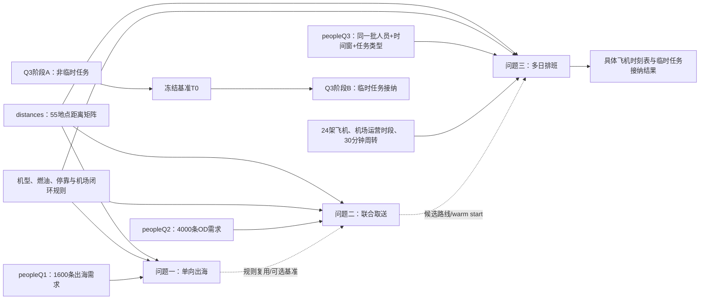

 
# B题：海上油田人员直升机运载计划编排

题面：[[联赛题目/题目/2026年度“策联杯”数学建模精英联赛-B题.md]]

逐问入口：[[联赛题目/B题/问题分析/问题一分析.md]] · [[联赛题目/B题/问题分析/问题二分析.md]] · [[联赛题目/B题/问题分析/问题三分析.md]]

> [!abstract] 一句话定位
> B题是一个逐层升级的运输优化题：问题一是**单向出海的带容量多站闭合路径编排**，问题二升级为**取送一体的联合运输**，问题三再叠加**时间窗、24架异构机队、多日排班以及临时任务的分层接纳**。三问的共同主目标都是总飞机使用时间，不能偷换成总距离、总油耗或总架次数。

> [!success] 当前证据边界
> 已核对题面PDF/Markdown，并对4个输入CSV和6个结果模板完成只读结构审计。本文可使用真实数据schema、OD规模、任务类别和时间窗统计，但尚未进行候选模型比较、求解或全局可行性证明。完整数据证据见[[联赛题目/B题/问题分析/数据审计报告.md]]。

## 1. 总体任务结构

### 1.1 三问分别是什么类型

| 分问 | 主要类型 | 数学本质 | 主要输出 |
|---|---|---|---|
| 问题一 | **优化/决策 + 网络路径** | 1600名出海人员的异构机型、起飞机场、人员合并、停靠顺序与加油决策 | `q1-assignments.csv`、`q1-routes.csv`及五项汇总指标 |
| 问题二 | **取送路径优化 + 装载调度** | 4000名出海、海返和穿梭人员在同一闭合架次内联合上下机 | `q2-assignments.csv`、`q2-routes.csv`及五项汇总指标 |
| 问题三 | **带时间窗的异构车队排程 + 分层多目标优化** | 24架具体飞机在7日窗口内执行多架次，先保障非临时任务，再在不增加基准总飞机使用时间下最大接纳临时任务 | `q3-assignments.csv`、`q3-routes.csv`、临时任务满足情况及五项汇总指标 |

这里没有预测或统计推断任务，核心是构造满足规则的运输计划并比较优化指标。问题三中的任务类别也不是分类标签预测，而是业务优先级和可取消性规则。

### 1.2 跨问题数据流

题面明确 `peopleQ1` 是 `peopleQ2` 中出海人员的子集，`peopleQ3` 与 `peopleQ2` 的人员编号及起终点相同。因此三问共享数据与规则并逐步增加难度，但**不存在必须把前一问最优解作为后一问输入的题给依赖**：Q1结果对Q2只可作基准或初始化，Q2路线对Q3只可作候选结构或warm start。唯一必须冻结的求解结果依赖是Q3内部“阶段A得到 $T_0$ → 阶段B在该预算下接纳临时任务”。

| 子问题 | 必需上游结果 | 可选复用 |
|---|---|---|
| Q1 | 无 | — |
| Q2 | 无 | Q1的闭合路线、燃油和校验逻辑；Q1结果作基准 |
| Q3 | 无Q2结果依赖；内部依赖阶段A的 $T_0$ | Q2路线作候选架次或warm start，必须重新验证时刻和具体飞机 |

### 1.3 共同规则与统一口径

| 类别 | 统一规则 |
|---|---|
| 地点 | 3座机场 `A01`—`A03`、52座海上设施 `F001`—`F052`，共55个地点 |
| 架次 | 从某机场起飞，最多发生5次海上着陆，最后返回**同一机场**；不得在另一机场中转或结束 |
| 人员 | 一名人员只能由一个架次从起点送至终点，不能换乘；同站先下后上 |
| `LAND` | 可接受任一机场；若写具体机场，则必须使用该机场 |
| 机型 | T1/T2/T3分别有12/16/19座，速度、单位里程油耗、油箱和安全余油不同 |
| 燃油 | 每个架次机场满油起飞；到达每一地点后剩余油量不低于安全余油；仅8个指定设施可选择加满 |
| 停靠 | 不加油至少10分钟，加油至少20分钟；等待可延长 |
| 时间 | 所有计算时间向上取整到整数分钟；架次使用时间包括飞行、停靠和等待 |
| 容量 | 每一航段机上人数不超过该架次机型座位数，必须按上下机事件逐段更新，不能只看总运送人数 |

### 1.4 共同指标定义

设架次集合为 $R$，架次 $r$ 的访问序列为 $v_{r,0},\ldots,v_{r,m_r}$，首末为同一机场；机型为 $k_r$，速度为 $s_{k_r}$，单位距离油耗为 $c_{k_r}$，座位数为 $Q_{k_r}$。令

$$
\tau_{ab}^{(k)}=\left\lceil\frac{60d_{ab}}{s_k}\right\rceil
$$

为机型 $k$ 从 $a$ 到 $b$ 的整数分钟飞行时间。对中间停靠 $h$，最低停靠时间为

$$
\sigma_h=\begin{cases}
20,&\text{该站加油},\\
10,&\text{该站不加油}.
\end{cases}
$$

则在没有额外等待时，架次基础使用时间为

$$
T_r=\sum_{h=0}^{m_r-1}\tau_{v_{r,h},v_{r,h+1}}^{(k_r)}+
\sum_{h=1}^{m_r-1}\sigma_h.
$$

问题三若为满足时间窗而延长停靠，等待时间也必须加入 $T_r$。统一评价量为：

| 指标 | 建议严格口径 |
|---|---|
| 总飞机使用时间 | $T^{air}=\sum_{r\in R}T_r$，而非机队排班跨度或飞行距离 |
| 人员总在途时间 | $T^{pax}=\sum_p(t_p^{arrive}-t_p^{depart})$，从飞机离开该人员起点到首次抵达其终点 |
| 总架次数 | $N^{flight}=|R|$ |
| 总燃油消耗 | $F=\sum_{r,h}c_{k_r}d_{v_{r,h},v_{r,h+1}}$；加油只重置油量，不改变已消耗量的统计方式 |
| 座位利用率 | $U=\dfrac{\sum_{r,h}n_{r,h}d_{r,h}}{\sum_{r,h}Q_{k_r}d_{r,h}}$，其中 $n_{r,h}$ 是该航段实际机上人数 |

### 1.5 目标优先级不能模糊

问题一、二要求“**在最小化总飞机使用时间的基础上**尽可能优化其他因素”。因此至少应采用词典序解释：

1. 第一层：最小化 $T^{air}$；
2. 在第一层最优值不恶化的解中，再改善人员在途时间、座位利用率、油耗或架次数；
3. 若实际求解只能得到近似解，应明确主目标容差，不能用任意加权和掩盖主目标的恶化。

题面没有规定次级指标之间的权重和顺序。它们可作为非支配比较或另设团队口径，但必须在论文中披露，不能伪装成题给规则。

### 1.6 全题真正的难点

1. **路径、装载和加油相互耦合**：访问顺序改变距离、飞行时间、燃油可达性与各航段人数；
2. **T1/T2/T3不存在绝对支配**：T1最快但座少且油耗高、无加油安全航程短；T2较省油；T3座位和航程最大但最慢；
3. **`LAND` 是决策自由度**：机场选择会影响闭合路线与后续问题三机队归属；
4. **问题二是带取送先后的路径**：必须在访问起点后才能携带穿梭/海返人员，且到达终点后第一次停靠就应下机；
5. **问题三是两阶段承诺**：先求非临时任务基准用时，再在不超过该值的约束下最大接纳临时任务，基准口径必须冻结。

---

# 问题一：单向出海运输

## 2. 题目原文提炼

为 `peopleQ1.csv` 中1600名出海人员编排机型、架次、起飞机场、停靠顺序、人员分配及必要的加油决策。不考虑时间窗与任务优先级，飞机数量无限。首要目标为总飞机使用时间最小；在此基础上改善其他指标，并提交两份逐行可校验的结果文件。

## 3. 数学本质判定

| 层次 | 判定 |
|---|---|
| 主类型 | 异构容量约束多站闭合路径与人员合并优化 |
| 需求结构 | 每名人员从某机场或 `LAND` 单向送至一个海上设施，没有海上上客 |
| 路线结构 | 每个架次从一座机场起飞、访问1—5个海上设施、返回同一机场 |
| 决策结构 | 机型、基地机场、人员分组、访问顺序、加油站选择共同决定可行性与主目标 |
| 不属于 | 不含时刻排班、有限机队冲突或业务优先级 |

## 4. 输入、输出与约束

| 维度 | 内容 |
|---|---|
| 已知输入 | 实测55×55距离矩阵；1600名人员、104个OD的 `person_id, origin_id, destination_id`；三种机型参数；8座可加油设施 |
| 待求输出 | 每名人员的机型、架次及上下机序号；每个架次的闭合访问序列及加油标志；五项汇总指标 |
| 硬约束 | 每人恰好安排一次；具体机场必须匹配、`LAND`可选机场；每架次最多5次海上着陆；首末同机场；逐航段座位不超限；燃油安全；加油仅限指定设施；CSV编号连续且引用一致 |
| 软约束 | 主目标最优后，人员在途时间更短、座位利用率更高、油耗和架次数更低；方案便于解释和复核 |

## 5. 关键逻辑与边界

### 5.1 人员在途时间不是整架次时间

出海人员从机场起飞时即开始计时，在其目的设施第一次被访问时结束。因此同一架次内，靠前目的地人员的在途时间较短；不能把所有乘员都记为整架次往返时间。

### 5.2 容量约束可简化但不能省略

本问中没有海上上客，机上人数只会随停靠下降。因此最大载客量出现在机场起飞后，等于该架次所载人员总数。即使如此，结果校验仍宜逐航段重算，以与问题二、三共用同一检查器。

### 5.3 重复停靠通常劣，但不是题面明令禁止

飞机再次返回同一设施仍计一次着陆。对纯出海任务，第二次访问同一目的地通常增加时间且没有送人必要；若解中出现，应给出由加油或其他约束导致的证据，否则视为可疑路线。

## 6. 常识与数量级校验

- 1600名人员的理论最低架次下界为 $\lceil1600/19\rceil=85$，实际还会受目的地分散、五次着陆、机场约束和燃油约束影响，因此不能声称85一定可行；
- T1、T2、T3从满油降至安全余油的无加油累计航程上限分别约为250、400、482.76 km；这是**两次加油之间的累计航程预算**，不是“每段都可飞这么远”；
- 一次架次中间最多5条海上设施记录，若输出6个不同海上设施或因重复访问造成6次海上着陆，立即违规；
- $0\le U\le1$；任何大于1的座位利用率都说明机上人数、容量或航段统计错误；
- 总飞机使用时间至少为全部架次纯飞行时间加每次中间停靠的最低10/20分钟，不能只用总距离除以速度。

## 7. 与后续问题的关系

问题一建立最基础的路线、机型、油量和文件校验口径。问题二保留这些规则，但允许在海上设施上客，导致机上人数可以上升；因此问题一的“起飞载客量即最大载客量”结论不能直接沿用。

## 8. 文献检索关键词

- 中文：海上平台直升机运输路径优化；异构机队容量约束路径；带加油站的航程约束路径；多仓库闭合车辆路径
- 英文：offshore helicopter routing; heterogeneous fleet capacitated routing; refueling-constrained vehicle routing; multi-depot closed route planning

---

# 问题二：出海、海返与穿梭联合运输

## 9. 题目原文提炼

为 `peopleQ2.csv` 中4000名出海、海返和海上设施间穿梭人员编排联合运载计划。时间窗、业务优先级和机队数量仍不纳入约束，优化层级与问题一相同。关键新增要求是人员可以在不同海上站点上、下机，但仍须全程乘坐同一架次。

## 10. 数学本质判定

| 层次 | 判定 |
|---|---|
| 主类型 | 异构机队取送路径优化（pickup-and-delivery routing） |
| 装载结构 | 同一站先下后上，容量随访问事件动态变化，释放的座位可立即复用 |
| 先后约束 | 每人的上机停靠序号严格小于下机停靠序号，且下机必须发生在上机后首次访问其终点时 |
| 网络特征 | 出海、海返和穿梭需求可在一个闭合架次内形成载客接力 |
| 核心难度 | OD配对、访问顺序、机型/机场、燃油及动态装载同时耦合 |

## 11. 输入、输出与约束

| 维度 | 内容 |
|---|---|
| 已知输入 | `peopleQ2.csv` 的4000人、264个OD需求（出海1600、海返1600、穿梭800）；距离矩阵；三种机型；可加油设施 |
| 待求输出 | 每人的具体架次及上下机序号；全部架次路线与加油决策；五项汇总指标 |
| 硬约束 | 继承问题一全部规则；同一人员不可换乘；起点在终点之前访问；同站先下后上；逐航段动态容量；首次到达终点即下机；每人必须安排 |
| 软约束 | 在主目标最小基础上，利用方向互补减少空座航段和额外绕行，并改善在途时间、油耗及架次数 |

## 12. 动态装载口径

设站点 $h$ 到站前机上人数为 $n_h^-$，该站下机人数为 $D_h$、上机人数为 $P_h$。题面规定先下后上，因此

$$
n_h^+=n_h^- -D_h+P_h,
$$

且必须同时满足

$$
0\le n_h^- -D_h,\qquad n_h^+\le Q_{k_r}.
$$

后一条航段的机上人数为 $n_h^+$。若先上后下校验，就会错误拒绝题面允许的“释放座位立即复用”方案。

## 13. 机场和方向兼容性

- 出海 `LAND→F`：实际起点等于该架次机场；
- 海返 `F→LAND`：实际终点等于该架次机场；
- 具体机场 `A0x→F` 或 `F→A0x`：架次必须从该机场出发并返回；
- 穿梭 `Fi→Fj`：只要同一闭合架次先访问 $F_i$ 再首次访问 $F_j$ 即可；
- 一个架次不能用另一机场接人，也不能以另一机场结束。

## 14. 常识与数量级校验

- 4000人按19座得到粗略装载下界 $\lceil4000/19\rceil=211$ 个“满座当量”，但由于同一座位可在一架次内先后服务多名人员，它**不是架次数下界**；问题二不能沿用问题一的简单除法下界；
- 每名穿梭人员必须满足 `pickupstoporder < deliverystoporder`；相等表示同站任务或填写错误；
- 某航段没有乘客仍可为返场或接人而飞行，但座位公里分子为0、分母仍计入；
- 联合运输应有机会优于分别执行三类任务的基准，但不保证所有实例都严格改进；应按同一主目标和同一指标重算比较；
- 任一人员的在途时间不得大于其所在架次总使用时间，且不得为负。

## 15. 与问题一、三的关系

问题二包含问题一的人员子集并扩展OD类型，建立问题三所需的取送路线结构。问题三的人员集合与问题二相同，但增加时间窗与任务类型；因此问题二可作为无时间约束的可行性/成本参照，却不能直接复制为问题三排班。

## 16. 文献检索关键词

- 中文：取送一体车辆路径；多站上下客联合运输；海上直升机人员调度；异构机队取送路径
- 英文：pickup and delivery vehicle routing; mixed pickup delivery routing; offshore helicopter transportation optimization; heterogeneous fleet pickup and delivery

---

# 问题三：带时间要求的多日排班

## 17. 题目原文提炼

在2026-08-03 00:00至2026-08-10 00:00的需求窗口内，使用题定24架具体飞机完成应急、增储上产和常规倒班任务，并处理可取消的临时任务。先不纳入临时任务，求得非临时任务的总飞机使用时间基准 $T_0$；再在总飞机使用时间不超过 $T_0$ 的条件下最大化已安排临时人员数，并继续改善其他指标。

## 18. 数学本质判定

| 层次 | 判定 |
|---|---|
| 主类型 | 带取送、时间窗、异构有限机队和多日运营窗的排班—路径联合优化 |
| 资源结构 | 24架具体飞机固定归属机场和机型，每架可执行多个架次但需30分钟周转 |
| 时间结构 | 人员上机离开起点不得早于最早时间，到达终点不得晚于最晚时间；飞机06:00—18:00起飞，20:00前返场 |
| 两阶段目标 | 阶段A以非临时任务建立基准；阶段B在 $T^{air}\le T_0$ 下最大化临时任务接纳数，再优化次级指标 |
| 输出结构 | 路线需精确到具体飞机和各站到离时刻，未安排临时任务也必须保留空白行 |

## 19. 输入、输出与约束

| 维度 | 内容 |
|---|---|
| 已知输入 | 与问题二同一批4000人和264个OD；最早/最晚时间与四类任务；24架飞机的机场—机型配置；距离、燃油、停靠与运营规则 |
| 待求输出 | 具体飞机逐架次、逐站到离时刻和加油；每人乘机及上下站序；临时任务满足数/率；五项汇总指标 |
| 硬约束 | 所有非临时任务必须安排；人员时间窗；飞机归属机场；06:00—18:00起飞、20:00前返场；不得海上过夜；同机相邻架次至少30分钟周转；路径、容量、燃油和五次着陆规则；阶段B总用时不超 $T_0$ |
| 软约束 | 首先接纳尽可能多的临时人员；同样接纳数下再改善人员在途时间、座位利用率、油耗和架次数 |

## 20. 时间传播与整数分钟口径

对同一架次，相邻站点时刻应满足

$$
a_{h+1}=d_h+\left\lceil\frac{60d_{v_hv_{h+1}}}{s_k}\right\rceil,
$$

中间站点则满足

$$
d_h-a_h\ge 10+10\cdot refuel_h,
$$

并可为等待时间而更长。对乘员 $p$：

$$
d_{pickup(p)}\ge e_p,\qquad a_{delivery(p)}\le l_p.
$$

注意最早时间约束作用在**飞机离开人员起点的时刻**，不是飞机抵达起点的时刻。架次首行只有 `departure_time`，末行只有 `arrival_time`；中间站必须同时填到、离时刻。

## 21. 有限机队与多架次排班

若飞机 $a$ 的第 $f$ 个架次返场时刻为 $A_{a,f}$、下个架次起飞为 $D_{a,f+1}$，则

$$
D_{a,f+1}\ge A_{a,f}+30\text{ min}.
$$

每架飞机的 `flight_no` 要按起飞时刻从1连续编号。机场与设施无并发容量限制，因此同一时刻多架飞机使用同一地点并不违规；不要擅自加入跑道、停机坪或加油站容量约束。

## 22. 临时任务的两阶段口径

这是问题三最重要且最容易写错的地方。建议严格定义：

1. **基准阶段**：仅使用 `emergency/production/shift` 人员，所有这些人员必须满足，求其主目标最小值 $T_0$；
2. **接纳阶段**：允许加入 `temporary`，约束 $T^{air}\le T_0$，第一目标最大化已安排临时人员数 $N_{temp}$；
3. **次级优化**：在 $N_{temp}$ 最大且不破坏 $T^{air}\le T_0$ 时，再优化其他因素；
4. `q3-assignments.csv` 中每名临时人员都保留一行；未安排时后四列全部为空。

“按业务性质优先级处理”与“只有临时任务可取消”共同意味着应急、增储上产和常规倒班不是可随意牺牲的对象。题面没有说明这三类可欠服务，因此当前按全部硬满足解释；若附件或官方说明另有规定，再更新证据登记表。

## 23. 常识与数量级校验

- 机队总数为24架，逐机场均为8架；机型合计T1/T2/T3分别为7/10/7架；
- 规划期需求时间覆盖7个自然日；每架飞机理论上可执行多个架次，但任一架次必须当日20:00前回到所属机场；
- 飞机若18:00起飞，只能执行不超过120分钟的架次；并非所有路线都适合18:00起飞；
- 相邻架次若前一架20:00返场，下一架次只能在次日06:00以后，30分钟周转已经被夜间间隔覆盖；
- 若阶段B安排了临时任务却令 $T^{air}>T_0$，无论增量多小都不满足题意；
- 所有非临时人员安排字段不得为空；临时人员的满足率分母必须是全部临时人员数，而非被尝试安排的人数。

## 24. 与前两问的关系

问题三继承问题二的OD、动态上下客和路线规则，但增加时间轴与实体飞机资源。问题二可提供路线结构或上界参考；问题三必须重新验证每个时间窗、每架飞机的不重叠和周转、每天运营窗以及阶段性目标约束。

## 25. 文献检索关键词

- 中文：带时间窗取送路径；异构机队多日排班；直升机机队调度；选择性取送路径；词典序多目标调度
- 英文：pickup and delivery problem with time windows; heterogeneous fleet scheduling; offshore helicopter fleet scheduling; selective pickup and delivery; lexicographic multiobjective scheduling

---

# 26. 数据与文件接口审计

## 26.1 题面声明的输入文件

| 文件 | 实测结构 | 当前状态 | 已完成的P0检查 |
|---|---|---|---|
| `distances.csv` | 55行、55个距离列及1个行ID列 | 已审计 | 行列地点集合一致；对称；无缺失/负值；非零距离14—579 km |
| `peopleQ1.csv` | 1600行、3列、104个OD | 已审计 | ID唯一、全部出海、无缺失/非法地点，是Q2同ID同OD子集 |
| `peopleQ2.csv` | 4000行、3列、264个OD | 已审计 | 出海1600、海返1600、穿梭800；无缺失/重复/非法地点 |
| `peopleQ3.csv` | 4000行、6列、264个OD | 已审计 | 与Q2逐ID同OD；四类任务；无逆窗；窗宽28—8691 min |

> [!important] 数据规模含义
> Q3按“OD+最早+最晚+业务类型”完全一致聚合后仍有1877组，最大组13人；最窄时间窗只有28分钟。附件结构通过审计不等于全局排班必然可行，模型仍须显式处理燃油、停靠、容量、时间窗和24架具体飞机。

## 26.2 输出模板与命名

原PDF明确使用 `q1-assignments.csv`、`q1-routes.csv`，不是Markdown转换中偶见的 `ql-*`（小写字母l）误读。建议所有代码、论文和结果文件统一使用原PDF命名。

| 问题 | 路线文件关键主键 | 人员文件关键主键 |
|---|---|---|
| Q1/Q2 | `aircraft_type + flight_no + stop_order` | `person_id`，并外键引用机型+架次+上下站序 |
| Q3 | `aircraft_id + flight_no + stop_order` | `person_id`，并外键引用具体飞机+架次+上下站序 |

## 26.3 输出前必须自动验收

1. 表头、编码、大小写、行数和空值规则与模板完全一致；
2. 每个路线的停靠序号从0连续，首末为所属同一机场；
3. 每个人员引用的停靠序号存在，起终点匹配且上机早于下机；
4. 下机站是上机后路线第一次访问该终点的位置；
5. 逐航段重算人数、距离、时间、油量和五项汇总指标；
6. Q3各时刻精确满足整数分钟递推，具体飞机无架次重叠且周转不少于30分钟；
7. Q3未安排临时人员只有后四列为空，非临时人员不得缺排；
8. 结果表结构不可擅自增删列，解释性中间量另存辅助文件。

---

# 27. 当前歧义、风险与待确认项

| 优先级 | 事项 | 当前解释/处理 |
|---:|---|---|
| 已关闭 | 4个输入CSV及6个模板已上传 | 已完成schema、主键、OD、时间窗、模板和跨文件一致性审计，见[[联赛题目/B题/问题分析/数据审计报告.md]] |
| P0 | 次级目标无权重和严格顺序 | 保留为主目标最优集上的多指标比较，不擅定题给权重 |
| P0 | 问题三基准 $T_0$ 必须是非临时任务的最小总用时 | 若仅用任意可行方案作基准，会人为放宽临时任务接纳空间 |
| P1 | 问题三是否要求前三类业务再作严格优先级层级 | 当前依据“只有临时任务可取消”将前三类全部视为硬满足；业务顺序用于冲突处理，不允许欠服务 |
| P1 | 等待时间是否可发生在任一海上站 | 题面称“需要等待时可以延长”，当前允许延长中间停靠；机场起飞也可在运营窗内选择更晚时刻 |
| P1 | 同一海上设施可否重复访问 | 题面明确重复访问仍计着陆，故不禁止，但总次数仍不超过5 |
| P2 | 距离矩阵是否严格对称、是否满足三角不等式 | 附件到位后实测，不能先验假定欧氏或公路式距离性质 |

# 28. 当前分析结论

1. B题三问的准确类型依次是：**单向容量路径优化 → 联合取送路径优化 → 带时间窗和有限异构机队的多日排班/选择性服务优化**；
2. 最关键口径是把“总飞机使用时间”作为词典序主目标，且时间包括飞行、最低停靠和必要等待；
3. 机场闭环、最多5次海上着陆、逐航段容量、逐站安全余油和首次到达终点下机是三问共同硬约束；
4. 问题三必须先冻结非临时任务最优基准 $T_0$，再在不增加总用时下尽量“搭载”临时人员；
5. 数据schema与接口已完成审计；下一步应补齐少量变量和解释口径并执行Stage 2复审，复审通过后再进入候选模型比较，当前仍不生成优化结果。
