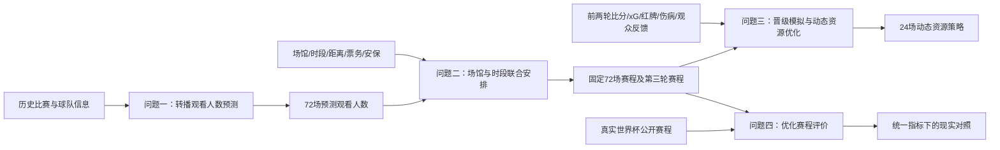
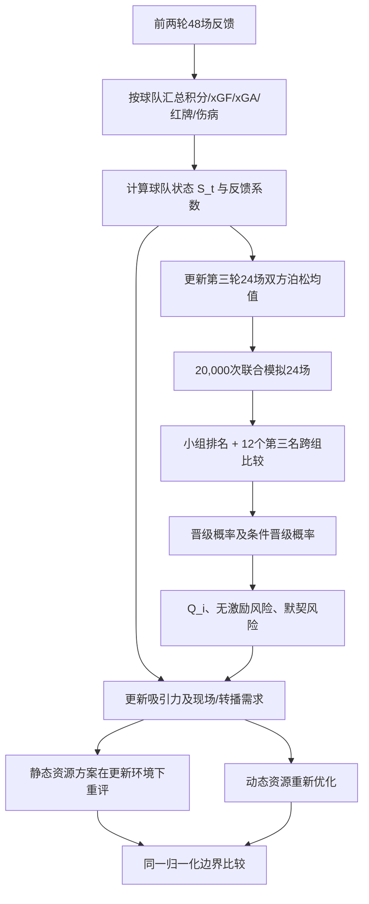

# C题：基于大数据驱动的足球世界杯赛事预测与赛程资源协同优化

题面：[[联赛题目/题目/2026年度“策联杯”数学建模精英联赛-C题.md]]

> [!abstract] 一句话定位
> C题不是单一预测题，而是“**需求预测 → 赛程优化 → 赛中反馈更新与资源再优化 → 现实赛程对标评价**”的四阶段决策链。其数学类型依次为监督回归、带多类业务约束的组合优化、Monte Carlo条件模拟与动态资源优化、同口径多指标评价。

> [!warning] 当前证据边界
> 已按2026-08-13更新后的题面重新分析；当前 vault 中尚未发现《C题数据附件.xlsx》及六个输出模板，因此本文中的表规模仅采用题面明确给出的48队、12组、72场、16场馆、80时段、24场第三轮和20,000次模拟。附件到位后必须再做主外键、单位、时间、缺失、可行性和泄漏审计。

## 1. 总体任务结构

### 1.1 四问分别是什么类型

| 分问 | 主要类型 | 数学本质 | 主要输出 |
|---|---|---|---|
| 问题一 | **监督回归预测 + 特征工程** | 根据赛前可得信息预测连续型转播观看人数 | 隐藏测试集预测、72场小组赛预测 |
| 问题二 | **多目标约束组合优化 + 赛程调度** | 为72场比赛联合分配场馆和时段，最大化给定综合目标 | 可执行赛程及总目标值 |
| 问题三 | **随机模拟 + 动态资源配置优化** | 根据前两轮反馈更新晋级概率、需求和风险，在固定第三轮赛程上重配资源 | 24场动态策略及相对静态方案的改善 |
| 问题四 | **外部数据采集 + 综合评价/基准对照** | 将一届真实世界杯赛程与优化方案按同一指标、权重和标准化口径比较 | 指标对照表、差异解释与稳健性结论 |

### 1.2 跨问题数据流

### 1.3 成败关键

1. **统一数据契约**：球队、比赛、场馆、时段和日期主键必须跨表一致；
2. **赛前信息边界**：问题一禁止使用比赛结束后才能知道的字段作为预测特征；
3. **可行性优先**：问题二先做到全部硬约束零违例，再谈目标值；
4. **随机模拟可复现**：问题三固定随机种子，并核对晋级规则与并列权重；
5. **归一化口径冻结**：问题二、三、四必须记录每项指标的方向、上下界和作用层级；
6. **跨问误差传播**：问题一预测误差会影响问题二赛程，问题二又固定问题三的场馆和时段。

---

# 问题一：赛事数据分析、特征工程与转播观看人数预测

## 2. 题目原文提炼

利用 `historicalmatches` 的固定日期划分训练集和隐藏标签测试集，分析球队实力、赛事类型、比赛阶段、球迷基础、悬念和时区区域等因素与转播观看人数的关系。以测试集MSE作为官方评价，同时预测模拟赛事的72场小组赛。最终须生成：

- `result1testprediction.csv`：测试集观看人数，单位为**百万人**；
- `result1matchprediction.csv`：72场模拟小组赛观看人数，单位为**人**。

## 3. 数学本质判定

| 层次 | 判定 |
|---|---|
| 目标类型 | 非负、可能右偏的连续变量回归 |
| 泛化结构 | 按日期固定的未来测试集泛化，不是随机插值 |
| 特征结构 | 比赛级双队对称特征、类别特征、时间特征和赛前市场特征 |
| 评价 | 测试集百万人尺度MSE；大误差受到平方惩罚 |
| 核心风险 | 赛后变量泄漏、日期泄漏、单位错误、球队A/B编码不对称、训练—模拟赛事分布漂移 |

## 4. 输入、输出与约束

| 维度 | 内容 |
|---|---|
| 已知输入 | `historicalmatches`公开字段、`datasetsplit`；`teams`静态属性；`groupsmatches`的72场对阵；`basepredictions`参考竞技信息 |
| 待求输出 | 主要规律和特征解释；固定测试集逐场预测；72场逐场预测；内部验证误差与不确定性 |
| 硬约束 | 固定官方train/test划分；测试标签不可见；输出行数、ID、字段顺序和单位严格遵守模板；只能使用预测时可获得的信息 |
| 软约束 | 预测非负；模型对极端热门比赛不过度缩减；球队交换次序不应导致无意义的大幅变化；结论可解释 |

## 5. 特征可用性审计

### 5.1 原则上可作为赛前特征

| 特征族 | 代表字段/构造 | 说明 |
|---|---|---|
| 球队实力 | Elo、实力排名/得分、双方差值与总量 | 应同时表达强弱差和总体强度 |
| 球迷与商业基础 | `fanbaseindex`、球星指数、市场价值、东道主标识 | 双方总量通常对应潜在受众，差值对应关注结构 |
| 赛事语境 | `competition`、`stage`、中立场、比赛日期 | 世界杯淘汰赛与友谊赛受众机制不同 |
| 赛前悬念 | 赔率隐含概率、概率熵/最大概率、Elo差 | 赔率应先去除水位并只使用赛前版本 |
| 时区区域 | 两队主要球迷时区组合 | 历史表未见明确开球时刻字段时，只能构造较粗区域特征 |
| 历史表现 | 严格截至比赛日期以前的滚动Elo、近期战绩等 | 必须按时间排序并只用过去信息 |

### 5.2 原则上不可用于赛前观看人数预测

`goalsa/goalsb`、`xga/xgb`、`shotsa/shotsb`、`possessiona/possessionb`、实际 `attendance` 都是比赛结束后或进行中才完整可知的变量。若用于预测赛前转播需求，会造成目标泄漏。它们可用于历史描述、构造**仅基于过去比赛的球队滚动状态**，但不能直接使用当前场数值。

### 5.3 对称性要求

题面明确A/B仅为记录顺序而非主客场。因此特征宜以双方总量、绝对差、最大/最小值或成对交互表达，并进行“交换A/B后预测基本一致”的测试。否则模型可能从任意行顺序学习伪规律。

## 6. 验证与数据泄漏边界

- 官方test标签隐藏，不能据其结果调参；
- 内部验证应使用训练集内部更早日期训练、更晚日期验证，模拟官方日期切分；
- 球队历史滚动特征必须在每场比赛日期前截断；
- 预处理器、缺失填补、编码和标准化只能在内部训练折拟合；
- 若同一球队跨越训练与验证，这本身不是泄漏，但球队状态特征不能使用验证日期之后的信息；
- 应设置不含复杂历史特征的简单基准，以证明新增特征确有稳定增益。

## 7. 评价与输出检查

官方指标为：

$$
MSE=\frac1n\sum_{j=1}^{n}(\widehat y_j-y_j)^2,
$$

其中测试文件按**百万人**计算。72场文件则按**人**输出，所以必须存在显式单位转换：

$$
\widehat V_{person}=10^6\widehat V_{million}.
$$

输出前至少验证：行数与模板一致、`matchid`一一匹配、无负数/缺失、单位数量级合理、A/B交换稳定、72场结果与问题二读取单位一致。

## 8. 与后续问题关系

问题一的72场预测是问题二转播价值 $B$ 的直接输入，也是问题三赛前转播需求 $V_i^{pre}$ 的输入。预测偏差不仅影响MSE，还可能改变优质时段和资源分配，因此后续应检验观看人数扰动时赛程与资源决策是否稳定。

## 9. 文献检索关键词

- 中文：足球赛事收视率预测、体育观众需求特征工程、时间切分回归验证
- 英文：football TV audience prediction, sports viewership forecasting, temporal validation target leakage

---

# 问题二：小组赛场馆与开球时段协同优化

## 10. 题目原文提炼

对72场比赛分别确定一个场馆和一个开球时段，在满足唯一安排、场馆冲突、轮次顺序、至少60小时休息、场馆日/总容量、黄金时段公平、安保适配与日容量、转播并发容量等规则下，最大化题给固定权重的综合目标：

$$
Z_2=0.25T+0.25B+0.15U+0.10H-0.08C-0.07D-0.06F-0.04R.
$$

## 11. 数学本质判定

| 层次 | 判定 |
|---|---|
| 主问题 | 多索引0—1组合优化与赛程调度 |
| 决策耦合 | 比赛—场馆—时段联合分配，旅行负担跨轮关联，场馆启用成本含固定费用 |
| 目标结构 | 八指标固定权重综合评价，含方案级公平性和归一化 |
| 可行性 | 多资源容量、时间顺序、安全资格与公平约束并存 |
| 难点 | 归一化对象不清会改变目标；旅行定义与实际所选上一场场馆并不完全一致 |

## 12. 决策变量、输入、输出与约束

可用抽象变量表示：

$$
x_{ivs}=\begin{cases}
1,&\text{比赛 }i\text{安排在场馆 }v\text{和时段 }s,\\
0,&\text{否则。}
\end{cases}
$$

并需用场馆启用变量记录一次性成本。若旅行按实际连续路线计算，还需跨相邻轮次的联动变量；但题面给出的基准旅行口径对第二、三轮采用“上一轮全部合格候选场馆到本轮场馆的平均负担”，应优先严格复现该口径，不可静默替换。

| 维度 | 内容 |
|---|---|
| 已知输入 | 72场对阵、16场馆、80时段、球队/场馆距离、票务与转播参数、问题一预测、基准竞技指标、安保需求、资源限制和固定权重 |
| 待求输出 | 每场唯一 `venueid` 与 `slotid`、派生日期/城市/UTC、各评价项、整套方案 $Z_2$ |
| 硬约束 | 题面a—f全部规则；场馆安保能力不低于比赛需求；第三轮日高等级安保容量；输出模板一致 |
| 软约束 | 收益、转播、悬念和吸引力高；组织成本、旅行、公平惩罚和风险低；方案易执行 |

## 13. 硬约束清单

1. 每场比赛恰好选择一个场馆—时段组合；
2. 同一场馆同一UTC时刻至多一场；
3. 每队比赛按第1、2、3轮顺序，且相邻轮开球至少间隔60小时；
4. 场馆按**当地日期**的场次数不超过 `maxmatchesperday`；
5. 各场馆总场次在 `mintotalmatches` 与 `maxtotalmatches` 之间；
6. 同一UTC时刻的比赛数不超过该时刻 `broadcastcapacity`；
7. 比赛最低安保等级不超过所选场馆能力；
8. 每个参考日内第三轮高需求比赛数不超过相应高安保容量；
9. 任意两队获得的全球黄金时段次数差不超过2；
10. 所有输出ID、日期、当地时刻与UTC时刻能由主表反查一致。

## 14. 八个评价指标的作用层级

| 指标 | 层级 | 主要来源 | 方向 |
|---|---|---|---|
| $T$票务收益 | 场次求和 | 基础票价×预计现场观众 | 越大越好 |
| $B$转播价值 | 场次求和 | 问题一观看人数×单位价值×时段价值×赞助权重 | 越大越好 |
| $U$悬念 | 场次求和/平均 | `uncertaintyindex` | 越大越好 |
| $H$吸引力 | 场次求和/平均 | `attractivenessindex/100` | 越大越好 |
| $C$成本 | 方案级 | 场馆启用、运营、安保成本 | 越小越好 |
| $D$旅行 | 跨轮/场次 | 距离、时间、时区差标准化加权 | 越小越好 |
| $F$公平惩罚 | 方案级 | 黄金时段次数与大场馆次数极差 | 越小越好 |
| $R$风险 | 场次求和/平均 | 气候、预计上座率、安全供需比 | 越小越好 |

题面要求Min-Max标准化，但必须在实现前冻结：哪些指标先按场次汇总、上下界来自全部候选组合还是可行方案集合、负向指标是否直接以减号进入。若最大值等于最小值，标准化值为0。

## 15. 规模与常识校验

- 原始三维候选上界为 $72\times16\times80=92{,}160$ 个比赛—场馆—时段组合；安保、轮次和日期预筛后应显著减少；
- 16个场馆的最小承办场次之和必须不超过72，最大承办场次之和必须不少于72，否则整体不可行；
- 每队3场且相邻两轮至少60小时，因此同一队第1轮到第3轮的跨度至少120小时；
- 全球黄金时段次数每队为0—3，题面差不超过2意味着不能同时出现0次与3次；
- “当地日期场馆容量”与“参考日期安保容量”属于不同日期口径，不能混用。

## 16. 结果验收

必须先建立独立可行性检查清单，验证72行、每场一次、所有冲突和容量为0违例，再计算目标值。还需重算 `expectedattendance`、收益、旅行、公平和风险，确认CSV中的派生列不是手工填入。目标值只写在 `totalobjectivevalue` 第一条记录，其余留空。

## 17. 文献检索关键词

- 中文：足球赛程场馆时段联合优化、多资源赛程公平、赛事旅行负担优化
- 英文：sports tournament venue time-slot assignment, fair scheduling MILP, broadcast-aware tournament scheduling

---

# 问题三：前两轮反馈下的第三轮动态资源优化

## 18. 题目原文提炼

保持问题二确定的24场第三轮比赛、场馆和开球时间不变。以所有第三轮开赛前的同一信息截面，汇总前两轮比分、xG、红牌、伤病、现场与转播反馈，更新球队竞技状态和第三轮进球均值；同时模拟24场第三轮比赛20,000次，计算晋级概率、晋级重要性和风险。随后为每场选择转播、安保、交通等级及票价调整，使更新环境下的总净效益最大，并与赛前信息下先优化后冻结的静态方案公平比较。

## 19. 数学本质判定

| 层次 | 判定 |
|---|---|
| 状态更新 | 由前两轮数据确定球队状态、伤病和需求反馈系数 |
| 随机模拟 | 基于更新泊松均值同时模拟24场第三轮及32强晋级 |
| 动态决策 | 固定赛程下，为24场重新配置四类资源 |
| 对照实验 | 静态与动态决策在同一更新环境、同一归一化边界下评价 |
| 关键风险 | 条件晋级概率计算错误、第三轮信息串行泄漏、并列晋级处理错误、静动态归一化不一致 |

## 20. 输入、决策变量、输出与约束

| 维度 | 内容 |
|---|---|
| 已知输入 | 问题二固定第三轮赛程；问题一赛前转播需求；前两轮实际结果与反馈；基准期望进球、吸引力、现场需求；场馆能力；每日资源限制与成本表 |
| 决策变量 | 每场转播优先级、安保等级、交通等级和连续票价调整比例 $\delta_i$ |
| 待求输出 | 双方晋级概率、更新现场/转播需求、无激励与默契风险、更新吸引力、四类资源建议、价值/成本/风险、静动态净值和改善率 |
| 硬约束 | 第三轮赛程固定；同一信息截面；20,000次联合模拟；安保等级上下界；逐日高等级资源容量和预算；票价上下界及上座率保底约束 |
| 软约束 | 票务、转播与吸引力高；资源成本和剩余风险低；动态方案相对静态方案有稳定改善 |

## 21. 计算链拆解

## 22. 模拟口径的关键解释

1. 24场第三轮必须在每次Monte Carlo复制中**同时生成**，因为8个最佳第三名跨12组竞争；
2. 全部第三轮都只使用赛前同一截面，不能先模拟某场再把其结果用于下一场；
3. 每组按积分、净胜球、总进球排序；仍完全相同则等比例分摊晋级权重；
4. $p_t$ 是总晋级概率，而 $p_t^D,p_t^W$ 是对特定比赛结果条件化后的晋级概率；必须从同一批模拟中筛选条件事件；
5. 条件事件样本过少时，条件概率方差会很大，应报告有效模拟次数；
6. 固定随机种子，并用多种种子检查晋级概率与资源配置稳定性。

## 23. 题面公式回源风险

更新版Markdown修复了大量旧OCR错误，但问题三仍残留明显疑点，例如动态安保式中出现“$50_i$”的识别结果、部分标点导致变量连接不清，以及模板字段在正文解析中被换行拆分。正式编码前必须回看原PDF公式和原始Excel字段；不得直接以当前OCR字符串为代码字段名或公式依据。

## 24. 静态—动态比较必须公平

静态方案并非“随便选的基线”，而是：

1. 在问题二固定第三轮赛程上；
2. 使用赛前现场需求、转播需求、吸引力和赛前风险；
3. 在与动态方案完全相同的候选决策、每日容量和预算下先优化；
4. 前两轮结束后冻结四项资源决策；
5. 用更新后的需求与风险重新评价。

动态方案则在相同更新环境下重新优化。两者必须共用同一组Min-Max上下界，否则 `improvementrate` 没有可比意义：

$$
\text{improvementrate}_i=
\frac{\text{dynamicnetvalue}_i-\text{staticnetvalue}_i}
{|\text{staticnetvalue}_i|}.
$$

分母为0时按题意留空。

## 25. 常识校验

- 每队前两轮均应有 $G_t=2$，若不为2说明比赛或球队聚合错误；
- $S_t,Q_i,A_i,F_i,R_i^{stake},R_i^{col},d_i$ 等被定义在 $[0,1]$ 的量必须逐项检查边界；
- 每次模拟应产生24场比分、48支球队的最终积分，并恰好分配32个晋级权重；
- 每日三级转播、三级交通、三级及以上安保数量和总预算不得超限；
- 推荐安保等级不得低于比赛需求，也不得高于场馆能力；
- 票价变化后预计上座不得低于同一交通等级、零调价情景的88%；
- 静态和动态的净值需用更新环境和同一上下界重算。

## 26. 文献检索关键词

- 中文：足球晋级概率泊松模拟、体育赛事动态资源配置、足球默契球风险
- 英文：football qualification probability Monte Carlo, dynamic event resource allocation, competitive balance collusion risk

---

# 问题四：实际赛程获取与优化方案综合评价

## 27. 题目原文提炼

选择一届已结束、采用四队小组且每队三场小组赛的世界杯，从可靠公开来源采集其实际赛程。用问题二相同的指标定义、标准化方法和基准权重，对真实赛程与本队优化赛程比较旅行、休息、跨时区、场馆利用、容量匹配、黄金时段、观众、票务/转播价值、公平和风险，并讨论现实赛程约束和结论稳健性。

## 28. 数学本质判定

| 层次 | 判定 |
|---|---|
| 主类型 | 多指标同口径比较评价 |
| 数据任务 | 外部实际赛程采集、时区转换、实体映射与来源追溯 |
| 可比性问题 | 真实赛事规模、队伍、场馆和地理范围可能与48队模拟赛事不同 |
| 推断边界 | 比较的是指标表现，不是证明优化方案在真实制度下必然可实施 |

## 29. 输入、输出与约束

| 维度 | 内容 |
|---|---|
| 已知输入 | 问题二优化赛程；一届已结束世界杯的公开赛程；问题二指标定义、固定权重和标准化方法 |
| 待求输出 | 真实赛程清洗表、逐指标实际值与优化值、绝对差、方向一致的相对改善、综合评价和稳健性 |
| 硬约束 | 选择四队小组且每队3场；每行保留来源URL与获取日期；UTC转换正确；同名指标使用同一定义和方向 |
| 软约束 | 优先权威一手来源；差异解释考虑现实限制；对规模差异做标准化；避免把模拟商业数据伪装成真实历史值 |

## 30. 对标对象与可比性

可选择2022、2018等已结束男子世界杯小组赛。由于这些赛事通常为32队、8组、48场，而题面模拟为48队、12组、72场，绝对总量不可直接比较。应优先使用：

- 每场平均旅行距离、每队总旅行距离；
- 平均/最小休息时间和低于某阈值的比例；
- 每队跨时区次数；
- 场馆利用率、日峰值利用率、容量匹配率；
- 每队黄金时段和大场馆次数的极差/标准差；
- 人均、每场或相对理论容量标准化的收益与风险指标。

如果真实赛程缺乏题面中的模拟字段（如 `climaterisk`、安保成本指数、预测观看人数），必须明确采用何种可比代理或将该指标标为不可直接识别，不能随意赋值。

## 31. 指标方向与改善率

设实际值为 $a_k$、优化值为 $o_k$。绝对差统一为 $o_k-a_k$；相对改善需依偏好方向定义：

$$
RI_k=\begin{cases}
(o_k-a_k)/|a_k|,&\text{higher},\\
(a_k-o_k)/|a_k|,&\text{lower}.
\end{cases}
$$

目标型指标则比较其距目标的偏差变化。若实际值为0，应留空或另报绝对差。这样正值才统一代表改善。

## 32. 现实因素解释边界

实际世界杯赛程还受电视合同、主办国政治与交通安排、场馆施工、气候、安保、赞助、球队抽签、同组末轮同时开球等制度影响。题面模拟规则并未覆盖全部现实约束。因此即使优化方案在给定指标上更高，也只能说明其在**本题固定评价体系**下更优，不能直接断言真实组织者安排不合理。

## 33. 稳健性检查

1. 改变规模标准化口径后，主要排序是否保持；
2. 对问题二固定权重做小范围扰动，综合结论是否反转；
3. 使用共同指标子集与扩展指标集时结论是否一致；
4. 问题一观看人数预测上下浮动时，票务/转播比较是否稳定；
5. 对真实赛程缺失字段采用不同合理代理时，结论是否稳健；
6. 分别报告总体平均与最差球队/最繁忙场馆，避免均值掩盖公平问题。

## 34. 文献与数据检索关键词

- 中文：世界杯小组赛赛程 场馆 开球时间 官方、世界杯赛程公平 旅行距离评价
- 英文：FIFA World Cup match schedule official PDF, World Cup scheduling fairness travel distance, tournament schedule benchmarking

---

# 35. 综合常识校验与工作优先级

## 35.1 跨问题一致性

| 接口 | 必须一致的内容 | 常见错误 |
|---|---|---|
| Q1→Q2 | 72个 `matchid`、双方球队、预测人数单位为人 | 把百万人直接带入商业价值 |
| Q2→Q3 | 第三轮24场的比赛、场馆、时段、日期和预计需求 | 第三轮赛程被动态优化时误改 |
| Q2/Q3 | 场馆安保能力、每日高等级安保容量 | 当地日期与参考日期混用 |
| Q3静态/动态 | 候选决策、约束、更新环境和归一化边界 | 两方案各自归一化造成虚假改善 |
| Q2→Q4 | 指标定义、方向、权重和归一化规则 | 只比较总量而忽略赛事规模不同 |

## 35.2 当前优先级

1. 获取并审计《C题数据附件.xlsx》和全部模板；
2. 建立跨表数据字典、主外键和单位清单；
3. 锁定问题一赛前可用字段及日期验证；
4. 建立问题二硬约束可行性检查器；
5. 回看PDF核准问题三残损公式和模板字段；
6. 冻结所有标准化上下界与指标层级；
7. 再进入模型选择和算法设计。

## 35.3 总体判断

C题具备很强的展示性，但不是“预测模型越复杂越好”。最容易失分的环节是数据泄漏、人数单位、时间/时区、赛程硬约束、问题三条件模拟和跨方案归一化。最稳妥的论文主线应强调：**可靠预测、零违例赛程、同一信息截面的动态更新、同口径现实对标**。

