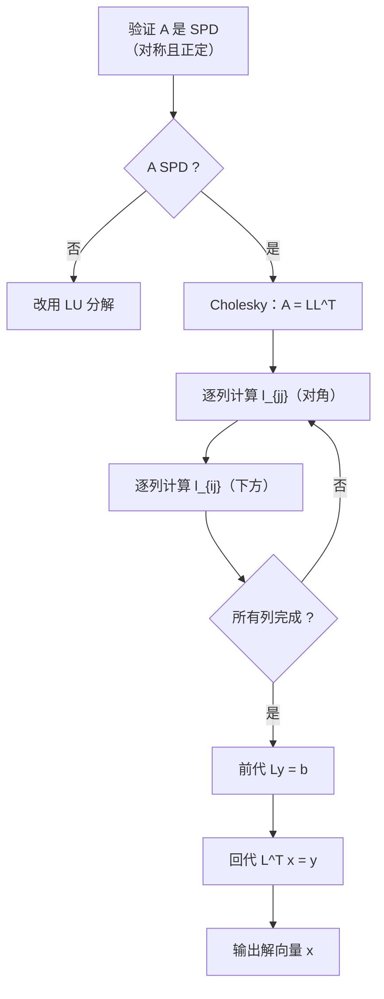

# Cholesky分解

## 一句话

SPD 矩阵的特化分解 $A=LL^T$——计算量只是 LU 分解的一半（$\frac13 n^3$），且天然数值稳定。

## 严格定义

设 $A$ 为 $n\times n$ **对称正定**矩阵，则存在唯一的下三角矩阵 $L$（对角元 $>0$）使得：

$$
\boxed{A=LL^T}
$$

**递推公式**（逐列计算）：

$$
\boxed{l_{jj}=\sqrt{a_{jj}-\sum_{k=1}^{j-1}l_{jk}^2}}
$$

$$
l_{ij}=\frac{1}{l_{jj}}\left(a_{ij}-\sum_{k=1}^{j-1}l_{ik}l_{jk}\right),\quad i=j+1,\ldots,n
$$

> [!important] 前提：$A$ 必须是对称正定——这同时保证了解的存在性和数值稳定性

## 推导：$A=LL^T$ 逐元素解出

> [!proof]- 推导
> 由 $A=LL^T$，逐元素写出：
>
> $$
> a_{ij}=\sum_{k=1}^{\min(i,j)}l_{ik}l_{jk}
> $$
>
> 按列 $j=1,\ldots,n$ 求解：
>
> 1. 对角元：$a_{jj}=\sum_{k=1}^{j}l_{jk}^2=l_{jj}^2+\sum_{k=1}^{j-1}l_{jk}^2\Rightarrow l_{jj}=\sqrt{a_{jj}-\sum_{k=1}^{j-1}l_{jk}^2}$
>
> 2. 非对角元（$i>j$）：$a_{ij}=\sum_{k=1}^{j}l_{ik}l_{jk}=l_{ij}l_{jj}+\sum_{k=1}^{j-1}l_{ik}l_{jk}\Rightarrow l_{ij}=(a_{ij}-\sum_{k=1}^{j-1}l_{ik}l_{jk})/l_{jj}$
>
> SPD 保证 $a_{jj}-\sum l_{jk}^2>0$（否则与正定性矛盾），无需选主元。

## 算法步骤

1. 检验 $A$ 对称正定
2. 对 $j=1,\ldots,n$
   - $l_{jj}=\sqrt{a_{jj}-\sum_{k=1}^{j-1}l_{jk}^2}$
   - 对 $i=j+1,\ldots,n$：$l_{ij}=(a_{ij}-\sum_{k=1}^{j-1}l_{ik}l_{jk})/l_{jj}$
3. 前代 $Ly=b$
4. 回代 $L^T x=y$

## 关键性质

| 性质 | 数值 |
|------|------|
| 计算量 | $\frac{1}{3}n^3+O(n^2)$（LU 的一半） |
| 存储 | 只需 $L$（约 $n^2/2$） |
| 选主元 | 不需要（SPD 保证稳定） |
| 适用前提 | $A$ 对称正定 |
| 稳定性 | 天然数值稳定 |

## 典型例题

> **题目**：对 $A=\begin{pmatrix}4&2&2\\2&5&3\\2&3&6\end{pmatrix}$ 做 Cholesky 分解。

> [!example]- 解答
> 先验证 SPD：对称成立，主子式 $4>0,\;4\times5-4=16>0,\;\det(A)>0$。
>
> **$j=1$**：$l_{11}=\sqrt{4}=2$，$l_{21}=2/2=1$，$l_{31}=2/2=1$
>
> **$j=2$**：$l_{22}=\sqrt{5-1^2}=\sqrt{4}=2$，$l_{32}=(3-1\times1)/2=1$
>
> **$j=3$**：$l_{33}=\sqrt{6-1^2-1^2}=\sqrt{4}=2$
>
> $$
> L=\begin{pmatrix}2&0&0\\1&2&0\\1&1&2\end{pmatrix},\quad L^T=\begin{pmatrix}2&1&1\\0&2&1\\0&0&2\end{pmatrix}
> $$
>
> 验证 $LL^T=A$。
>
> **点评**：全部分解仅 3 列、6 个非零元素——Cholesky 的高效来自利用对称性天然的约简。

## 易错点

> [!warning] 仅适用于 SPD 矩阵
> 若 $A$ 只是对称但非正定（如鞍点系统），Cholesky 分解中 $l_{jj}$ 会变成虚数——此时需用 $LDL^T$ 分解（允许 $D$ 有负对角元）。

> [!warning] SPD 检验不能只靠主子式
> 所有主子式 $>0$ 是正定的充分必要条件，但对浮点计算来说检验几乎不可行（大矩阵主子式计算量巨大）——实践中靠物理背景（如刚度矩阵）或尝试 Cholesky 分解本身判断。

> [!warning] $A=LL^T$ vs $A=LDL^T$
> 若 $A$ 病态，开根号 $l_{jj}=\sqrt{\cdots}$ 会放大舍入误差——此时优先用 $LDL^T$（无开根号）。

## 相关概念

- [[概念/对称正定矩阵]]
- [[方法/LU分解(Doolittle)]]
- [[方法/共轭梯度法]]

## 习题

- [[课程/归档/数值分析/习题库/05-对称正定线性方程组/README|第5章习题库]]

## 操作补充

### 操作补充：适用场景
系数矩阵 $A$ 是对称正定（SPD）矩阵时的最优直接解法，计算量仅为 LU 分解的一半，且数值稳定无需选主元。

### 操作补充：核心公式/步骤

1. 验证 $A$ 对称正定（所有顺序主子式 > 0 或所有特征值 > 0）
2. Cholesky 分解 $\boxed{A=LL^T}$，逐列计算：
   - 对角元：$\boxed{l_{jj}=\sqrt{a_{jj}-\sum_{k=1}^{j-1}l_{jk}^2}}$
   - 列元素：$\boxed{l_{ij}=\frac{1}{l_{jj}}\left(a_{ij}-\sum_{k=1}^{j-1}l_{ik}l_{jk}\right)}$，$i>j$
3. 前代：$\boxed{Ly=b}$ → $y_i=(b_i-\sum_{j=1}^{i-1}l_{ij}y_j)/l_{ii}$
4. 回代：$\boxed{L^T x=y}$ → $x_i=(y_i-\sum_{j=i+1}^n l_{ji}x_j)/l_{ii}$

### 操作补充：典型例题

> **题目**：用 Cholesky 分解解 $A=\begin{bmatrix}4&2&-2\\2&10&2\\-2&2&6\end{bmatrix}$，$b=[2,-1,3]^T$。

> [!example]- 解答
> $A$ 对称正定。$L=\begin{bmatrix}2&0&0\\1&3&0\\-1&1&2\end{bmatrix}$
> $Ly=b$ → $y=[1,-2/3,7/3]^T$
> $L^T x=y$ → $x=[25/18,-11/18,7/6]^T$
> 点评：按乘法与加法分别计数，Cholesky 分解主项约 $n^3/3$，LU 约 $2n^3/3$，且数值稳定无需选主元。

### 操作补充：链接的知识点

本流程的条件、公式与推导已统一在本页前半部分维护。

### 操作补充：链接的习题
- [[课程/归档/数值分析/习题库/05-对称正定线性方程组/README|第5章习题库]]
