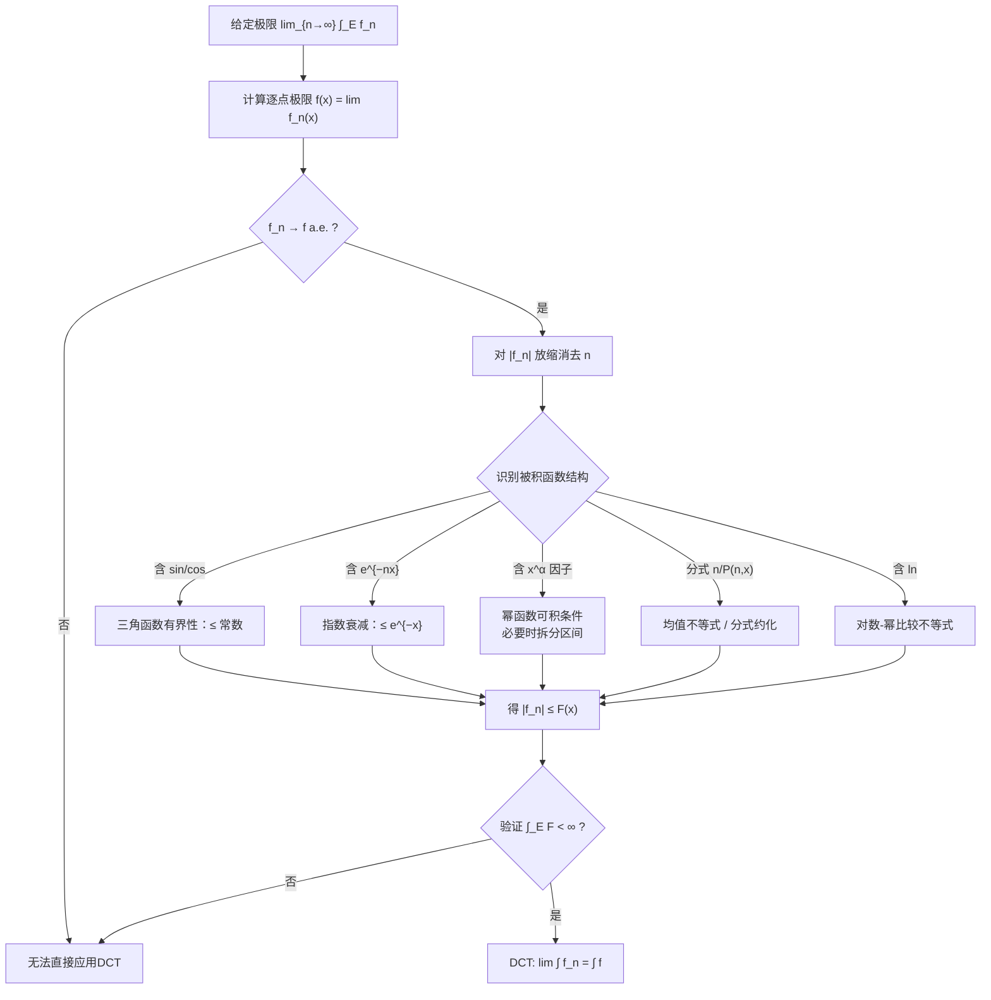

# DCT控制函数构造法

## 适用场景

需要计算 $\lim_{n\to\infty} \int f_n$ 类型的极限，且逐点极限已知，但积分与极限的交换需要验证 Lebesgue 控制收敛定理（DCT）的条件——此时核心难点在于构造一个不依赖于 $n$ 的可积控制函数 $F(x)$。

## 核心公式/步骤

**DCT 核心公式**（目标）：

$$\boxed{\lim_{n\to\infty} \int_E f_n = \int_E f = \int_E \lim_{n\to\infty} f_n}$$

**前提条件**：$f_n \to f$ a.e.，且存在 $F \in L(E)$ 使 $|f_n| \leq F$ a.e.

---

### 构造控制函数的常见套路

| 序号 | 套路 | 关键不等式 | 适用信号 |
|:---:|------|-----------|----------|
| (1) | **三角函数有界性** | $\vert\sin x\vert, \vert\cos x\vert \leq 1$ | 被积函数含 $\sin(nx)$、$\cos(nx)$ 因子，直接常数控制 |
| (2) | **指数衰减** | $e^{-nx} \leq e^{-x}$（$n \geq 1, x>0$） | 含 $e^{-nx}$ 的项，利用 $e^{-x} \in L(0,\infty)$ |
| (3) | **幂函数可积条件** | $x^{-\alpha} \in L(0,1) \iff \alpha<1$；$x^{-\alpha} \in L(1,\infty) \iff \alpha>1$ | 含 $x^\alpha$ 因子，注意 $(0,\infty)$ 上必须拆分区间 |
| (4) | **均值不等式** | $\frac{nx}{1+n^2x^2} \leq \frac{nx}{2nx} = \frac{1}{2}$（$a^2+b^2 \geq 2ab$） | 分母含 $1+n^2x^2$，分子含 $nx$ |
| (5) | **对数-幂比较** | $\frac{\ln(1+x)}{x} \leq 1$（$x>0$）；$\frac{\ln t}{t} \leq e^{-1}$ | 含 $\ln(1+x^n)$ 或 $\ln x$ 因子 |
| (6) | **分式约化** | $\frac{n}{1+n^2x^2} \leq \frac{n}{n^2x^2} = \frac{1}{nx^2}$ | $n$ 大时放大分母，与常数控制结合 |
| (7) | **拆分区间** | 在 $0$ 附近和 $\infty$ 附近分别控制 | 幂函数可积条件在 $(0,\infty)$ 不统一时必须拆分 |

### 操作步骤

1. **计算逐点极限**：$f(x) = \lim_{n\to\infty} f_n(x)$（通常逐点成立）
2. **放大 $|f_n|$**：从上述套路中选择合适的策略，放缩得到 $|f_n(x)| \leq G(n,x)$，再消去 $n$ 得到 $|f_n(x)| \leq F(x)$
3. **验证可积性**：单独验证 $\int_E F < \infty$（这步不能省略——控制函数只有界是不够的）
4. **引用 DCT**：三个条件满足后，直接写出 $\lim \int f_n = \int f$

> [!warning] 关键易错点
> - 控制函数必须**不依赖于 $n$**——所有含 $n$ 的量必须在上界中被消去
> - 控制函数必须是**可积的**（$\int F < \infty$），仅有界不够（除非 $m(E) < \infty$ 时可用有界收敛定理）
> - 拆分区间时，不同区间的控制函数可以不同，但每段上都必须可积
> - DCT 要求的是 **a.e.** 逐点收敛，不需要一致收敛——这是 DCT 最强大的地方

## 流程图

## 典型例题

> **题目 1**：计算 $\displaystyle \lim_{n\to\infty} \int_0^\infty \frac{\sin(nx)}{n(1+x^2)}\,dx$。

> [!example]- 解答
> **逐点极限**：$|\sin(nx)| \leq 1$，故 $\left|\frac{\sin(nx)}{n(1+x^2)}\right| \leq \frac{1}{n(1+x^2)} \to 0$，即 $f(x)=0$。
>
> **控制函数**：直接利用 $|\sin(nx)| \leq 1$，得
> $$\left|\frac{\sin(nx)}{n(1+x^2)}\right| \leq \frac{1}{n(1+x^2)} \leq \frac{1}{1+x^2} \quad (n \geq 1)$$
> 故取 $F(x) = \frac{1}{1+x^2}$。
>
> **验证可积**：$\int_0^\infty \frac{1}{1+x^2}\,dx = \frac{\pi}{2} < \infty$，$F \in L(0,\infty)$。
>
> **DCT 结论**：$\displaystyle \lim_{n\to\infty} \int_0^\infty \frac{\sin(nx)}{n(1+x^2)}\,dx = \int_0^\infty 0\,dx = 0$。
>
> **点评**：套路 (1)（三角函数有界性）的典型应用。关键是用 $|\sin(nx)| \leq 1$ 一步消去分子中的 $n$ 依赖，再利用 $1/(1+x^2)$ 的自然可积性。

---

> **题目 2**：计算 $\displaystyle \lim_{n\to\infty} \int_0^1 \frac{nx}{1+n^2x^2}\,dx$。

> [!example]- 解答
> **逐点极限**：固定 $x>0$，$\frac{nx}{1+n^2x^2} \sim \frac{1}{nx} \to 0$；$x=0$ 时值为 $0$。故 $f(x)=0$ a.e.。
>
> **控制函数**：使用均值不等式 $a^2+b^2 \geq 2ab$，令 $a=1, b=nx$：
> $$1+n^2x^2 \geq 2nx \implies \frac{nx}{1+n^2x^2} \leq \frac{nx}{2nx} = \frac{1}{2}$$
> 故取 $F(x) = \frac{1}{2}$。
>
> **验证可积**：$\int_0^1 \frac{1}{2}\,dx = \frac{1}{2} < \infty$（有限测度集上有界函数必可积）。
>
> **DCT 结论**：$\displaystyle \lim_{n\to\infty} \int_0^1 \frac{nx}{1+n^2x^2}\,dx = 0$。
>
> **点评**：套路 (4)（均值不等式）的经典应用。本题若不使用 DCT 而直接积分也可得 $\frac{\ln(1+n^2)}{2n} \to 0$，但 DCT 路径更优雅，且验证了 $f_n$ 的 $L^1$ 收敛性。

---

> **题目 3**：计算 $\displaystyle \lim_{n\to\infty} \int_0^\infty \frac{\ln(1+x^n)}{1+x^n}\,e^{-x}\,dx$。

> [!example]- 解答
> **逐点极限**：当 $x \in [0,1)$，$x^n \to 0$，故 $\frac{\ln(1+x^n)}{1+x^n} \to 0$；当 $x=1$，值为 $\frac{\ln 2}{2}e^{-1}$；当 $x>1$，$x^n \to \infty$，$\frac{\ln(1+x^n)}{1+x^n} \sim \frac{n\ln x}{x^n} \to 0$。故 $f(x)=0$ a.e.（$x=1$ 单点不影响积分）。
>
> **控制函数**：利用套路 (5) $\frac{\ln(1+t)}{1+t} \leq \ln(1+t) \leq t$（$t \geq 0$）：
> $$\left|\frac{\ln(1+x^n)}{1+x^n}\right| \leq x^n \quad (x \geq 0)$$
> 乘以 $e^{-x}$ 得 $|f_n(x)| \leq x^n e^{-x}$。
>
> 由于对任意 $n \geq 1$ 和 $x \geq 0$，函数 $g(t)=t e^{-t/n}$… 更直接的方法是注意到 $x^n e^{-x} \leq x e^{-x}$ 是否成立？不总成立。需要分情况：
> - 当 $0 \leq x \leq 1$：$x^n \leq x$，故 $x^n e^{-x} \leq x e^{-x}$
> - 当 $x > 1$：$x^n e^{-x}$ 不由 $x e^{-x}$ 控制。但 DCT 要求对**每个** $n$ 有统一控制，这点需要更细致的技巧。
>
> 实际上，利用 $t e^{-t}$ 在 $[0,\infty)$ 上有最大值 $e^{-1}$：
> $$x^n e^{-x} = e^{n\ln x - x}$$
> 对固定 $n$，该函数在 $x=n$ 处取最大值 $(n/e)^n e^{-n}$，这不是统一有界的。
>
> **修正控制**：利用 $\frac{\ln(1+t)}{1+t} \leq 1$（对所有 $t \geq 0$），得
> $$|f_n(x)| \leq 1 \cdot e^{-x} = e^{-x}$$
> 而 $e^{-x} \in L(0,\infty)$。
>
> **DCT 结论**：$\displaystyle \lim_{n\to\infty} \int_0^\infty \frac{\ln(1+x^n)}{1+x^n}\,e^{-x}\,dx = 0$。
>
> **点评**：展示了一个常见陷阱——最初想用 $x^n e^{-x}$ 作为控制，但发现无法对所有 $n$ 统一控制。回头使用更简单的不等式 $\frac{\ln(1+t)}{1+t} \leq 1$ 即可。选控制函数时，**宁粗勿紧**——只要可积，越简单的上界越好。

## 知识链接

- [[知识点/实变函数/Lebesgue控制收敛定理]] — DCT 的严格定义、前提条件和 $L^1$ 收敛结论
- [[知识点/实变函数/Fatou引理]] — DCT 证明的核心工具（Fatou 双向夹逼）
- [[知识点/实变函数/Levi单调收敛定理]] — 单调情形下的积分极限交换，与 DCT 互补
- [[知识点/实变函数/有界收敛定理]] — 有限测度集上 DCT 的特例（控制函数为常数）

## 习题链接

- [[课程/实变函数/习题库/04-Lebesgue积分/习题4.16-控制收敛定理-习题]] — DCT 基础验证题
- [[课程/实变函数/习题库/04-Lebesgue积分/习题4.17-控制收敛定理应用：指数衰减型控制函数-习题]] — 套路 (2) 指数衰减控制
- [[课程/实变函数/习题库/04-Lebesgue积分/习题4.18-控制收敛定理应用：幂次型控制函数-习题]] — 套路 (3) 幂函数可积条件 + 拆分区间
- [[课程/实变函数/习题库/04-Lebesgue积分/习题4.19-控制收敛定理应用：经典极限定义e-习题]] — DCT 在经典极限中的应用
