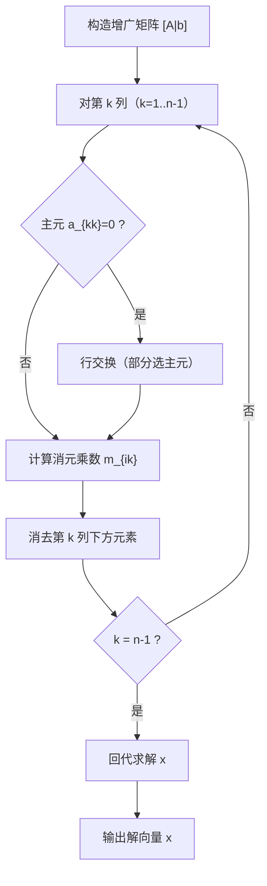

# Gauss消元法

## 一句话

通过行初等变换将线性方程组 $Ax=b$ 约化为上三角形式，然后回代求解。

## 严格定义

求解 $Ax=b$，$A\in\mathbb{R}^{n\times n}$。

**消元过程**（第 $k$ 步，$k=1,\ldots,n-1$）：

$$
\boxed{m_{ij}=\frac{a_{ij}^{(k)}}{a_{kk}^{(k)}},\quad i=k+1,\ldots,n}
$$

$$
a_{ij}^{(k+1)}=a_{ij}^{(k)}-m_{ik}a_{kj}^{(k)},\quad b_i^{(k+1)}=b_i^{(k)}-m_{ik}b_k^{(k)}
$$

消元结束后 $A^{(n)}=U$（上三角）。

**回代过程**：

$$
x_n=\frac{b_n^{(n)}}{a_{nn}^{(n)}},\qquad x_i=\frac{b_i^{(i)}-\sum_{j=i+1}^{n}a_{ij}^{(i)}x_j}{a_{ii}^{(i)}}
$$

> [!important] 主元 $a_{kk}^{(k)}\neq0$ 是消元继续的前提——为零时需行交换

## 推导：消元矩阵

> [!proof]- 推导
> 第 $k$ 步消元等价于左乘消元矩阵：
>
> $$
> E_k=I-m_k e_k^T,\quad m_k=\begin{pmatrix}0&\cdots&0&m_{k+1,k}&\cdots&m_{n,k}\end{pmatrix}^T
> $$
>
> 则：
>
> $$
> E_{n-1}\cdots E_2 E_1 A=U
> $$
>
> 即 $A=LU$（其中 $L=E_1^{-1}\cdots E_{n-1}^{-1}$ 为单位下三角，其第 $k$ 列恰为消元乘数 $m_{ik}$）。
>
> Gauss 消元法的本质是隐性完成 LU 分解。

## 算法步骤

1. **前向消元**：对 $k=1,\ldots,n-1$
   - 若 $a_{kk}^{(k)}=0$，交换行
   - 计算乘数 $m_{ik}=a_{ik}^{(k)}/a_{kk}^{(k)}$，$i=k+1,\ldots,n$
   - 更新 $a_{ij}^{(k+1)}=a_{ij}^{(k)}-m_{ik}a_{kj}^{(k)}$，$b_i^{(k+1)}=b_i^{(k)}-m_{ik}b_k^{(k)}$
2. **回代**：从 $x_n$ 开始倒序求解

## 关键性质

| 性质 | 数值 |
|------|------|
| 计算量（消元） | $\frac{2}{3}n^3+O(n^2)$ |
| 计算量（回代） | $O(n^2)$ |
| 总计算量 | $\frac{2}{3}n^3+O(n^2)$ |
| 等价分解 | $A=LU$（不含行交换） |
| 对角占优矩阵 | 不需选主元 |

## 典型例题

> **题目**：用 Gauss 消元法解方程组：
> $$\begin{cases}2x+3y+z=5\\4x+7y+3z=10\\-2x+4y+7z=12\end{cases}$$

> [!example]- 解答
> **增广矩阵**：
>
> $$
> \begin{pmatrix}
> 2 & 3 & 1 & | & 5 \\
> 4 & 7 & 3 & | & 10 \\
> -2 & 4 & 7 & | & 12
> \end{pmatrix}
> $$
>
> **第 1 步**：$a_{11}=2$ 为主元。
>
> $m_{21}=4/2=2$，第 2 行 $-2\times$ 第 1 行：$(4-4,7-6,3-2,10-10)=(0,1,1,0)$
>
> $m_{31}=-2/2=-1$，第 3 行 $-(-1)\times$ 第 1 行：$(-2+2,4+3,7+1,12+5)=(0,7,8,17)$
>
> **第 2 步**：主元 $a_{22}^{(2)}=1$。
>
> $m_{32}=7/1=7$，第 3 行 $-7\times$ 第 2 行：$(0,0,8-7,17-0)=(0,0,1,17)$
>
> **上三角**：
>
> $$
> \begin{pmatrix}2&3&1&|&5\\0&1&1&|&0\\0&0&1&|&17\end{pmatrix}
> $$
>
> **回代**：$z=17$，$y=-17$，$x=(5-17+51)/2=19.5$
>
> **点评**：检查解 $2(19.5)+3(-17)+17=5$，正确。

## 易错点

> [!warning] 主元为零必须处理
> 若 $a_{kk}^{(k)}=0$ 且下方同列无非零元素，则该矩阵奇异（方程组无解或有无穷多解）。若下方有非零元素，交换行即可继续——这正是列主元的思想。

> [!warning] 乘数 $m_{ik}$ 的计算依赖主元
> $m_{ik}=a_{ik}^{(k)}/a_{kk}^{(k)}$——若主元很小（非零但 $\approx 10^{-16}$），$m_{ik}$ 会极大，放大舍入误差。这是列主元消元存在的根本原因。

> [!warning] 消元顺序固定非最优
> 逐列消元的顺序对稀疏矩阵（如来自 PDE 离散化）可能导致大量 fill-in——需要重排方程/变量顺序（如 Cuthill-McKee）。

## 相关概念

- [[概念/数值分析/对角占优]]
- [[概念/数值分析/数值稳定性]]
- [[知识点/数值分析/LU分解(Doolittle)]]
- [[知识点/数值分析/列主元消元(PA=LU)]]

## 习题

- [[课程/数值分析/习题库/03-线性方程组的直接解法/README|第3章习题库]]

## 操作补充

### 操作补充：适用场景
求解一般稠密线性方程组 $Ax=b$，是最基础、最通用的直接解法。

### 操作补充：核心公式/步骤

1. 构造增广矩阵 $\boxed{[A\mid b]}$
2. 逐列消元（$k=1,\ldots,n-1$）：
   - 选主元（列主元：选第 $k$ 列中绝对值最大者）
   - 必要时交换行（部分选主元）
   - 消元乘数 $\boxed{m_{ik}=a_{ik}^{(k)}/a_{kk}^{(k)}}$，消去下方元素：$\boxed{a_{ij}^{(k+1)}=a_{ij}^{(k)}-m_{ik}a_{kj}^{(k)}}$
3. 得到上三角形式 $Ux=\tilde{b}$
4. 回代：$\boxed{x_n=\tilde{b}_n/u_{nn},\quad x_i=(\tilde{b}_i-\sum_{j=i+1}^n u_{ij}x_j)/u_{ii}}$

### 操作补充：典型例题

> **题目**：用 Gauss 消元法解 $\begin{cases}2x_1+x_2-x_3=1\\x_1-2x_2+3x_3=-2\\3x_1-x_2+2x_3=3\end{cases}$。

> [!example]- 解答
> 第三个方程的左端恰为前两个方程左端之和，而右端 $3\ne1+(-2)$。消元得到矛盾行 $[0,0,0\mid4]$，因此原方程组无解。
>
> **点评**：遇到零主元要区分需要换行与矩阵秩亏；不能对矛盾行继续除法回代。列主元有助于控制乘数，但不是对所有矩阵数值稳定的无条件保证。

### 操作补充：链接的知识点
- [[知识点/数值分析/Gauss消元法]]

### 操作补充：链接的习题
- [[课程/数值分析/习题库/03-线性方程组的直接解法/README|第3章习题库]]
