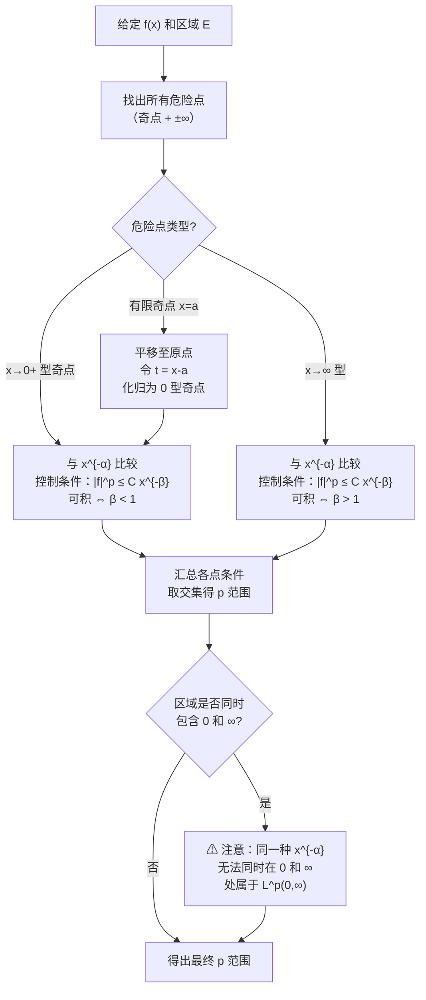

# L^p可积性判断法

## 适用场景

判断函数 $f(x)$ 是否属于 $L^p(E)$（即 $\int_E |f|^p < \infty$ 是否成立），尤其当 $f$ 在奇点附近或无穷远处呈现幂型衰减/发散行为时。

## 核心公式/步骤

### 标准判据（幂型函数 $f(x) = x^{-\alpha}$）

$$\boxed{x^{-\alpha} \in L^p(0,1) \iff \alpha p < 1 \quad (\text{即 } \alpha < 1/p)}$$

$$\boxed{x^{-\alpha} \in L^p(1,\infty) \iff \alpha p > 1 \quad (\text{即 } \alpha > 1/p)}$$

$$\boxed{x^{-\alpha} \notin L^p(0,\infty) \quad \text{对任意 } \alpha,\; 1 \le p < \infty}$$

> [!warning] 关键易错点：无穷远处和原点处的可积条件方向相反（$\alpha < 1/p$ vs $\alpha > 1/p$），不存在单个 $\alpha$ 能同时满足两者！

### 一般函数的判断步骤

1. **找出所有"危险点"**：奇点（分母为零的点）$+ \pm\infty$
2. **局部比较**：在每个危险点附近，将 $f$ 与 $x^{-\alpha}$ 比较，利用比较判别法：
   - 在 $x=0$ 附近：若 $|f|^p \le C x^{-\beta}$ 且 $\beta < 1$，则可积
   - 在 $x \to \infty$ 处：若 $|f|^p \le C x^{-\beta}$ 且 $\beta > 1$，则可积
3. **综合条件**：汇集各危险点的条件，得出 $p$ 的取值范围
4. **特殊函数**：
   - $e^{-x} \in L^p(0,\infty)$ 对所有 $p$ 成立（指数衰减压倒一切）
   - $\displaystyle \frac{\ln x}{1+x^2} \in L^p(0,\infty)$ 对多数 $p$ 成立
   - $\displaystyle \frac{1}{x|\ln x|^\alpha} \in L^1(0,1/2)$ 当 $\alpha > 1$

> [!warning] 复合奇点需分段处理：对有多个奇点的函数，分别在每个奇点邻域内独立判断，取各段条件之交集。

## 流程图

## 典型例题

> **题目 1**：确定 $f(x) = x^{-\alpha}(1+x)^{-\beta}$ 属于 $L^1(0,\infty)$ 的参数范围。

> [!example]- 解答
> 危险点：$x \to 0^+$ 和 $x \to \infty$。
>
> **在 $x \to 0^+$ 附近**：$(1+x)^{-\beta} \approx 1$，故 $f(x) \sim x^{-\alpha}$。可积条件：
> $$\alpha \cdot 1 < 1 \implies \alpha < 1.$$
>
> **在 $x \to \infty$ 处**：$f(x) \sim x^{-(\alpha+\beta)}$。可积条件：
> $$(\alpha+\beta) \cdot 1 > 1 \implies \alpha + \beta > 1.$$
>
> **结论**：$f \in L^1(0,\infty)$ 当且仅当 $\boxed{\alpha < 1 \;\text{且}\; \alpha + \beta > 1}$。
>
> **直观理解**：原点处只有 $x^{-\alpha}$ 起作用，要求衰减不能太快；无穷远处 $\alpha+\beta$ 共同决定衰减速度，要求衰减足够快。
>
> 当 $\alpha=0$ 时退化为 $f(x)=(1+x)^{-\beta}$，条件变为 $\beta>1$——这正是 $x^{-\beta}$ 在无穷远处的可积条件，与标准判据一致。

> **题目 2**：判断 $\displaystyle f(x) = \frac{\sin x}{x}$ 属于 $L^p(0,\infty)$ 对哪些 $p$ 成立。

> [!example]- 解答
> 危险点：$x \to 0^+$ 和 $x \to \infty$。
>
> **在 $x \to 0^+$ 附近**：$\sin x \sim x$，故 $f(x) \sim 1$。对任意 $p$，$|f|^p \sim 1$ 在 $(0,1)$ 上可积，$0$ 处不构成危险（$f$ 有界）。
>
> **在 $x \to \infty$ 处**：$|\sin x| \le 1$，故 $|f(x)|^p \le x^{-p}$。按标准判据：
> $$p > 1 \text{ 时 } x^{-p} \in L^1(1,\infty) \implies f \in L^p.$$
>
> 但需验证 $p \le 1$ 时是否仍可积。$f$ 的振荡减缓了发散：当 $p=1$ 时，
> $$\int_0^\infty \frac{|\sin x|}{x}\,dx = \infty$$
> （每个周期贡献约 $1/n$，调和级数发散）。故 $f \notin L^1$。
>
> 对 $p<1$，$|\sin x|^p / x^p$ 比 $1/x$ 发散更慢... 实际上用 Dirichlet 判别法可证 $f \notin L^p$ 对 $p \le 1$。
>
> **结论**：$\displaystyle \frac{\sin x}{x} \in L^p(0,\infty)$ 当且仅当 $\boxed{p > 1}$。
>
> **点评**：此题体现了"有界+振荡"型函数的特点——原点处 $\sin x/x \to 1$ 不构成威胁；无穷远处 $|\sin x| \le 1$ 控制下用比较判别法，结合 $x^{-p}$ 的 $L^p$ 判据即可。

## 知识链接

- [[知识点/实变函数/Hölder不等式]] — 比较判别中积分估计的基础工具
- [[知识点/实变函数/Minkowski不等式]] — $L^p$ 范数三角不等式，$L^p$ 空间之基础
- [[知识点/实变函数/Lebesgue控制收敛定理]] — 处理参数化积分收敛性的核心定理
- [[知识点/实变函数/Levi单调收敛定理]] — 非负函数逐点逼近积分的依据

## 习题链接

- [[课程/实变函数/习题库/05-重积分与Lp空间/习题5.8-有限测度集上L^p空间的包含关系-习题]] — $L^{p_2} \subset L^{p_1}$ 的证明与范数不等式
- [[课程/实变函数/习题库/05-重积分与Lp空间/习题5.6-Hölder不等式-习题]] — 判断可积性的核心不等式工具
- [[课程/实变函数/习题库/05-重积分与Lp空间/习题5.10-L^p收敛蕴含依测度收敛（定理4.1.9）-习题]] — $L^p$ 收敛与测度收敛的关系
- [[课程/实变函数/习题库/05-重积分与Lp空间/习题5.11-L^p控制收敛定理（定理4.1.10）-习题]] — $L^p$ 收敛的充分条件
