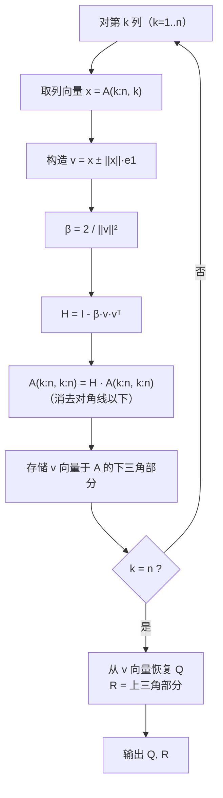

# QR分解流程(Householder)

## 适用场景
对任意实矩阵做数值稳定的 QR 分解，是 QR 算法求特征值的基础。Householder 法比 Gram-Schmidt 更稳定。

## 核心公式/步骤

1. 逐列构造 Householder 反射子（$k=1,\ldots,n$）：
   - 取当前列 $k$ 的子向量 $\mathbf{x}=[a_{kk},\ldots,a_{nk}]^T$
   - 构造反射向量：$\boxed{\mathbf{v}=\mathbf{x}\pm\|\mathbf{x}\|_2\mathbf{e}_1}$（符号取与 $x_1$ 同号以避免抵消）
   - Householder 矩阵：$\boxed{H_k=I-\beta\mathbf{v}\mathbf{v}^T}$，其中 $\boxed{\beta=2/\|\mathbf{v}\|^2}$
2. 用 $H_k$ 左乘剩余子矩阵，消去第 $k$ 列对角线以下元素
3. 累积 $Q$：$\boxed{Q=H_1 H_2\cdots H_n}$（也可存储 $\mathbf{v}$ 向量隐式表示 $Q$）
4. 最终 $\boxed{R=H_n\cdots H_1 A}$（上三角），$\boxed{A=QR}$

## 典型例题

> **题目**：用 Householder 法对 $A=\begin{bmatrix}3&2\\4&1\end{bmatrix}$ 做 QR 分解。

> [!example]- 解答
> 第1列 $\mathbf{x}=[3,4]^T$, $\|\mathbf{x}\|=5$, $\mathbf{v}=[8,4]^T$, $\beta=2/80=0.025$
> $H_1=\begin{bmatrix}-0.6&-0.8\\-0.8&0.6\end{bmatrix}$, $R=H_1A=\begin{bmatrix}-5&-2\\0&-1\end{bmatrix}$
> $Q=H_1^T=\begin{bmatrix}-0.6&-0.8\\-0.8&0.6\end{bmatrix}$
> 点评：Householder 法向后稳定，是 QR 分解的首选方法。

## 链接的知识点
- [[知识点/数值分析/QR算法]]

## 链接的习题
- [[课程/数值分析/习题库/06-矩阵特征值的数值解法/README|第6章习题库]]
