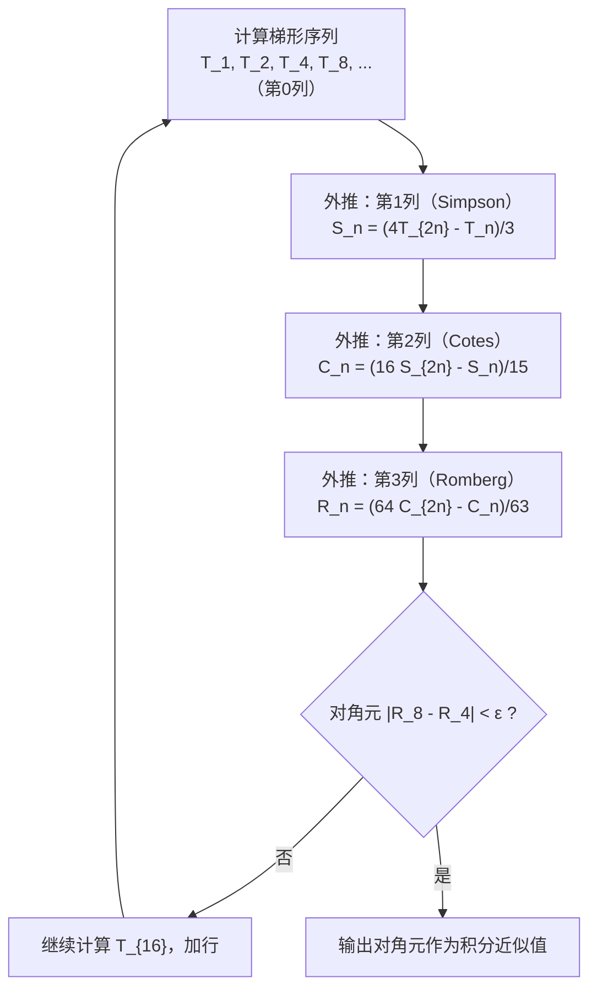

# Romberg外推流程

## 适用场景
被积函数充分光滑时，用梯形序列通过 Richardson 外推快速收敛到高精度积分值，兼具高效和高精度的优点。

## 核心公式/步骤

1. 计算梯形序列（变步长）：$\boxed{T_1^{(0)}, T_2^{(0)}, T_4^{(0)}, T_8^{(0)},\ldots}$（$T_n^{(0)}$ 表示 $n$ 等分梯形值）
2. Romberg 外推公式：
   $\boxed{T_n^{(m)}=\frac{4^m T_{2n}^{(m-1)}-T_n^{(m-1)}}{4^m-1}}$
3. 填表结构：
   - 第 0 列：梯形值
   - 第 1 列：Simpson 值
   - 第 2 列：Cotes 值
   - 第 3 列：Romberg 值
4. 对角线元素 $\boxed{T_1^{(0)}, T_2^{(1)}, T_4^{(2)}, T_8^{(3)},\ldots}$ 收敛到积分精确值
5. 检查 $|T_{2n}^{(m)}-T_n^{(m)}|<\varepsilon$ 作为停机准则

## 典型例题

> **题目**：用 Romberg 积分计算 $\int_0^\pi \sin x\,dx$。

> [!example]- 解答
> $T_1^{(0)}=0$（梯形值，1等分）
> $T_2^{(0)}=\pi/2\approx1.5708$（2等分）
> $T_4^{(0)}\approx1.8961$（4等分）
> 外推 $T_2^{(1)}=(4\cdot1.8961-1.5708)/3\approx2.0045$（Simpson）
> 外推 $T_4^{(1)}\approx1.9742$ → $T_4^{(2)}\approx1.9986$（Cotes）
> 精确值 $=2$。点评：Romberg 用少量梯形值外推达到高阶精度。

## 链接的知识点
- [[方法/Romberg外推]]
- [[方法/复化求积法]]

## 链接的习题
- [[课程/归档/数值分析/习题库/09-数值积分与数值微分/README|第9章习题库]]
