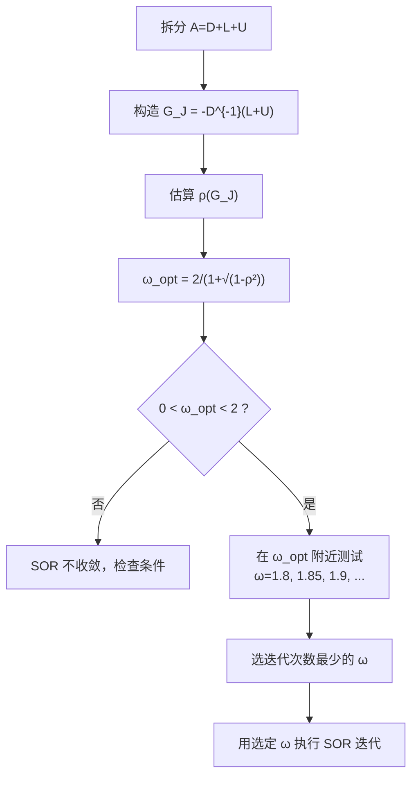

# SOR参数选择流程

## 适用场景
使用 SOR（逐次超松弛）迭代法求解大型线性方程组时，需选取最优松弛因子 $\omega_{opt}$ 以最大化收敛速度。

## 核心公式/步骤

1. 拆分 $A=D+L+U$，构造 Jacobi 迭代矩阵 $\boxed{G_J=-D^{-1}(L+U)}$
2. 计算（或估算）$\boxed{\rho(G_J)}$（Jacobi 矩阵的谱半径）
3. SOR 最优参数：$\boxed{\omega_{opt}=\frac{2}{1+\sqrt{1-\rho(G_J)^2}}}$
4. 验证 $\boxed{0<\omega_{opt}<2}$（SOR 收敛的必要条件）
5. 实际中可在 $\omega_{opt}$ 附近试探几个值，比较迭代次数
6. SOR 迭代：$\boxed{x^{(k+1)}=(1-\omega)x^{(k)}+\omega D^{-1}(b-Lx^{(k+1)}-Ux^{(k)})}$

## 典型例题

> **题目**：对 Poisson 方程离散后的 $n\times n$ 矩阵（$n$ 大），求 $\omega_{opt}$ 并分析 $\omega=1$（G-S）与 $\omega_{opt}$ 的差别。

> [!example]- 解答
> $\rho(G_J)=\cos(\pi/n)\approx1-\frac{\pi^2}{2n^2}$ → $\omega_{opt}\approx\frac{2}{1+\pi/n}\approx2-\frac{2\pi}{n}$
> $\rho(G_{GS})=\rho(G_J)^2$，而 $\rho(G_{SOR,opt})=\omega_{opt}-1\approx1-\frac{2\pi}{n}$
> 点评：$n$ 大时 $\omega_{opt}\approx2$，SOR 比 G-S 快一个数量级（$\rho$ 从 $1-O(1/n^2)$ 降到 $1-O(1/n)$）。

## 链接的知识点
- [[知识点/数值分析/SOR迭代]]
- [[知识点/数值分析/迭代收敛定理(谱半径)]]

## 链接的习题
- [[课程/数值分析/习题库/04-线性方程组的迭代法/README|第4章习题库]]
