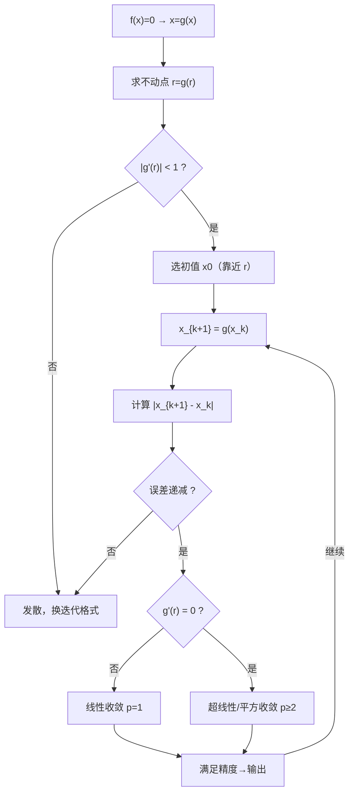

# 不动点迭代判敛流程

## 适用场景
方程已改写为 $x=g(x)$，需判断迭代是否收敛及收敛速度，用于分析迭代格式的可行性。

## 核心公式/步骤

1. 将 $f(x)=0$ 改写为 $\boxed{x=g(x)}$（多种改写方式）
2. 求不动点 $r=g(r)$，检查 $\boxed{|g'(r)|<1}$（局部收敛的充要条件）
3. 选初值 $x_0$（在不动点附近），迭代 $\boxed{x_{k+1}=g(x_k)}$
4. 计算近似误差 $|x_{k+1}-x_k|$，检查是否递减
5. 判断收敛阶：$g'(r)\neq0$→$p=1$（线性）；$g'(r)=0, g''(r)\neq0$→$p=2$（平方）

## 典型例题

> **题目**：$f(x)=x^3+2x-4=0$，构造 $g_1(x)=\frac{4-x^3}{2}$ 和 $g_2(x)=\sqrt[3]{4-2x}$，分析收敛性。

> [!example]- 解答
> 先求根：$f(1)=-1,\ f(1.2)=0.128$，根 $r\approx1.18$。
> 
> $g_1'(x)=-\frac{3}{2}x^2$，$|g_1'(1.18)|\approx2.09>1$→发散。
> $g_2'(x)=-\frac{2}{3}(4-2x)^{-2/3}$，$|g_2'(1.18)|\approx0.48<1$→收敛。
> 
> 点评：同一方程不同 $g(x)$ 收敛性不同，构造 $g$ 是关键。

## 链接的知识点
- [[方法/不动点迭代]]
- [[知识点/收敛阶定理]]

## 链接的习题
- [[课程/归档/数值分析/习题库/02-非线性方程求根/README|第2章习题库]]
