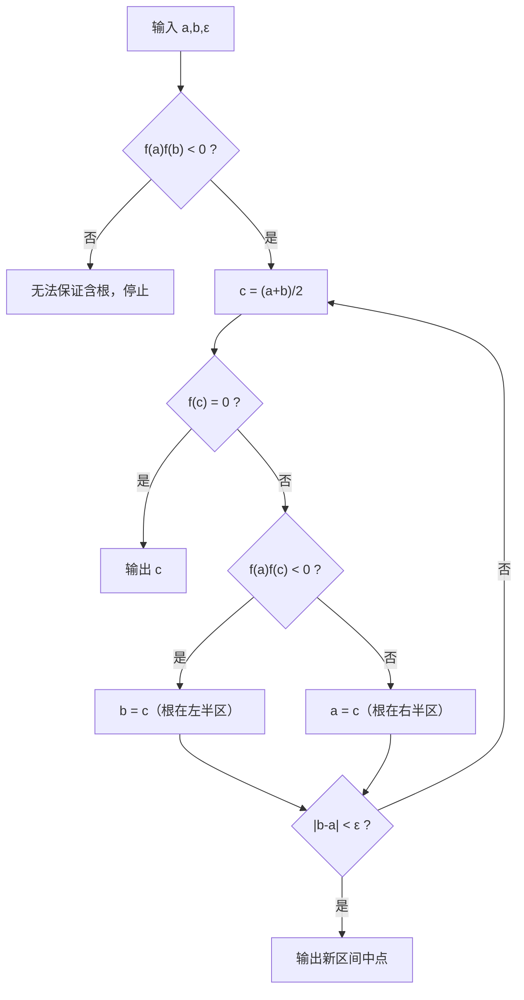

# 二分法

通过保持有效区间并逐步对分来缩小解的位置。求根依据函数异号与连续性；求极值依据导数符号和单峰性，二者的前提不同。

## 求根

### 求根：一句话

利用连续函数介值定理，每次将含根区间对分，是最简单可靠的全局收敛求根方法。

### 求根：严格定义

设 $f\in C[a,b]$ 且 $f(a)f(b)<0$，则 $(a,b)$ 内至少有一个根。二分法构造序列：

$$
c_n = \frac{a_n+b_n}{2},\quad n=0,1,2,\ldots
$$

- 若 $f(c_n)=0$，则 $r=c_n$，停机
- 若 $f(a_n)f(c_n)<0$，则根在 $[a_n,c_n]$，令 $a_{n+1}=a_n,\;b_{n+1}=c_n$
- 若 $f(c_n)f(b_n)<0$，则根在 $[c_n,b_n]$，令 $a_{n+1}=c_n,\;b_{n+1}=b_n$

**误差界**：

$$
\boxed{|c_n-r|\le\frac{b-a}{2^{n+1}}}
$$

$n$ 轮后区间长度为 $(b-a)/2^n$。

> [!important] 前提条件 $f(a)f(b)<0$ 不可省略

### 求根：推导：误差界

> [!proof]- 推导
> 每一步区间长度减半：$L_{n}=L_{n-1}/2$。
>
> 初始 $L_0=b-a$，$n$ 轮后 $L_n=(b-a)/2^n$。
>
> 中点 $c_n$ 与真根 $r$ 的距离不超过 $L_n/2$，故：
>
> $$
> |c_n-r|\le\frac{L_n}{2}=\frac{b-a}{2^{n+1}}
> $$
>
> 给定精度 $\varepsilon$，所需最少迭代次数：
>
> $$
> n>\log_2\frac{b-a}{2\varepsilon}
> $$

### 求根：算法步骤

1. 检查 $f(a)f(b)<0$（不满足则无法使用）
2. 算中点 $c=(a+b)/2$，计算 $f(c)$
3. 若 $|f(c)|<\varepsilon$ 或 $|b-a|<\delta$，停机
4. 否则，若 $f(a)f(c)<0$ 则 $b=c$；若 $f(c)f(b)<0$ 则 $a=c$
5. 返回步骤 2

### 求根：关键性质

| 性质 | 数值 |
|------|------|
| 收敛类型 | 全局收敛（只要 $f(a)f(b)<0$） |
| 收敛阶 | 区间长度和误差上界线性缩减 |
| 收敛率 | $1/2$（区间长度每步减半） |
| 每步函数值计算 | 1 次 |
| 是否需要导数 | 不需要 |
| 适用范围 | 任意连续函数 |

### 求根：典型例题

> **题目**：用二分法求 $\sqrt{2}$（即 $f(x)=x^2-2=0$ 在 $[1,2]$ 上的根），要求误差 $<10^{-3}$。

> [!example]- 解答
> 初始区间 $[1,2]$，$f(1)=-1<0$，$f(2)=2>0$，满足条件。
>
> 误差界 $(2-1)/2^{n+1}<10^{-3}\Rightarrow 2^{n+1}>10^3\Rightarrow n+1>9.97\Rightarrow n\ge 9$。
>
> 实际计算（前几步）：
>
> | $n$ | $a_n$ | $b_n$ | $c_n$ | $f(c_n)$ |
> |-----|-------|-------|-------|----------|
> | 0 | 1 | 2 | 1.5 | 0.25 |
> | 1 | 1 | 1.5 | 1.25 | -0.4375 |
> | 2 | 1.25 | 1.5 | 1.375 | -0.1094 |
> | 3 | 1.375 | 1.5 | 1.4375 | 0.0664 |
> | 4 | 1.375 | 1.4375 | 1.40625 | -0.0225 |
> | 5 | 1.40625 | 1.4375 | 1.421875 | 0.0217 |
>
> 在 $n=9$ 时，$c_9=1.4150390625$，误差不超过 $2^{-10}<10^{-3}$。
>
> **点评**：用区间长度验证位置误差；函数残差小本身不保证位置误差小。

### 求根：易错点

> [!warning] 必须满足 $f(a)f(b)<0$
> 若区间两端函数值同号，二分法无法使用（区间内可能有偶数个根或没根）。这要求使用者先确定一个跨零点的初始区间。

> [!warning] 收敛慢是固有特征而非 bug
> 二分法的区间长度每步减半，误差上界也随之减半，约为每 3 步多一位有效数字。对于高精度需求（如 10 位有效数字），需要约 30-35 步。

> [!warning] $|f(c_n)|$ 小不一定表示 $c_n$ 接近根
> 可能函数在该区间内"平滑"而真值很小。最好同时检查 $|f(c_n)|$ 和区间长度两种停机准则。

### 求根：相关概念

- [[概念/收敛性]]
- [[概念/误差]]
- [[方法/不动点迭代]]
- [[方法/牛顿法]]

### 求根：习题

- [[课程/归档/数值分析/习题库/02-非线性方程求根/README|第2章习题库]]

## 求极值

### 求极值：一句话

二分法利用导数符号判断极小点位于区间中点的左侧还是右侧，每次砍掉一半区间，比黄金分割法收敛更快。

### 求极值：严格定义

设 $f\in C^1$，并存在极小点 $x^*$，使其左侧 $f'<0$、右侧 $f'>0$。仅有严格单峰但允许侧面导数为零时，不能直接用 $f'=0$ 判定已找到极小点。每轮在中点 $x^{(k)}=\frac{a_k+b_k}{2}$ 处计算 $f'(x^{(k)})$ 的符号：

| $f'(x^{(k)})$ | 结论 | 理由 |
|:---:|------|------|
| $>0$ | $x^*\in[a_k,x^{(k)}]$ | 中点在"上山"段，极小点在左边 |
| $<0$ | $x^*\in[x^{(k)},b_k]$ | 中点在"下山"段，极小点在右边 |
| $=0$ | $x^{(k)}$ 即是极小点 | 在上述导数符号假设下判为极小点；仅有一阶必要条件本身不足以保证极小 |

区间压缩比为 $\frac{1}{2}$，$N$ 步后 $L_N=L_0\cdot(1/2)^N$。停机准则：$L_0\cdot(1/2)^N<\varepsilon$。

### 求极值：与黄金分割法的对比

| | 二分法 | 黄金分割法 |
|---|---|---|
| 使用信息 | **导数** $f'$ | 仅**函数值** $f$ |
| 区间压缩比 | $\frac12$ | $\mu\approx0.618$ |
| 收敛速度 | 更快 | 较慢 |
| 前提条件 | 连续可微且导数在极小点两侧分别严格为负、为正 | 连续且在所选区间单峰 |

### 求极值：典型例题

> $f(x)=x^4-14x^3+60x^2-70x$，$[0,2]$，要求长度 $<0.3$。

> [!example]- 解答
> $f'(x)=4x^3-42x^2+120x-70$。需 $2\cdot(1/2)^N<0.3\Rightarrow N\ge3$，比黄金分割法少 1 步。
> 
> S1：$x^{(0)}=1,f'(1)=12>0\to[0,1]$。S2：$x^{(1)}=0.5,f'(0.5)=-20<0\to[0.5,1]$。S3：$x^{(2)}=0.75,f'(0.75)=-1.9375<0\to[0.75,1]$。最终 $x^*\approx0.780884$。

### 求极值：相关概念

- [[概念/线搜索]]
- [[方法/黄金分割法]]
- [[方法/牛顿法]]

### 求极值：习题

- [[课程/归档/最优化方法/习题库/07-一维搜索方法/README|第7章习题库]]

## 操作补充

### 操作补充：适用场景
已知有根区间 $[a,b]$ 满足 $f(a)f(b)<0$，求近似根，不需要导数信息，稳健但收敛较慢。

### 操作补充：核心公式/步骤

1. 确认 $f$ 在 $[a,b]$ 连续；先处理端点恰好为根，再验证 $f(a)f(b)<0$（不满足时本流程不能保证有根）
2. 取中点 $\boxed{c=\frac{a+b}{2}}$，计算 $f(c)$
3. 若 $f(c)=0$，立即输出；否则若 $f(a)f(c)<0$，根在 $[a,c]$，令 $b=c$；否则根在 $[c,b]$，令 $a=c$
4. 检查停机准则 $\boxed{|b-a|<\varepsilon}$ 或 $|f(c)|<\delta$
5. 若区间长度满足要求，输出新区间中点；若残差标准满足，仅报告残差达到要求，除非另有位置误差保证；否则返回步骤 2

### 操作补充：典型例题

> **题目**：用二分法求 $f(x)=x^3-x-1$ 在 $[1,2]$ 内的根，精度 $\varepsilon=0.5\times10^{-1}$。

> [!example]- 解答
> $f(1)=-1<0,\ f(2)=5>0$，有根。
> 
> 第1次：$c=1.5,\ f(1.5)=0.875>0$，$f(1)f(1.5)<0$→$b=1.5$，区间 $[1,1.5]$
> 第2次：$c=1.25,\ f(1.25)=-0.297<0$→$a=1.25$，区间 $[1.25,1.5]$
> 第3次：$c=1.375,\ f(1.375)=0.225>0$→$b=1.375$，区间 $[1.25,1.375]$
> 第4次：$c=1.3125$，$f(c)\approx-0.0515<0$，新区间为 $[1.3125,1.375]$，长度 $0.0625>0.05$。
> 第5次：$c=1.34375$，$f(c)>0$，新区间为 $[1.3125,1.34375]$，长度 $0.03125<0.05$；输出其新中点 $1.328125$，位置误差不超过 $0.015625$。
> 
> 若继续迭代，可得根约 $1.3247$；每步区间长度减半。

### 操作补充：链接的知识点

本流程的条件、公式与推导已统一在本页前半部分维护。

### 操作补充：链接的习题
- [[课程/归档/数值分析/习题库/02-非线性方程求根/README|第2章习题库]]
