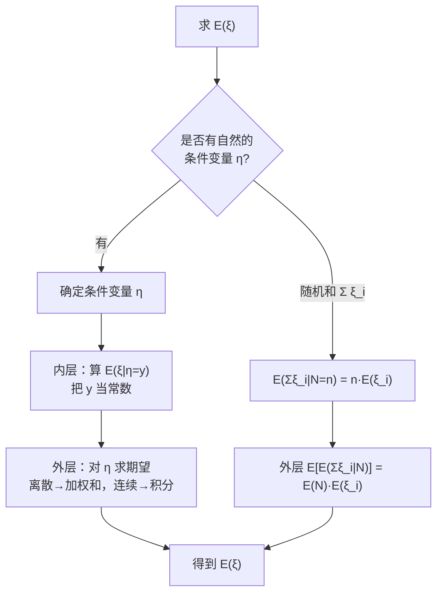

# 全期望公式法

## 适用场景
分层模型（条件期望嵌套）、随机个随机变量之和（$S = \sum_{i=1}^N \xi_i$）、已知条件期望求无条件期望。思想：**先固定条件变量，算内层期望；再对条件变量取外层期望**。

## 核心公式/步骤

**全期望公式**：
$$\boxed{E(\xi) = E[E(\xi|\eta)]}$$

- 离散型：$E(\xi) = \sum_k E(\xi|\eta = y_k) \cdot P(\eta = y_k)$
- 连续型：$E(\xi) = \int E(\xi|\eta = y) \cdot f_\eta(y) \, dy$

**随机和特例**（$\xi_i$ 同分布且与 $N$ 独立）：
$$\boxed{E\!\left(\sum_{i=1}^N \xi_i\right) = E(N) \cdot E(\xi)}$$

## 典型例题

> **题目**（随机白球）：袋中装有 $N$ 只球，其中白球数 $W$ 为随机变量，$E(W)=n$。试证从该袋中摸一球得到白球的概率为 $\frac{n}{N}$。

> [!example]- 解答
> **证**：设袋中白球数为随机变量 $W$（取非负整数值），已知 $E(W)=n$。
>
> 从袋中随机摸一球，摸得白球的概率用全期望公式：
> $$\begin{aligned}
> P(\text{摸得白球}) &= E[P(\text{摸得白球} \mid W)] \\
> &= E\!\left[\frac{W}{N}\right] = \frac{1}{N} E(W) = \frac{n}{N}
> \end{aligned}$$
>
> 等价地，用全概率公式展开：
> $$P(\text{摸得白球}) = \sum_{k=0}^{N} P(W=k) \cdot \frac{k}{N} = \frac{1}{N}\sum_{k=0}^{N} k \cdot P(W=k) = \frac{E(W)}{N} = \frac{n}{N}$$
>
> **点评**：本题体现全期望公式的精髓——即使白球数本身随机，只要知道其均值，就能确定无条件概率。这是条件期望线性性的直接体现。结果 $n/N$ 与已知白球数恰好为 $n$ 时完全一致。

---

> **题目**（随机顾客消费）：某段时间内到达商场的顾客人数 $N \sim P(\lambda)$。每位顾客消费额 $\xi \sim U[a,b]$，各顾客消费独立且与 $N$ 独立。求总消费额 $S = \sum_{i=1}^N \xi_i$ 的期望。

> [!example]- 解答
> 由全期望公式：
> $$E(S) = E[E(S|N)]$$
>
> 给定 $N=n$：$E(S|N=n) = E\left(\sum_{i=1}^n \xi_i\right) = n \cdot \frac{a+b}{2}$
>
> 外层：$E(S) = E\!\left[N \cdot \frac{a+b}{2}\right] = \frac{a+b}{2} \cdot E(N) = \frac{a+b}{2} \cdot \lambda$
>
> **点评**：核心技巧——先用条件期望把 $N$ 固定下来变成普通和，再对 $N$ 求期望。结果 $E(S) = E(N)E(\xi)$ 简洁且普适（只要 $\xi_i$ 与 $N$ 独立且同分布）。

## 链接的知识点
- [[知识点/全数学期望公式]]
- [[知识点/条件方差]]

## 链接的习题
- [[课程/概率论/习题库/04-数字特征/习题4.20]]
- [[课程/概率论/习题库/04-数字特征/习题4.5]]
