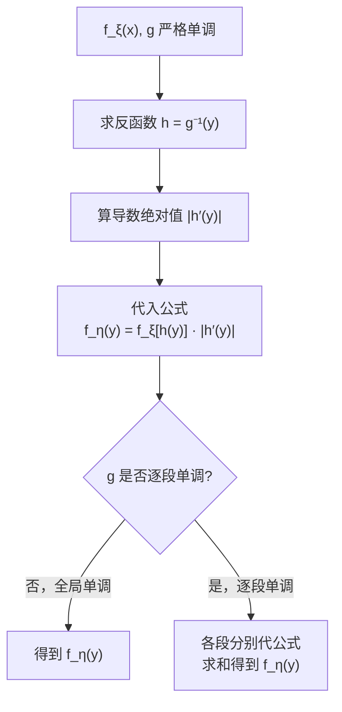

# 公式法（单调函数）

## 适用场景
$g(x)$ **严格单调**且反函数 $h = g^{-1}$ 有连续导数时，公式法比分布函数法更快捷。典型应用：正态线性变换 $\eta = a\xi+b$、$\eta = \ln\xi$（$\xi > 0$）、$\eta = e^\xi$。

## 核心公式/步骤

设 $\xi$ 密度为 $f_\xi(x)$，$g$ 严格单调，反函数 $h = g^{-1}$，则：

$$\boxed{f_\eta(y) = f_\xi[h(y)] \cdot |h'(y)|}$$

若 $g$ 在各区间 $I_1, I_2, \ldots$ 上**逐段严格单调**，反函数分别为 $h_1(y), h_2(y), \ldots$，则各段贡献相加：

$$\boxed{f_\eta(y) = \sum_i f_\xi[h_i(y)] \cdot |h_i'(y)|}$$

> **注意**：绝对值 $|h'(y)|$ 不能丢——保证密度非负，无论 $g$ 单调增还是减。

## 典型例题

> **题目**（正态线性变换）：$\xi \sim N(\mu, \sigma^2)$，求 $\eta = a\xi + b$（$a \neq 0$）的分布。

> [!example]- 解答
> $g(x) = ax + b$ 严格单调（$a>0$ 增，$a<0$ 减）。反函数 $h(y) = \dfrac{y-b}{a}$，$|h'(y)| = \dfrac{1}{|a|}$。
>
> 代入公式法：
> $$\begin{aligned}
> f_\eta(y) &= f_\xi\!\left(\frac{y-b}{a}\right) \cdot \frac{1}{|a|} \\
> &= \frac{1}{\sqrt{2\pi}\sigma} \exp\left\{-\frac{[(y-b)/a - \mu]^2}{2\sigma^2}\right\} \cdot \frac{1}{|a|} \\
> &= \frac{1}{\sqrt{2\pi}\,|a|\sigma} \exp\left\{-\frac{[y - (a\mu+b)]^2}{2a^2\sigma^2}\right\}
> \end{aligned}$$
>
> 故 $\eta \sim N(a\mu+b, \, a^2\sigma^2)$。
>
> **点评**：正态随机变量的线性函数仍是正态——均值线性变换，方差按 $a^2$ 缩放。取 $a = 1/\sigma$，$b = -\mu/\sigma$ 即得标准化变换 $\eta \sim N(0,1)$。

---

> **题目**（逐段单调——$\eta = \xi^2$）：设 $\xi \sim N(0,1)$，求 $\eta = \xi^2$ 的概率密度。

> [!example]- 解答
> $g(x) = x^2$ 在 $(-\infty, 0]$ 和 $[0, +\infty)$ 上分别严格单调。对 $y > 0$：
> - 在 $[0, +\infty)$ 上：$x = h_1(y) = \sqrt{y}$，$|h_1'(y)| = \dfrac{1}{2\sqrt{y}}$
> - 在 $(-\infty, 0]$ 上：$x = h_2(y) = -\sqrt{y}$，$|h_2'(y)| = \dfrac{1}{2\sqrt{y}}$
>
> $$\begin{aligned}
> f_\eta(y) &= \frac{1}{\sqrt{2\pi}}e^{-y/2} \cdot \frac{1}{2\sqrt{y}} + \frac{1}{\sqrt{2\pi}}e^{-y/2} \cdot \frac{1}{2\sqrt{y}} \\
> &= \frac{1}{\sqrt{2\pi y}} e^{-y/2}, \quad y > 0
> \end{aligned}$$
>
> 这正是 $\chi^2(1)$ 分布（自由度为 1 的卡方分布）的密度。
>
> **点评**：$y = x^2$ 是逐段单调的典型例子——同一个 $y$ 对应两个 $x$（正负平方根），两段贡献相加。

## 链接的知识点
- [[知识点/一维随机变量函数的分布]]

## 链接的习题
- [[课程/概率论/习题库/03-多维随机变量/习题3.20]]
