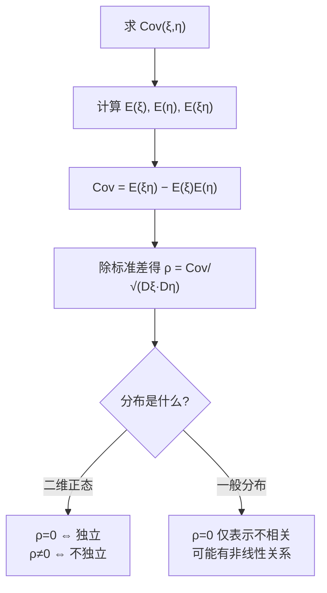

# 协方差/相关系数法

## 适用场景
度量两随机变量线性关联强度、求线性组合的方差、判定独立性（正态时 $\rho=0 \iff$ 独立）。涉及含 $\text{Cov}$ 的方差展开、线性变换下相关系数的不变性、条件期望塔式性质求协方差。

## 核心公式/步骤

**协方差**（最常用计算式）：
$$\boxed{\text{Cov}(\xi,\eta) = E(\xi\eta) - E(\xi)E(\eta)}$$

**相关系数**（标准化协方差）：
$$\boxed{\rho_{\xi\eta} = \frac{\text{Cov}(\xi,\eta)}{\sqrt{D(\xi)}\sqrt{D(\eta)}},\quad |\rho| \le 1}$$

**和的方差展开**（协方差的来源）：
$$\boxed{D\!\left(\sum \xi_i\right) = \sum D(\xi_i) + 2\sum_{i<j} \text{Cov}(\xi_i, \xi_j)}$$

**线性变换下相关系数的不变性**：
$$\boxed{\rho_{a\xi+b,\, c\eta+d} = \text{sgn}(ac) \cdot \rho_{\xi\eta}}$$

**计算四步走**：
1. 算 $E(\xi), E(\eta), E(\xi\eta)$
2. 得 $\text{Cov} = E(\xi\eta) - E(\xi)E(\eta)$
3. 除标准差得 $\rho = \text{Cov}/\sqrt{D(\xi)D(\eta)}$
4. 判断独立性（正态时 $\rho=0 \iff$ 独立；一般分布 $\rho=0 \nRightarrow$ 独立）

## 典型例题

> **题目**（线性变换不变性）：设 $\rho_{XY} = 0.9$，$Z = X - 0.4$，求 $Y$ 与 $Z$ 的相关系数。

> [!example]- 解答
> $Z = X - 0.4$ 是 $X$ 的平移变换（$a=1, b=-0.4$）。
>
> 协方差：$\text{Cov}(Y, Z) = \text{Cov}(Y, X-0.4) = \text{Cov}(Y, X)$（常数协方差为零）。
>
> 方差：$D(Z) = D(X-0.4) = D(X)$（平移不改变方差）。
>
> 代入：
> $$\rho_{YZ} = \frac{\text{Cov}(Y,Z)}{\sqrt{DY \cdot DZ}} = \frac{\text{Cov}(Y,X)}{\sqrt{DY \cdot DX}} = \rho_{XY} = 0.9$$
>
> **点评**：相关系数在线性变换 $aX+b$（$a \neq 0$）下，绝对值不变。符号取决于 $ac$ 是否同号——这里 $a=1>0$，同号，故 $\rho$ 不变。常数项对相关系数无任何影响。

---

> **题目**（协方差塔式求法）：$\xi$ 的均值和方差为 $\mu, \sigma^2$，$\eta|\xi=x \sim N(x,\tau^2)$。求 $\text{Cov}(\xi, \eta)$。

> [!example]- 解答
> $$\begin{aligned}
> \text{Cov}(\xi, \eta) &= E[(\xi-\mu)(\eta-\mu)] \\
> &= E\big[E[(\xi-\mu)(\eta-\mu) \mid \xi]\big] \\
> &= E\big[(\xi-\mu) \cdot E[\eta-\mu \mid \xi]\big] \\
> &= E[(\xi-\mu)(\xi-\mu)] = D(\xi) = \sigma^2
> \end{aligned}$$
>
> 条件期望塔式性质：先对条件变量 $\xi$ 取内层期望（把 $(\xi-\mu)$ 提出），再取外层期望。
>
> **点评**：当两个变量通过条件期望关联时，协方差的计算捷径是塔式性质——把 $\eta$ 的信息"投射"到 $\xi$ 上。

## 链接的知识点
- [[知识点/协方差]]
- [[知识点/相关系数]]
- [[知识点/二维正态分布]]

## 链接的习题
- [[课程/概率论/习题库/04-数字特征/习题4.6]]
- [[课程/概率论/习题库/04-数字特征/习题4.12]]
- [[课程/概率论/习题库/04-数字特征/习题4.14]]
