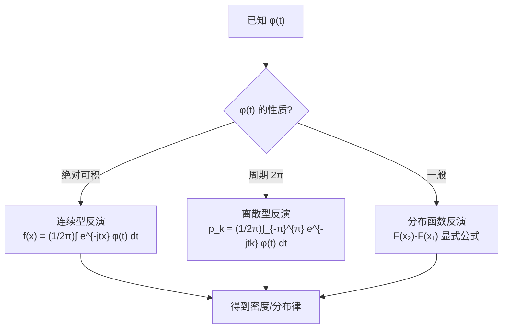

# 反演公式法

## 适用场景
已知特征函数 $\varphi(t)$，反求分布函数、密度或分布律。当特征函数乘积无法直接匹配已知分布时（特征函数法第三步失败），用反演公式恢复分布。也是验证唯一性定理的实践工具。

## 核心公式/步骤

**唯一性定理**：分布函数由其特征函数唯一确定：
$$F_1(x) \equiv F_2(x) \iff \varphi_1(t) \equiv \varphi_2(t)$$

**连续型反演**（$\varphi(t)$ 绝对可积时）：
$$\boxed{f(x) = \frac{1}{2\pi} \int_{-\infty}^{+\infty} e^{-jtx} \varphi(t) \, dt}$$

**离散型反演**（$\xi$ 取整数值时）：
$$\boxed{p_k = \frac{1}{2\pi} \int_{-\pi}^{\pi} e^{-jtk} \varphi(t) \, dt}$$

**一般反演**（分布函数版本）：
$$\boxed{F(x_2) - F(x_1) = \lim_{T \to \infty} \frac{1}{2\pi} \int_{-T}^{T} \frac{e^{-jtx_1} - e^{-jtx_2}}{jt} \varphi(t) \, dt}$$

## 典型例题

> **题目**：$\xi \sim N(0,1)$，其特征函数 $\varphi(t) = e^{-t^2/2}$ 在 $\mathbb{R}$ 上绝对可积，用反演公式验证其密度。

> [!example]- 解答
> $\varphi(t) = e^{-t^2/2}$ 满足 $\int_{-\infty}^{+\infty} |\varphi(t)| dt = \sqrt{2\pi} < \infty$，可积。代入连续型反演公式：
>
> $$\begin{aligned}
> f(x) &= \frac{1}{2\pi} \int_{-\infty}^{+\infty} e^{-jtx} e^{-t^2/2} \, dt \\
> &= \frac{1}{2\pi} \int_{-\infty}^{+\infty} e^{-\frac{1}{2}(t^2 + 2jtx)} \, dt
> \end{aligned}$$
>
> 配方：$t^2 + 2jtx = (t + jx)^2 + x^2$
>
> $$\begin{aligned}
> f(x) &= \frac{1}{2\pi} e^{-x^2/2} \int_{-\infty}^{+\infty} e^{-\frac{1}{2}(t + jx)^2} \, dt \\
> &= \frac{1}{2\pi} e^{-x^2/2} \cdot \sqrt{2\pi} \\
> &= \frac{1}{\sqrt{2\pi}} e^{-x^2/2}
> \end{aligned}$$
>
> 结果正是标准正态密度的公式，验证通过。
>
> **点评**：正态特征函数绝对可积是得天独厚的性质——可以用傅里叶逆变换直接恢复密度。配方法将指数中的 $jtx$ 合并到完全平方中，复平面上围道积分的平移不变性保证了积分结果仍为 $\sqrt{2\pi}$。

---

> **题目**（离散型反演）：设 $\varphi(t) = \cos t$，判断这是否为某整数值随机变量的特征函数，并求其分布律。

> [!example]- 解答
> $\varphi(t) = \cos t = \frac{e^{jt} + e^{-jt}}{2}$。周期 $2\pi$，可用离散反演：
>
> $$p_k = \frac{1}{2\pi} \int_{-\pi}^{\pi} e^{-jtk} \cos t \, dt$$
>
> 将 $\cos t = \frac{e^{jt}+e^{-jt}}{2}$ 代入：
> $$p_k = \frac{1}{4\pi} \int_{-\pi}^{\pi} \left[e^{-jt(k-1)} + e^{-jt(k+1)}\right] dt$$
>
> 当 $k = \pm 1$ 时：$p_1 = p_{-1} = 1/2$；其余 $p_k = 0$。
>
> 故 $\xi$ 的分布律为 $P\{\xi=1\} = P\{\xi=-1\} = 1/2$（Rademacher 分布）。
>
> **点评**：周期 $2\pi$ 的特征函数对应整数值离散型分布——反演公式化为傅里叶系数计算。$\cos t$ 对应的是对称两点分布。

## 链接的知识点
- [[知识点/概率论/反演公式与唯一性定理]]

## 链接的习题
- [[课程/概率论/习题库/05-极限定理/习题5.4]]
- [[课程/概率论/习题库/05-极限定理/习题5.10]]
