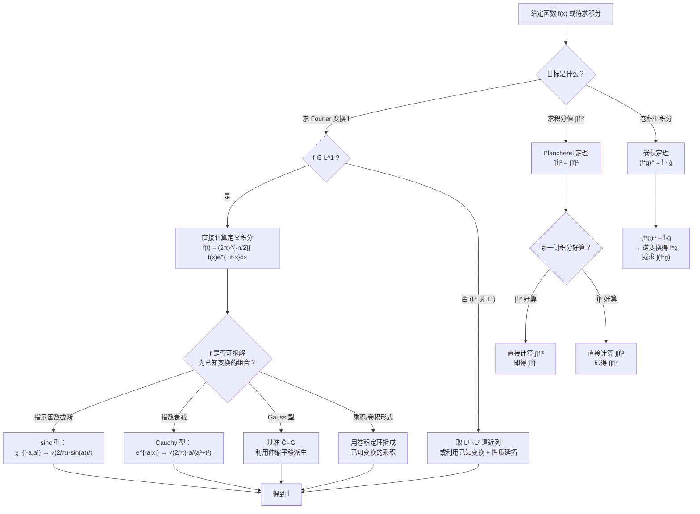

# Fourier变换求解法

## 适用场景

需要计算具体函数的 Fourier 变换、利用卷积定理简化含卷积的积分、或利用 Plancherel 定理将难以直接计算的积分转化为 $L^2$ 范数等式求解。

## 核心公式/步骤

**Fourier 变换定义**（$L^1$ 中）：

$$\boxed{\hat{f}(t) = (2\pi)^{-n/2} \int_{\mathbb{R}^n} f(x)\, e^{-i t \cdot x}\, dx}$$

**Fourier 逆变换**（速降函数类 $\mathcal{S}$ 中）：

$$\boxed{f(x) = (2\pi)^{-n/2} \int_{\mathbb{R}^n} \hat{f}(t)\, e^{i x \cdot t}\, dt}$$

---

### 操作步骤

1. **判断函数所属空间**：确认 $f \in L^1$（可直接积分定义）还是 $f \in L^2 \setminus L^1$（需用延拓 / Plancherel）
2. **识别可用的简化性质**：
   - 平移 $\leftrightarrow$ 乘相位：$\widehat{f(x-a)}(t) = e^{-i a \cdot t}\,\hat{f}(t)$
   - 卷积 $\leftrightarrow$ 乘积：$\widehat{f*g} = \hat{f} \cdot \hat{g}$（卷积定理）
   - 伸缩 $\leftrightarrow$ 反伸缩：$\widehat{f(ax)}(t) = |a|^{-n}\,\hat{f}(t/a)$
3. **选用基准变换**（见下方变换表），组合性质得出目标函数的 Fourier 变换
4. **利用 Plancherel 求积分值**：$\|\hat{f}\|_2 = \|f\|_2$，即
   $$\boxed{\int_{\mathbb{R}^n} |\hat{f}(t)|^2\,dt = \int_{\mathbb{R}^n} |f(x)|^2\,dx}$$
   当等式一侧易于计算时，即可求出另一侧的积分值

---

### 常见变换表（$n=1$，归一化 $(2\pi)^{-1/2}$）

| $f(x)$ | $\hat{f}(t)$ | 备注 |
|:---|:---|:---|
| $\chi_{[-a,a]}(x)$ | $\displaystyle \sqrt{\frac{2}{\pi}}\,\frac{\sin(at)}{t}$ | sinc 型 — 截断函数的 Fourier 变换 |
| $e^{-a\|x\|}\;(a>0)$ | $\displaystyle \sqrt{\frac{2}{\pi}}\,\frac{a}{a^{2}+t^{2}}$ | Cauchy 分布 — 指数衰减对应有理衰减 |
| $e^{-ax^{2}}\;(a>0)$ | $\displaystyle (2a)^{-1/2}\,e^{-t^{2}/4a}$ | Gauss 型 — $a=1/2$ 时 $\hat{G}=G$ |
| $G(x)=e^{-\|x\|^{2}/2}$ | $\hat{G}(t)=G(t)$ | **基准**：Gauss 函数是 Fourier 变换的特征函数 |

> [!warning] 关键易错点
> - **归一化常数因文献而异**：本文采用 $(2\pi)^{-n/2}$，部分教材用 $(2\pi)^{-1/2}$ 或 $1$——做题前必须先确认定义
> - **卷积定理对 $L^1$ 函数成立**，推广到 $L^2$ 需用 $L^1 \cap L^2$ 稠密延拓——不可直接在 $L^2$ 中对任意函数套用
> - **$L^1$ 中 Fourier 变换的值不一定回到 $L^1$**（如 $\chi_{[-a,a]}$ 的变换为 sinc，不属于 $L^1$），因此不能随意写逆变换积分公式
> - 使用 Plancherel 时，等式为 $\|\hat{f}\|_2 = \|f\|_2$，不要误写成 $\|\hat{f}\|_1 = \|f\|_1$（**一般不成立**）

## 流程图

## 典型例题

> **题目 1**：计算 $f(x) = e^{-|x|}$（$x \in \mathbb{R}$）的 Fourier 变换，并利用 Plancherel 定理验证结果。

> [!example]- 解答
> **直接计算**（$f \in L^1$，归一化 $(2\pi)^{-1/2}$）：
> $$\begin{aligned}
> \hat{f}(t) &= \frac{1}{\sqrt{2\pi}} \int_{-\infty}^{\infty} e^{-|x|}\, e^{-i t x}\, dx \\
> &= \frac{1}{\sqrt{2\pi}} \left( \int_{-\infty}^{0} e^{x(1-it)}\, dx + \int_{0}^{\infty} e^{-x(1+it)}\, dx \right) \\
> &= \frac{1}{\sqrt{2\pi}} \left( \frac{1}{1-it} + \frac{1}{1+it} \right)
>   = \sqrt{\frac{2}{\pi}}\,\frac{1}{1+t^{2}}
> \end{aligned}$$
>
> **Plancherel 验证**：
> $$\begin{aligned}
> \|f\|_2^2 &= \int_{-\infty}^{\infty} e^{-2|x|}\, dx = 2\int_{0}^{\infty} e^{-2x}\,dx = 1 \\
> \|\hat{f}\|_2^2 &= \frac{2}{\pi} \int_{-\infty}^{\infty} \frac{1}{(1+t^{2})^{2}}\, dt
>   = \frac{2}{\pi} \cdot \frac{\pi}{2} = 1
> \end{aligned}$$
> 验证通过 $\|\hat{f}\|_2 = \|f\|_2 = 1$。
>
> **点评**：本题展示了 Fourier 变换从定义出发的直接计算路线——先拆分积分区间消去绝对值，再合并为有理函数。Plancherel 验证不仅是检查，也是"$\|\hat{f}\|_2 = 1$"这个事实本身可反过来用于后续积分计算。

---

> **题目 2**：利用卷积定理证明 $\displaystyle \int_{-\infty}^{\infty} \frac{\sin^{2} x}{x^{2}}\,dx = \pi$。

> [!example]- 解答
> **思路**：将 $\frac{\sin x}{x}$ 与某已知函数的 Fourier 变换关联。
>
> 令 $f(x) = \chi_{[-1,1]}(x)$（区间 $[-1,1]$ 上的指示函数）。由变换表：
> $$\hat{f}(t) = \sqrt{\frac{2}{\pi}}\,\frac{\sin t}{t}$$
>
> 卷积定理：$\widehat{f*f} = \hat{f} \cdot \hat{f} = (\hat{f})^{2}$。取 Fourier 逆变换（在 $\mathcal{S}$ 意义上）：
> $$(f*f)(x) = \frac{1}{\sqrt{2\pi}} \int_{-\infty}^{\infty} (\hat{f}(t))^{2}\, e^{i x t}\, dt$$
>
> 在 $x=0$ 处：
> $$(f*f)(0) = \frac{1}{\sqrt{2\pi}} \int_{-\infty}^{\infty} \frac{2}{\pi}\,\frac{\sin^{2} t}{t^{2}}\, dt
>   = \sqrt{\frac{2}{\pi}}\,\frac{1}{\pi} \int_{-\infty}^{\infty} \frac{\sin^{2} t}{t^{2}}\, dt$$
>
> 另一方面，直接计算卷积：
> $$(f*f)(x) = \int_{-\infty}^{\infty} \chi_{[-1,1]}(x-y)\,\chi_{[-1,1]}(y)\, dy
>   = \max(0,\, 2-|x|)$$
> 故 $(f*f)(0) = 2$。
>
> 等置两边得：
> $$\sqrt{\frac{2}{\pi}}\,\frac{1}{\pi} \int_{-\infty}^{\infty} \frac{\sin^{2} t}{t^{2}}\, dt = 2
>   \implies \int_{-\infty}^{\infty} \frac{\sin^{2} x}{x^{2}}\, dx = \pi$$
>
> **点评**：本题是卷积定理的经典应用——把难以直接积分的 $\int \sin^{2}x/x^{2}\,dx$ 转化为两个简单函数（指示函数）卷积在 $0$ 点的值。关键技巧是识别 $\sin t/t$ 为 $\chi_{[-1,1]}$ 的 Fourier 变换，再用卷积定理将乘积逆推回卷积。

---

> **题目 3**：设 $f(x) = e^{-x^{2}/2}$（$x \in \mathbb{R}$），利用 Gauss 函数为 Fourier 变换特征函数的性质，求 $\displaystyle \int_{-\infty}^{\infty} x^{2} e^{-x^{2}}\,dx$。

> [!example]- 解答
> Gauss 基准：$G(x) = e^{-x^{2}/2}$ 满足 $\hat{G} = G$。
>
> 令 $f(x) = e^{-x^{2}/2}$，则 $\hat{f} = f$。Plancherel 给出 $\|f\|_2 = \|\hat{f}\|_2$（平凡验证）。
>
> 对于 $xe^{-x^{2}/2}$：由 $f'(x) = -x f(x)$，且 $\widehat{f'}(t) = i t \hat{f}(t)$，得
> $$\widehat{-x f(x)}(t) = i t \hat{f}(t) \implies \widehat{x f(x)}(t) = -i t \hat{f}(t) = -i t f(t)$$
>
> 由此：
> $$\begin{aligned}
> \int_{-\infty}^{\infty} x^{2} e^{-x^{2}}\,dx
>   &= \int_{-\infty}^{\infty} (x e^{-x^{2}/2})^{2}\,dx \\
>   &= \|x f(x)\|_2^{2} \\
>   &= \|\widehat{x f}\|_2^{2} \quad \text{(Plancherel)} \\
>   &= \int_{-\infty}^{\infty} |-i t f(t)|^{2}\,dt \\
>   &= \int_{-\infty}^{\infty} t^{2} e^{-t^{2}}\,dt
> \end{aligned}$$
>
> 这给出等式 $\int x^{2} e^{-x^{2}}dx = \int t^{2} e^{-t^{2}}dt$（平凡）。更进一步的技巧是直接对 Gauss 积分求导：
> $$\int_{-\infty}^{\infty} e^{-a x^{2}} dx = \sqrt{\frac{\pi}{a}}
>   \implies \int_{-\infty}^{\infty} x^{2} e^{-a x^{2}} dx = \frac{\sqrt{\pi}}{2} a^{-3/2}$$
> 令 $a=1$ 即得 $\displaystyle \int_{-\infty}^{\infty} x^{2} e^{-x^{2}} dx = \frac{\sqrt{\pi}}{2}$。
>
> **点评**：本题展示 Plancherel 与 Fourier 变换性质结合求积分的模式。虽然本题可用参数求导绕过，但当被积函数结构更复杂（如混合 Fourier 变换）时，Plancherel + 性质组合往往是唯一可行的路线。

## 知识链接

- [[知识点/实变函数/Plancherel定理]] — Fourier 变换在 $L^2$ 上的等距延拓，$\|\hat{f}\|_2 = \|f\|_2$
- [[知识点/实变函数/正交基与Fourier展开]] — $L^2$ 中 Fourier 展开与 Parseval 等式，Plancherel 的离散对应
- [[知识点/实变函数/Young不等式(卷积版)]] — 卷积在 $L^p$ 中的连续性，卷积定理成立的基础

## 习题链接

- [[课程/实变函数/习题库/05-重积分与Lp空间/考题-Fourier变换的核心性质]] — 卷积定理证明、Gauss 变换、Plancherel 陈述（考试级综合题）
- [[课程/实变函数/习题库/05-重积分与Lp空间/考题-正交基与Fourier展开]] — 正交基、Fourier 展开与 Parseval 等式（离散版本对照）
