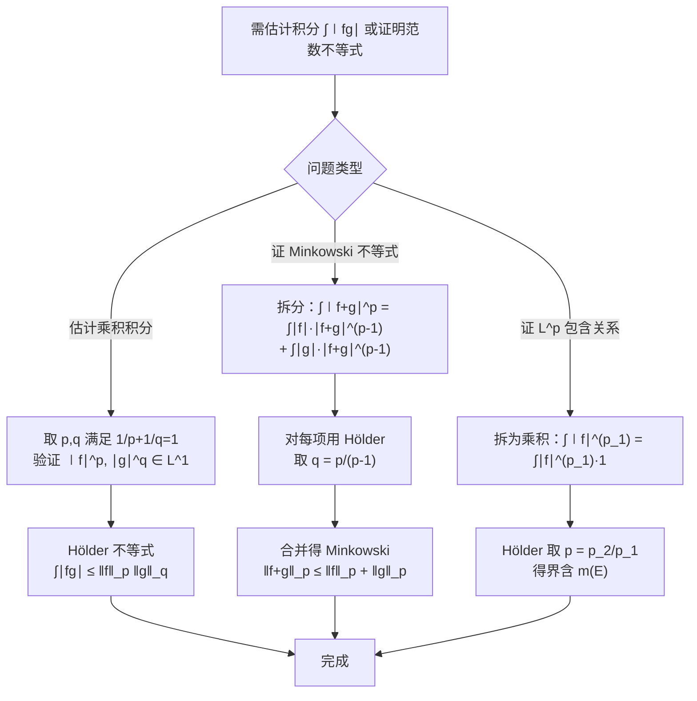

# Hölder不等式应用法

## 适用场景

需要估计积分 $\int |fg|$ 的大小或证明范数不等式时使用 Hölder / Minkowski / Schwarz 不等式。本质是将乘积函数的积分转化为各自 $L^p$ 范数的乘积，是 $L^p$ 空间理论中估计积分大小的核心工具。

## 核心公式/步骤

**Hölder 不等式**（共轭指数 $p,q$ 满足 $\frac{1}{p}+\frac{1}{q}=1$）：

$$\boxed{\int |fg| \leq \|f\|_p \|g\|_q \qquad \left(\frac{1}{p}+\frac{1}{q}=1\right)}$$

- $p=q=2$：**Cauchy-Schwarz** $|\int fg| \leq \|f\|_2 \|g\|_2$
- 证明技巧：**Young 不等式** $ab \leq \dfrac{a^p}{p} + \dfrac{b^q}{q}$（$a,b \geq 0$）

**执行步骤**：

1. 确定要估计的积分 $\int |fg|$ 或 $\int |f+g|^p$
2. 选取合适的 $p,q$ 使得 $\frac{1}{p}+\frac{1}{q}=1$，且 $|f|^p, |g|^q$ 分别可积
3. 对 $\int |f+g|^p$ 型：拆分为 $\int |f||f+g|^{p-1} + \int |g||f+g|^{p-1}$，对每项用 Hölder（取 $q = \frac{p}{p-1}$）

**常见应用**：

- **证明 $L^p$ 包含关系**：$m(E)<\infty$，$p_1<p_2$。对 $f \in L^{p_2}$：
  $$\int |f|^{p_1} = \int |f|^{p_1} \cdot 1 \leq \left(\int |f|^{p_2}\right)^{\frac{p_1}{p_2}} \left(\int 1\right)^{1-\frac{p_1}{p_2}} = \|f\|_{p_2}^{p_1}\, m(E)^{1-\frac{p_1}{p_2}} < \infty$$
  故 $L^{p_2} \subset L^{p_1}$

- **证明对偶性**：$\|f\|_p = \sup_{\|g\|_q=1} \int fg$

- **证明 Young 不等式（卷积版）**

> [!warning] 易错点
> - $p,q$ 必须满足 $\frac{1}{p}+\frac{1}{q}=1$（共轭指数）
> - $p=1,q=\infty$ 也是允许的边界情形
> - 有限测度条件下的包含关系方向：$L^{p_2}$ 在有限测度上比 $L^{p_1}$ **"小"**（大指数空间嵌入小指数空间）

## 流程图

## 典型例题

> **题目 1**：证明 $m(E)<\infty$ 时 $L^{p_2} \subset L^{p_1}$（$p_1 < p_2$）。

> [!example]- 解答 1
> 对 $f \in L^{p_2}(E)$，将 $|f|^{p_1}$ 写为乘积：
> 
> $$\int_E |f|^{p_1} = \int_E |f|^{p_1} \cdot 1$$
> 
> 取 Hölder 共轭指数 $p = \frac{p_2}{p_1}$，$q = \frac{p_2}{p_2-p_1}$（满足 $\frac{1}{p}+\frac{1}{q}=1$）：
> 
> $$\begin{aligned}
> \int_E |f|^{p_1} \cdot 1 &\leq \left(\int_E (|f|^{p_1})^{p}\right)^{\frac{1}{p}} \left(\int_E 1^q\right)^{\frac{1}{q}} \\
> &= \left(\int_E |f|^{p_2}\right)^{\frac{p_1}{p_2}} \cdot m(E)^{1-\frac{p_1}{p_2}} \\
> &= \|f\|_{p_2}^{p_1} \cdot m(E)^{\frac{p_2-p_1}{p_2}} < \infty
> \end{aligned}$$
> 
> 故 $f \in L^{p_1}(E)$，即 $L^{p_2} \subset L^{p_1}$。
> 
> **点评**：关键技巧是将被积函数拆为 $|f|^{p_1} \cdot 1$，取 $p = p_2/p_1 > 1$ 使第一个因子回到 $L^{p_2}$。若 $m(E)=\infty$ 此包含关系不成立。

> **题目 2**：证明 **Minkowski 不等式**：$\|f+g\|_p \leq \|f\|_p + \|g\|_p$（$1 \leq p < \infty$）。

> [!example]- 解答 2
> 考虑 $\|f+g\|_p^p = \int |f+g|^p$，用三角不等式拆分：
> 
> $$\begin{aligned}
> \int |f+g|^p &= \int |f+g| \cdot |f+g|^{p-1} \\
> &\leq \int |f| \cdot |f+g|^{p-1} + \int |g| \cdot |f+g|^{p-1}
> \end{aligned}$$
> 
> 对第一项用 Hölder（取 $q = \frac{p}{p-1}$，满足 $\frac{1}{p} + \frac{1}{q} = 1$）：
> 
> $$\int |f| \cdot |f+g|^{p-1} \leq \|f\|_p \cdot \left(\int |f+g|^{(p-1)q}\right)^{\frac{1}{q}}$$
> 
> 由于 $(p-1)q = p$，故 $\left(\int |f+g|^{(p-1)q}\right)^{\frac{1}{q}} = \left(\int |f+g|^p\right)^{\frac{p-1}{p}} = \|f+g\|_p^{p-1}$。
> 
> 于是 $\int |f| \cdot |f+g|^{p-1} \leq \|f\|_p \cdot \|f+g\|_p^{p-1}$，同理第二项 $\leq \|g\|_p \cdot \|f+g\|_p^{p-1}$。
> 
> 合并：
> 
> $$\|f+g\|_p^p \leq (\|f\|_p + \|g\|_p) \cdot \|f+g\|_p^{p-1}$$
> 
> 当 $\|f+g\|_p > 0$ 时，两边除以 $\|f+g\|_p^{p-1}$ 即得 $\|f+g\|_p \leq \|f\|_p + \|g\|_p$。当 $\|f+g\|_p = 0$ 时不等式平凡成立。
> 
> **点评**：Minkowski 的证明是 Hölder 最经典的应用——将 $|f+g|^p$ 拆为 $|f||f+g|^{p-1} + |g||f+g|^{p-1}$，对每项用 Hölder，利用 $(p-1)q = p$ 使指数匹配后约化。

## 知识链接

- [[知识点/实变函数/Hölder不等式]] — Hölder 不等式的严格陈述与 Young 不等式证明
- [[知识点/实变函数/Minkowski不等式]] — Minkowski 不等式（$L^p$ 三角不等式）的 Hölder 证明
- [[知识点/实变函数/Young不等式]] — Young 不等式 $ab \leq a^p/p + b^q/q$（Hölder 证明的前置工具）
- [[知识点/实变函数/L^p空间]] — $L^p$ 空间定义、范数、包含关系与对偶性（均依赖 Hölder）
- [[知识点/实变函数/Riesz定理]] — $L^p$ 对偶空间的 Riesz 表示定理

## 习题链接

- [[课程/实变函数/习题库/05-重积分与Lp空间/习题5.6-Hölder不等式-习题]] — Hölder 不等式的基本证明与直接应用
- [[课程/实变函数/习题库/05-重积分与Lp空间/习题5.7-Minkowski不等式（L^p三角不等式）-习题]] — Minkowski 不等式的完整证明
- [[课程/实变函数/习题库/05-重积分与Lp空间/习题5.8-有限测度集上L^p空间的包含关系-习题]] — $m(E)<\infty$ 时 $L^{p_2} \subset L^{p_1}$ 的证明
- [[课程/实变函数/习题库/05-重积分与Lp空间/习题5.9-L^p范数的对偶表示（定理4.1.5）-习题]] — $\|f\|_p = \sup_{\|g\|_q=1} \int fg$ 的对偶刻画
- [[课程/实变函数/习题库/05-重积分与Lp空间/习题5.5-Young不等式-习题]] — Young 不等式（Hölder 证明的前置工具）
