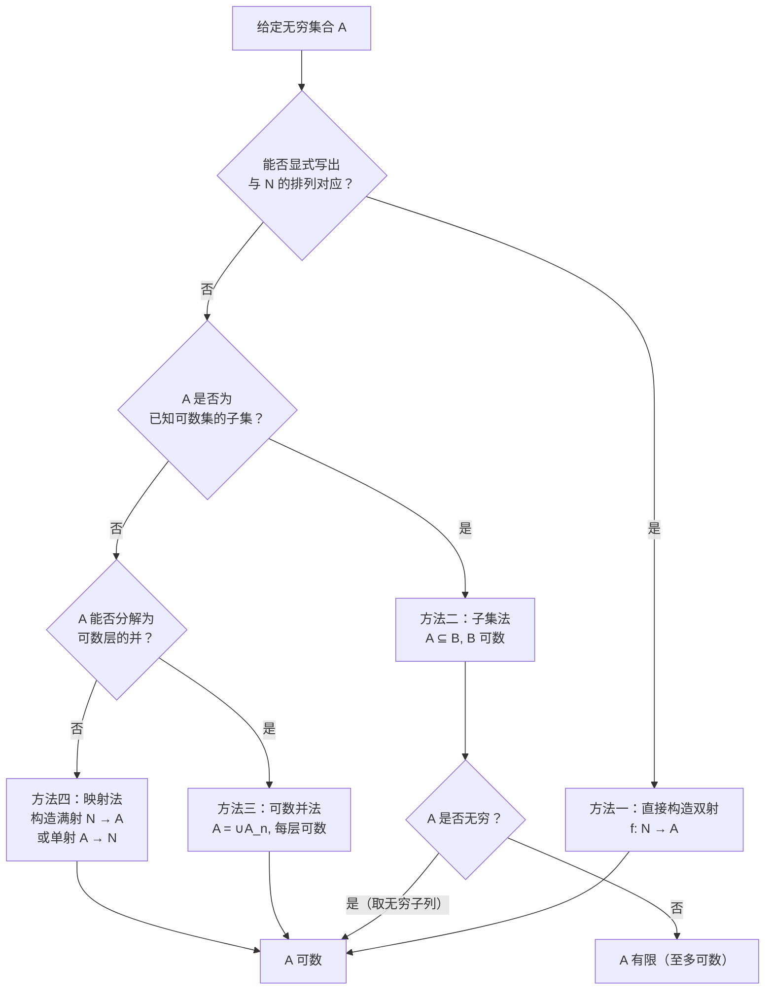

# 证明集合可数的方法

## 适用场景

判断一个无穷集合是否为可数集——即能否与 $\mathbb{N}$ 建立双射（势为 $\aleph_0$）。四种标准方法覆盖了实变函数中绝大多数可数性判定问题。

## 核心公式/步骤

### 方法一：直接构造双射

显式写出从 $\mathbb{N}$ 到目标集合的一一对应。

$$\boxed{f: \mathbb{N} \to A \text{ 是双射}}$$

典型构造：$\mathbb{Z}$ 与 $\mathbb{N}$ 的双射

$$f(n) = (-1)^n \left\lfloor \frac{n+1}{2} \right\rfloor \quad (n = 0,1,2,\ldots)$$

排列效果：$0 \mapsto 0,\; 1 \mapsto -1,\; 2 \mapsto 1,\; 3 \mapsto -2,\; 4 \mapsto 2,\; \ldots$

### 方法二：子集法

证明集合是某个**已知可数集**的子集。

$$\boxed{A \subseteq B,\; B \text{ 可数} \;\Longrightarrow\; A \text{ 至多可数}}$$

> [!warning] 子集法仅给出"至多可数"
> 若还需证明 $A$ 为无穷集，需额外论证 $A$ 不是有限集（通常取一无穷子列即可）。

### 方法三：可数并法（对角线排列法）

证明集合可表示为**可数个可数集的并**。

$$\boxed{A = \bigcup_{n=1}^{\infty} A_n,\quad \text{每个 } A_n \text{ 可数} \;\Longrightarrow\; A \text{ 可数}}$$

典型构造（$\mathbb{Q}$ 的可数性）：

$$\mathbb{Q} = \bigcup_{q=1}^{\infty} \left\{ \frac{p}{q} : p \in \mathbb{Z} \right\}$$

每层 $\{p/q : p \in \mathbb{Z}\}$ 与 $\mathbb{Z}$ 等势（可数），可数个可数集的并可数。

> [!warning] 可数并可数，但直积不一定可数
> 可数个可数集的**并**仍可数；但可数个有限集的**直积**可能不可数——例如 $\{0,1\}^{\mathbb{N}}$ 的势为 $\mathfrak{c}$（连续统）。这是初学者最易混淆的地方。

### 方法四：映射法

构造**满射** $\mathbb{N} \to A$ 或**单射** $A \to \mathbb{N}$。

$$\boxed{\exists\; \text{满射 } g: \mathbb{N} \twoheadrightarrow A \;\Longrightarrow\; |A| \leq \aleph_0}$$

$$\boxed{\exists\; \text{单射 } h: A \hookrightarrow \mathbb{N} \;\Longrightarrow\; |A| \leq \aleph_0}$$

- **满射**方向：说明 $A$ 的元素能被"枚举"（允许重复）。
- **单射**方向：说明 $A$ 的势不超过 $\aleph_0$（每个元素对应一个唯一自然数编码）。

### 方法选择速查

| 场景特征 | 推荐方法 | 典型例子 |
|:--|:--|:--|
| 集合有显式排列规律 | 方法一（直接构造双射） | $\mathbb{Z}$、$\mathbb{N} \times \mathbb{N}$ |
| 集合是已知可数集的子集 | 方法二（子集法） | 代数数集 $\subseteq$ 可数集 |
| 集合可按"层级"分解 | 方法三（可数并法） | $\mathbb{Q}$、整系数多项式全体 |
| 构造双射困难但可编码 | 方法四（映射法） | 不相交开区间族 → 每区间取有理数 |

## 流程图

## 典型例题

> **题目1**：证明整系数多项式全体（记作 $\mathbb{Z}[x]$）是可数集。

> [!example]- 解答
> **分析**：整系数多项式由次数 $n$ 和 $n+1$ 个整系数决定，可按次数分层。
>
> **证明**（方法三 — 可数并法）：
>
> 记 $P_n$ 为次数不超过 $n$ 的整系数多项式全体（$n=0,1,2,\ldots$），则
> $$\mathbb{Z}[x] = \bigcup_{n=0}^{\infty} P_n$$
>
> 每个 $P_n$ 中的多项式 $a_0 + a_1 x + \cdots + a_n x^n$ 与 $(a_0, a_1, \ldots, a_n) \in \mathbb{Z}^{n+1}$ 一一对应。
>
> $\mathbb{Z}^{n+1}$ 是 $n+1$ 个可数集的直积——有限个可数集的直积仍可数（可通过对角线排列 $\mathbb{N}^{k}$ 证明）。故 $P_n$ 可数。
>
> $\mathbb{Z}[x]$ 是可数个可数集 $\{P_n\}$ 的并，由可数并定理知 $\mathbb{Z}[x]$ 可数。
>
> **点评**：本题也可直接构造编码——每个整系数多项式对应一个有限长整数序列，用素数幂编码为单个自然数（满射 $\mathbb{N} \to \mathbb{Z}[x]$），属方法四的范畴。两种思路殊途同归。

---

> **题目2**：证明 $\mathbb{R}$ 中任意一族两两不相交的非空开区间至多是可数集。

> [!example]- 解答
> **分析**：无法直接构造与 $\mathbb{N}$ 的双射，但每个开区间内都有一个有理数——这是**方法四（单射法）**的经典范例。
>
> **证明**（方法四 — 构造单射）：
>
> 设 $\mathcal{F} = \{I_\alpha\}_{\alpha \in A}$ 是 $\mathbb{R}$ 中一族两两不相交的非空开区间。
>
> 对每个 $I_\alpha$，由 $\mathbb{Q}$ 在 $\mathbb{R}$ 中的稠密性，存在有理数 $q_\alpha \in I_\alpha$。
>
> 由于区间两两不交，不同区间包含的有理数必然不同：
> $$I_\alpha \cap I_\beta = \emptyset \;\Longrightarrow\; q_\alpha \neq q_\beta$$
>
> 因此映射 $\alpha \mapsto q_\alpha$ 是从指标集 $A$ 到 $\mathbb{Q}$ 的**单射**。而 $\mathbb{Q}$ 可数，故 $|A| \leq \aleph_0$，即 $\mathcal{F}$ 至多可数。
>
> **点评**：这是实变函数中"利用有理数的可数稠密性"的第一个经典应用。该技巧反复出现——任何互不相交的开集族都可借此证明可数性。此结论也是证明 $\mathbb{R}$ 中开集结构定理（开集可唯一表示为至多可数个互不相交开区间的并）的基础。
>
> **易错提醒**：构造的是 $A \to \mathbb{Q}$ 的单射，而非双射——我们不需要也通常无法让每个有理数都对应一个区间。单射足以说明 $|A| \leq |\mathbb{Q}| = \aleph_0$。

## 知识链接

- [[知识点/实变函数/Cantor对角线法]] — 对角线法是证明集合**不可数**的互补方法，与本文四种可数性方法构成完整的势判定工具箱
- [[概念/实变函数/可数集]] — 可数集的定义、基本性质与运算规则
- [[概念/实变函数/不可数集]] — 不可数集的判定标准，$\mathbb{R}$ 的势 $\mathfrak{c} > \aleph_0$
- [[概念/实变函数/势]] — 势的比较理论（Cantor-Bernstein 定理），为单射/满射法提供理论基础

## 习题链接

- [[课程/实变函数/习题库/01-集合论与点集拓扑基础/习题1.1-自然数集与偶数集的一一对应-思考题]] — 直接构造双射：$\mathbb{N} \to$ 偶数集，进而思考 $\mathbb{N}$ 与 $\mathbb{Z}$、$\mathbb{Q}$ 的对等性
- [[课程/实变函数/习题库/01-集合论与点集拓扑基础/习题1.30-不相交开区间族可数-例题]] — 方法四（单射法）的典例：每区间取一有理数
- [[课程/实变函数/习题库/01-集合论与点集拓扑基础/习题1.31-单调函数不连续点可数-例题]] — 方法四的延伸应用：每不连续点对应一个跳跃区间，再利用习题1.30
- [[课程/实变函数/习题库/01-集合论与点集拓扑基础/习题1.32-可列集的有限子集全体可列-证明题]] — 方法三（可数并法）：按子集大小分层，每层可数
