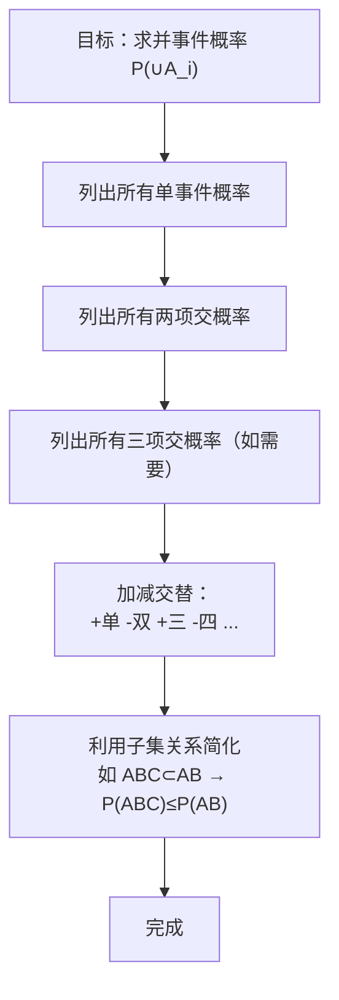

# 容斥原理

## 适用场景

计算事件的并集概率——事件之间不独立、不互斥，无法用简单的乘积或对立法简化时，使用容斥原理（概率加法公式）。

## 核心步骤

### 两个事件

$$\boxed{P(A \cup B) = P(A) + P(B) - P(AB)}$$

### 三个事件

$$\boxed{P(A \cup B \cup C) = P(A) + P(B) + P(C) - P(AB) - P(AC) - P(BC) + P(ABC)}$$

### $n$ 个事件（一般形式）

$$P\!\left(\bigcup_{i=1}^n A_i\right) = \sum_i P(A_i) - \sum_{i<j} P(A_i A_j) + \sum_{i<j<k} P(A_i A_j A_k) - \cdots + (-1)^{n-1} P(A_1 A_2 \cdots A_n)$$

### 操作步骤

**①** 列出所有事件及其概率

**②** 逐层计算交集概率（两项交、三项交……）

**③** 加减交替（奇数个交集加，偶数个交集减）

**④** 技巧：若某些交集包含于另一些（如 $ABC \subset AB$），可用概率单调性简化

> [!warning] 关键点
> - 容斥原理**不要求事件独立或互斥**——这是它的通用性优势。
> - 当 $n$ 较大时项数爆炸式增长（$2^n-1$ 项），实际中常只取前两三层。
> - 若 $P(AB)=0$，由单调性 $P(ABC) \leq P(AB) = 0$，故 $P(ABC)=0$——可以跳过部分三层项。

## 流程图

## 典型例题

> **题目**（习题 1.10）：设 $P(A)=P(B)=P(C)=1/3$，$P(AB)=0$，$P(AC)=1/6$，$P(BC)=1/8$，求 $P(A\cup B\cup C)$。

> [!example]- 解答
> 三事件容斥公式：
> $$P(A\cup B\cup C) = P(A)+P(B)+P(C) - P(AB)-P(AC)-P(BC) + P(ABC)$$
>
> 已知 $P(AB)=0$，由单调性 $ABC \subset AB$，故 $0 \leq P(ABC) \leq P(AB) = 0$，即 $P(ABC)=0$。
>
> 代入计算：
> $$\begin{aligned}
> P(A\cup B\cup C) &= \frac{1}{3} + \frac{1}{3} + \frac{1}{3} - 0 - \frac{1}{6} - \frac{1}{8} + 0 \\
> &= 1 - \frac{4}{24} - \frac{3}{24} = 1 - \frac{7}{24} = \frac{17}{24}
> \end{aligned}$$
>
> **点评**：$P(AB)=0$ 是关键突破口——通过子集关系 $ABC\subset AB$ 直接推出 $P(ABC)=0$，无需额外计算。$P(AB)=0$ 不意味 $A$ 与 $B$ 互不相容，只是交集概率为零，但对后续推理无影响。

## 知识链接

- [[知识点/概率论/全概率公式]]
- [[知识点/概率论/贝叶斯公式]]

## 习题链接

- [[课程/概率论/习题库/01-概率基础/习题1.10]] — 三个事件的容斥原理计算
