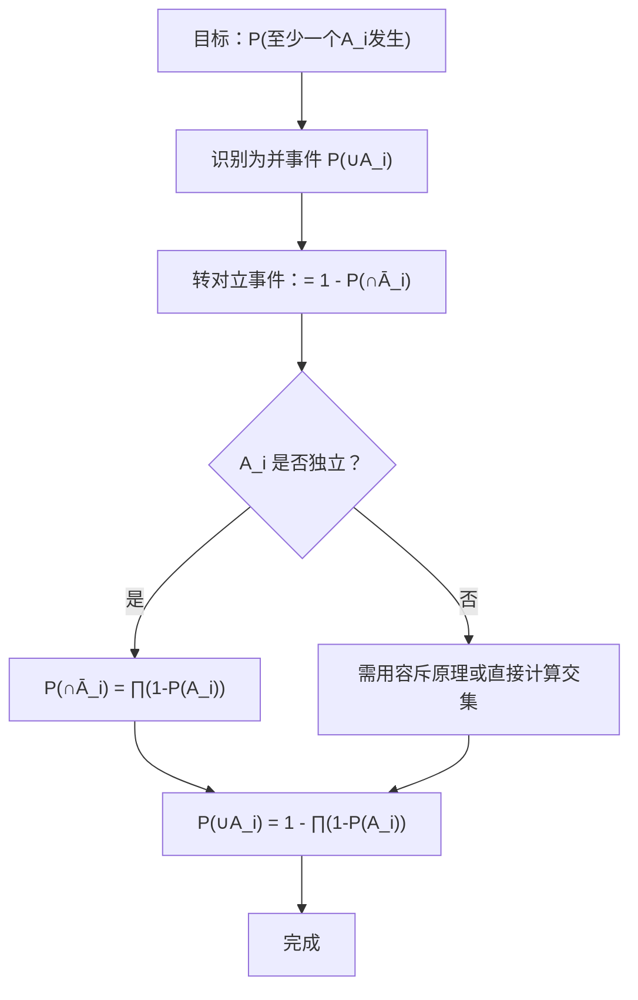

# 对立事件法

## 适用场景

"至少有一个发生"类问题——用对立事件（"全不发生"）将并事件概率转化为乘积形式。

## 核心步骤

### 公式

$$\boxed{P\!\left(\bigcup_{i=1}^n A_i\right) = 1 - P\!\left(\bigcap_{i=1}^n \overline{A_i}\right)}$$

当 $A_i$ 相互独立时：

$$\boxed{P\!\left(\bigcup_{i=1}^n A_i\right) = 1 - \prod_{i=1}^n P(\overline{A_i}) = 1 - \prod_{i=1}^n [1 - P(A_i)]}$$

### 操作步骤

**①** 识别"至少……"结构 → 转成对立事件"全不……"

**②** 利用独立性的乘法公式计算 $P(\bigcap \overline{A_i}) = \prod P(\overline{A_i})$

**③** $1 - \text{全不概率} = \text{至少一个概率}$

> [!warning] 关键点
> - 此法要求**独立性**（或已知交事件的概率），否则无法直接乘积。
> - "至少有一个"的对立是"一个都没有"——这是最常见的模式。
> - 适用于：至少一次成功、至少一件次品、至少一家故障等场景。

## 流程图

## 典型例题

> **题目**（习题 1.7 型）：三个独立工作的元件，各自失效概率分别为 $p_1, p_2, p_3$。求系统正常工作的概率（至少一个元件正常 = 非全部失效）。

> [!example]- 解答
> "至少一个正常"的对立是"全部失效"。
>
> 全部失效概率：$P(\text{全失效}) = p_1 p_2 p_3$（独立性）。
>
> 系统正常工作概率：
> $$P(\text{至少一个正常}) = 1 - p_1 p_2 p_3$$
>
> 推广到 $n$ 个元件：$P(\text{至少一个正常}) = 1 - \prod_{i=1}^n p_i$。
>
> **点评**："至少"转"全不"是概率计算的最基本技巧——避免了对并事件做复杂的容斥展开。

## 知识链接

- [[知识点/概率论/全概率公式]]
- [[知识点/概率论/贝叶斯公式]]

## 习题链接

- [[课程/概率论/习题库/01-概率基础/习题1.7]] — 频率和概率的关系（概念题）
- [[课程/概率论/习题库/01-概率基础/习题1.20]] — 独立事件至少发生一个的概率
