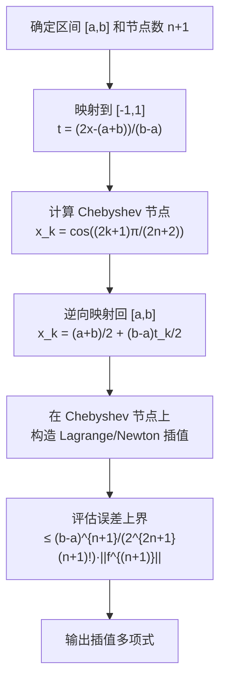

# Chebyshev节点选取流程

## 适用场景
需要高精度多项式插值且可自由选取节点时，用 Chebyshev 节点代替等距节点，避免 Runge 现象（边界振荡）。

## 核心公式/步骤

1. 将目标区间 $[a,b]$ 映射到 $[-1,1]$：$\boxed{t=\frac{2x-(a+b)}{b-a}}$
2. 在 $[-1,1]$ 上计算 Chebyshev 节点（$n+1$ 个）：
   $\boxed{t_k=\cos\left(\frac{(2k+1)\pi}{2n+2}\right)}$，$k=0,1,\ldots,n$
3. 逆向映射回 $[a,b]$：$\boxed{x_k=\frac{a+b}{2}+\frac{b-a}{2}t_k}$
4. 在 Chebyshev 节点 $\{x_k\}$ 上构造 Lagrange 或 Newton 插值多项式
5. 插值误差上界为 $\boxed{\|f-P_n\|_\infty\le\frac{(b-a)^{n+1}}{2^{2n+1}(n+1)!}\|f^{(n+1)}\|_\infty}$

## 典型例题

> **题目**：在 $[-1,1]$ 上用 5 个 Chebyshev 节点插值 $f(x)=1/(1+25x^2)$，与等距节点对比。

> [!example]- 解答
> Chebyshev 节点（$n=4$）：$t_k=\cos(\frac{(2k+1)\pi}{10})$ → $\approx\pm0.951,\pm0.588,0$
> 等距节点插值在边界振荡严重（Runge 现象），Chebyshev 节点插值振荡大幅减轻。
> 点评：Chebyshev 节点使插值多项式最大误差达到理论下界，是最佳一致逼近的近似。

## 链接的知识点
- [[知识点/数值分析/Chebyshev插值]]
- [[知识点/数值分析/Lagrange插值]]

## 链接的习题
- [[课程/数值分析/习题库/07-插值法/README|第7章习题库]]
